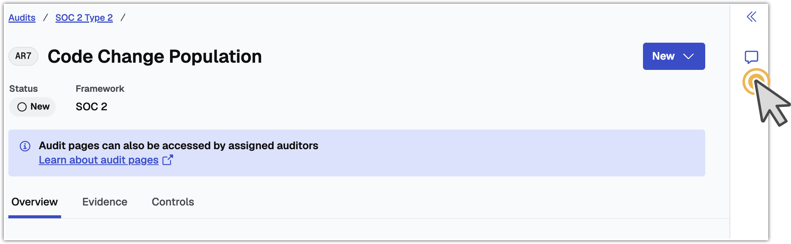
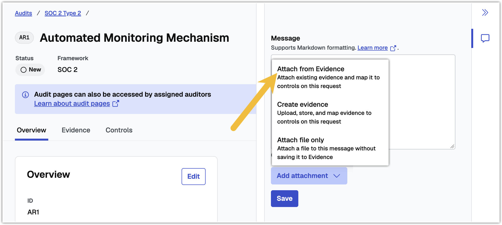
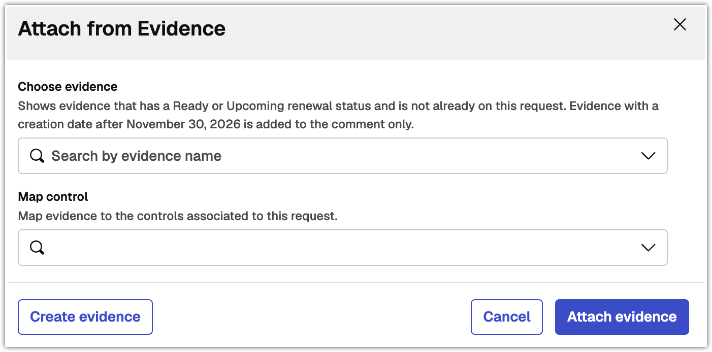
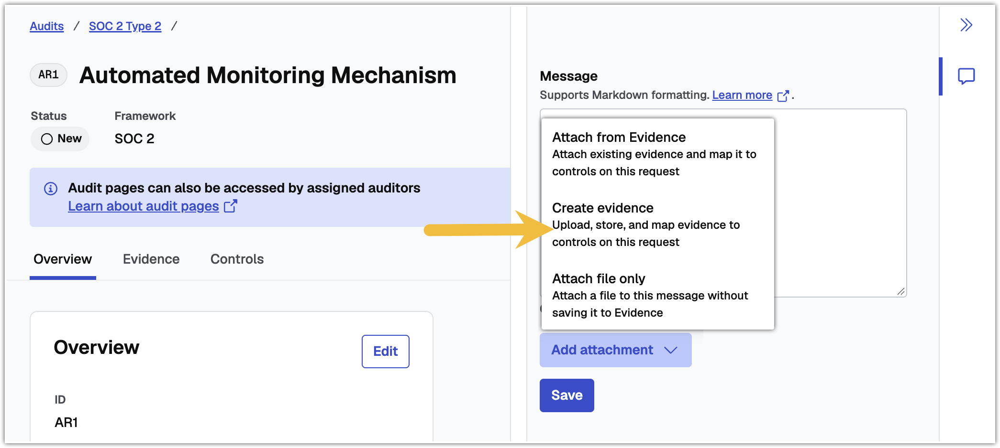

# Link to Evidence from Audit Hub Requests

Source: https://help.drata.com/en/articles/18519989-link-to-evidence-from-audit-hub-requests
Collection: Understand the Drata Platform › Evidence
Updated: 2026-11-20
Fetched: 2026-11-22

## Article text

When an auditor asks for a document in a request message, you can reply with evidence you already have in Drata instead of downloading it and uploading it again.

You can add evidence to a message in three ways:

| **Option** | **Use it when** | **What happens to the file** |
|---|---|---|
| Attach from Evidence | The document already exists in Evidence Library | The existing item is linked to the message and the request. |
| Create evidence | The document is new and should be kept as evidence | A new item is added to Evidence Library, mapped to controls, and linked to the request. |
| Attach file only | The file is a one-off that should not become evidence | The file is available only within that audit and is not added to Evidence Library. |

## Attach an existing item from Evidence Library

Use this option when the document the auditor asked for is already in Evidence Library. Follow the steps below to link it to your reply.

1. Go to **Compliance > Audits** and open the audit.
2. Open the request the auditor messaged you about. Then, the message panel.
   
3. Select **Add attachment, then Attach from Evidence**.
   
4. In the picker, search or filter to find the evidence item, then select it.
   - It is not copied, so changes to the evidence item in are reflected everywhere it is linked.
   - The picker only shows evidence with a current file dated within the audit period, and hides items already on your draft message.
   - Evidence you attach is mapped to at least one control on the request, so it becomes part of the request's evidence set.
      
5. Select Save to post your message to the auditor.

You can also create new evidence while you write a message, so it is saved to Evidence Library at the same time. Learn more in the next section.

## Create new evidence from a message

Use this option when the document is not in Evidence Library yet and should be kept as evidence. This option is unavailable if the request has no mapped controls,.

1. Open the request the auditor messaged you about. Then, the message panel.
2. Select **Add attachment**, then **Create evidence**.
   
3. **Add artifact:** Enter the name. You can also add a description, implementation guidance, an owner, a renewal period, and a renewal date. Select **Continue**.
4. **Select source:** Add the file, URL, or ticket link, and enter its creation date. The date can't be in the future. If it is after the audit's end date, a warning appears: "File will not appear on this request."
   - **Note:** Some accounts may have an older single-file form, where the creation date and renewal frequency are on the source step. The fields may be arranged differently, but the information you enter is the same.
5. **Map controls:** Select at least one control (only controls mapped to this request are listed), then select **Finish**.
6. You return to your draft message with the new evidence attached. Select **Save** to post your message to the auditor.

The new evidence is added to Evidence Library, mapped to its controls, and linked to this audit request. You can reuse it in later audits, and it stays in Evidence Library even if you don't post the message.

**Note:** Your message draft is kept while you create the evidence, and Messages stays open beside the form. Do not reload the page, or you will lose the draft.

## Upload a file without adding it to Evidence Library

Use this option only for one-off files that should not become evidence, such as a short clarification or a screenshot that answers a single question.

1. Open the request the auditor messaged you about. Then, the message panel.
2. Select **Add attachment, thenAttach file only.**
3. Select your file, then select Save to post your message to the auditor.

The file stays with that audit's messages. It is not added to Evidence Library, is not mapped to controls, and is not part of the request's evidence set. It cannot be converted into evidence later. If you change your mind, create the evidence in Evidence Library and attach it to the request.

## Where your evidence appears

Evidence you attach from Evidence or create from a message appears in:

- The message you sent
- The evidence for the audit request
- The controls the evidence is mapped to
- Evidence Library

Files you upload without adding to Evidence Library stay with that audit's messages.

## Duplicate prevention

If an evidence item is already attached to your message, Drata does not let you attach it a second time. The picker hides items that are already on your draft message.

## File limits

A message can include up to 10 attachments in total, with uploaded files and evidence items counted together. Uploaded files are limited to 25 MB each. Evidence Library items are references, not uploads, so the 25 MB limit does not apply to them.

## Things to know

- **Permissions and availability.** Attach from Evidence and Create evidence require Evidence Library write permission. They aren't available to auditor users. The feature rolls out per account, so some accounts may not see it yet.
- **The request needs controls first.** Both Evidence Library options stay unavailable until at least one control is mapped to the request. Attach file only always works.
- **Evidence must be dated within the audit period.** Items with no current file dated within the audit's period can't be attached.
- **Save posts your message.** Selecting Save sends your message to the auditor.
- **Drafts don't survive a reload.** If you leave to create evidence, your draft is kept while the page stays open. Refreshing loses the message text and files, but the evidence you created is still saved and can be attached.
- **Auditors see it as evidence.** In the Audit Portal, your Evidence Library attachments appear as evidence on the message.

## Troubleshooting

**I don't see Attach from Evidence or Create evidence, or they're grayed out.** The request needs at least one control mapped to it first. Go to the request's **Controls** tab, select **Map controls**, and map a control. Attach file only stays available either way. If the request already has controls, check these other causes:

- The feature may not be turned on for your account yet. Contact your Drata account team.
- You need Evidence Library write access, and you can't be signed in as an auditor.
- Your draft message already has 10 attachments.

**I can't select an evidence item.** It may already be on your draft message, or it may have no current file dated within the audit period. Check the item in Evidence Library.

**My uploaded file isn't in Evidence page.** Files uploaded to a message are not added to Evidence Library. Create the evidence in Evidence Library, or use **Create evidence** next time.

## Images

- [image 01] ../../images/ux/audits/link-to-evidence-from-audit-hub-requests--01.png
- [image 02] ../../images/ux/audits/link-to-evidence-from-audit-hub-requests--02.png
- [image 03] ../../images/ux/audits/link-to-evidence-from-audit-hub-requests--03.png
- [image 04] ../../images/ux/audits/link-to-evidence-from-audit-hub-requests--04.png

## Related articles

- [Map evidence and policies to controls (New Experience)](map-evidence-and-policies-to-controls-new-experience.md)
- [How audit date ranges and evidence sampling affect auditor access](how-audit-date-ranges-and-evidence-sampling-affect-auditor-access.md)
- [Using the Drata Audit Portal (New Experience)](using-the-drata-audit-portal-new-experience.md)
- [Audits page overview (New Experience)](audits-page-overview-new-experience.md)
- [Map audit requests to DCF controls with AI](map-audit-requests-to-dcf-controls-with-ai.md)
