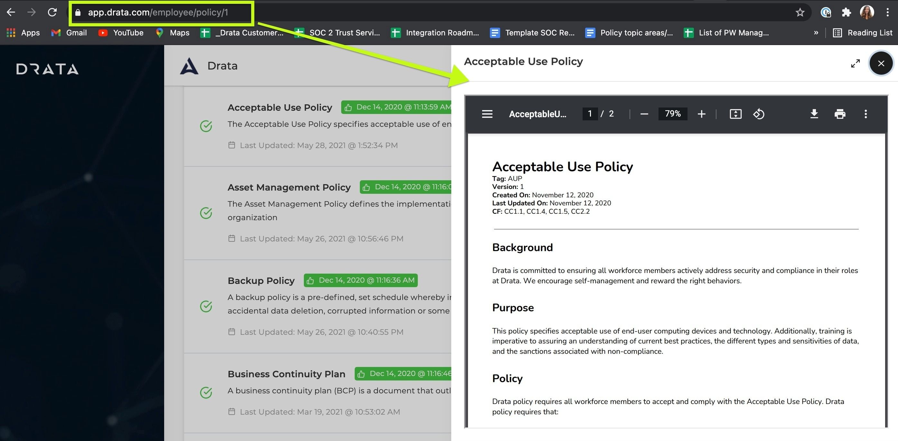

# Linking directly to specific employee security policies

Source: https://help.drata.com/en/articles/5283266-linking-directly-to-specific-employee-security-policies
Collection: Understand the Drata Platform › Policies
Updated: 2026-11-14
Fetched: 2026-11-22
Description: Embedding links to Drata policies in other tools or locations

## Article text

**HERE'S WHY**

Many customers have requested the ability to link from other sources such as Confluence, Notion, Slab, etc. directly to specific policies employees will be accepting in Drata.

**HERE'S HOW**

As an Admin or information security lead, select your name on the Drata interface and select 'My Drata'. Select 'Review & Acknowledge Company Policies'. The section will expand and show all policies your company has in place. Select the policy you'd like to link to, and copy the URL from the navigation bar to include where you see fit.

## Images

- [image 01] ../../images/ux/personnel/linking-directly-to-specific-employee-security-policies--01.jpg

## Related articles

- [Test 45: Employees Acknowledge the Acceptable Use Policy](test-45-employees-acknowledge-the-acceptable-use-policy.md)
- [Test: Employees Acknowledge the Data Protection Policy](test-employees-acknowledge-the-data-protection-policy.md)
- [Create a policy](create-a-policy.md)
- [External Policy: Use BambooHR to manage your policies](external-policy-use-bamboohr-to-manage-your-policies.md)
- [External Policy: Use Confluence or Notion to manage your policies](external-policy-use-confluence-or-notion-to-manage-your-policies.md)
