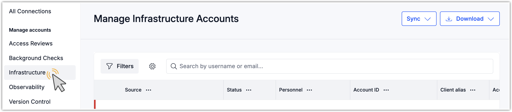

# Manage connected infrastructure accounts

Source: https://help.drata.com/en/articles/13278430-manage-connected-infrastructure-accounts
Collection: Understand the Drata Platform › Connections
Updated: 2026-11-09
Fetched: 2026-11-22
Description: In this article, you learn how to manage connected infrastructure accounts.

## Article text

Managing connected infrastructure accounts helps ensure Drata accurately tracks who has access to your systems and maintains a clear audit trail for access changes.

## Prerequisites

Before managing infrastructure accounts in Drata:

- An [infrastructure provider](https://help.drata.com/en/collections/16505277-infrastructure-guidance) (such as AWS, GCP, or Azure) must be connected
- An [identity provider](https://help.drata.com/en/collections/16504711-identity-idp-guidance) must be connected to sync personnel into Drata

Drata uses read-only access to collect this information and does not make changes in your infrastructure provider.

## How infrastructure accounts appear in Drata

The **Infrastructure** page shows accounts discovered through your connected infrastructure providers.

This page helps you:

- View which infrastructure accounts Drata is monitoring
- Understand who or what each account represents
- Link accounts to personnel
- Identify service or system accounts
- Maintain an audit trail for access changes
- Infrastructure account information such as:
   - The current access state reported by the provider
   - Indicators such as MFA status, when available

## Link infrastructure accounts to personnel

When infrastructure accounts are first synced, they may not be automatically linked to personnel. Linking accounts helps Drata accurately track who has access to your infrastructure and maintain a clear audit trail.

For a complete explanation of how account linking works across Drata, including how service accounts are handled, refer to **[Linking accounts to personnel in Drata](map-accounts-to-personnel-in-drata-new-experience.md)**.

## Access changes and audit trail

**Note**: When you remove a user from your connected infrastructure system, it can take up to 24 hours to see the updates appear within Drata. This is due to the connection API.

Deleting an account in your infrastructure provider will not remove it from Drata. Instead, Drata records a timestamp indicating when access was revoked, creating an audit trail used to track access control SLAs. The timestamp is indicated under the **Access revoked **column.

This ensures you can demonstrate **when access was removed**, which is often required during audits.

## MFA status and Database and Admin access indicators

For infrastructure accounts, Drata may display indicators such as **database access** or **administrative access**.

Drata does not allow you to enable or disable DB or admin access from this page. To change these permissions, update the account directly in your infrastructure provider. Drata will reflect the change after the next sync.

For some infrastructure accounts, Drata detects access indicators such as MFA status. Important details are indicated under the MFA column.

- MFA status is read-only and reported by the provider
- MFA configuration must be managed in the provider, not in Drata
- These indicators are used to evaluate relevant compliance tests

If an MFA-related test fails, refer to **[Test 86: MFA on Identity Provider](test-86-mfa-on-identity-provider.md) **for remediation guidance.

## Important considerations

- Changes made in the infrastructure provider may take time to appear in Drata
- Some fields are informational and do not directly affect monitoring

## Images

- [image 01] ../../images/ux/connections/manage-connected-infrastructure-accounts--01.png

## Related articles

- [Test 88: MFA on Infrastructure Console](test-88-mfa-on-infrastructure-console.md)
- [Test 95: Infrastructure Accounts Properly Removed](test-95-infrastructure-accounts-properly-removed.md)
- [Manage connected version control](manage-connected-version-control.md)
- [Map accounts to personnel in Drata (New Experience)](map-accounts-to-personnel-in-drata-new-experience.md)
- [Integrate Multiple Identity and HRIS Connections](integrate-multiple-identity-and-hris-connections.md)
