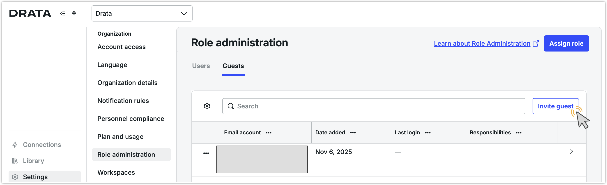

# Manage guest administrators

Source: https://help.drata.com/en/articles/13580839-manage-guest-administrators
Collection: Settings › Role Administration
Updated: 2026-11-09
Fetched: 2026-11-22
Description: Invite a guest administrator to manage compliance on your behalf, or remove access when it’s no longer needed.

## Article text

## When to use guest administrators

Invite a guest administrator if you work with a:

- Managed Security Service Provider (MSSP)
- Virtual CISO (vCISO)
- Centralized security/compliance team supporting your workspace

## Prerequisites

- Only users with the **Admin** role can invite or remove guest administrators.
- Guest administrators have **full access to the Drata application**, equivalent to an **Admin**.
- For security reasons, you can invite guest administrators only from **approved email domains**.
- **Personal email addresses aren't supported** for guest administrator invitations.
- To approve a new email domain, contact the **Drata Support team.**
- Guest administrators must use a work email address on an approved domain that is different from your Drata tenant’s domain.

- Guest administrator access is not tied to the organization's Identity Provider (IdP); their access is tied solely to the invited email address.

### When access becomes active

## Getting a new domain approved

Before you can invite a guest administrator, their email domain must be approved by Drata. This is a one-time step per domain — once a domain is approved, any future guests from that domain can be invited without repeating it.

### How domain approval works

1. Contact the Drata Support Team and provide the email domain you want to approve (for example, partnerfirm.com).
2. Drata reviews and adds the domain on the backend — this typically takes 1 business day.
3. Once approved, you'll be able to invite guests from that domain using the steps below.

**Could not display content**

### What to include when requesting approval

- The email domain to approve (e.g. partnerfirm.com)
- The name of your organization and the guest's company or role
- The email address(es) of the guest(s) you plan to invite

Personal email addresses (Gmail, Outlook.com, Yahoo, etc.) are not supported and cannot be approved. Guests must use a work email on a company domain.

After you send an invitation, the guest administrator **may not have access immediately**. Invitations are processed during a scheduled data sync, and access can take **up to 1 hour** after the invite is accepted.

## Invite a guest administrator

1. Go to **Settings → Organization → Role administration** page.
2. Select the **Guest tab**, then select the **Invite guest button.**
    (links to https://downloads.intercomcdn.com/i/o/am69aeco/2020321760/e8cf2f4919d22b3030135fe12d2b/image.png?expires=1780120800&signature=4f6e9c160e3860a971266af8ed2ea3fa7742d763337b39cec6e0c7cb1787d5df&req=diAlFsp8nIZZWfMW3nq%2BgcGUYb0JPap0xNjKNONTgTyrCNYCrCuMWxCQRjSq%0A6y3hPTxM%2BTxjSSp7XlgA9Pzb%2FHc%3D%0A)
3. Enter the guest administrator's **work email address**.
4. Select **Invite**.
5. Confirm the invitation when prompted.

### What happens next

- The guest administrator receives an email invitation.
- They must **accept the invitation** to complete setup.
- Until they accept, their status appears as **Pending**.

Access may take up to **1 hour** after acceptance due to scheduled syncing.

## Guest Administrator Login

1. The invited guest will receive an email notification.
2. For their first login, they can either click the link in the email or:
   - Go to the Drata login page.
   - Enter the invited email address.
   - Choose a sign-in method (Google, Microsoft, or email with a magic link).
3. Upon first login, they must accept terms, confirm their name, and select your company’s account.

## Remove a guest administrator

1. Go to **Settings → Organization → Role administration**.
2. Select the **Guest** tab.
3. Locate the guest administrator in the table.
4. Select the **ellipsis (⋯)**, then select **Remove access**.
5. Confirm removal when prompted.

**Result:** The guest administrator is removed and no longer has access to your organization.

---

## Troubleshooting Common Issues

If you encounter issues while inviting a Guest Administrator, try the following:

1. Clear your browser’s cache and cookies.
2. Log back into your Drata account.
3. Retry the invitation process.

If the issue persists, verify with your administrator or domain management team that the correct domain was approved and there were no errors in the approval process.

## Images

- [image 01] ../../images/ux/settings/manage-guest-administrators--01.png

## Related articles

- [Google Workspace Integration Guide](google-workspace-integration-guide.md)
- [MIM Dashboard](mim-dashboard.md)
- [Add guest administrators with a different domain](add-guest-administrators-with-a-different-domain.md)
- [Integrate Multiple Identity and HRIS Connections](integrate-multiple-identity-and-hris-connections.md)
- [Manage user roles in Drata](manage-user-roles-in-drata.md)
