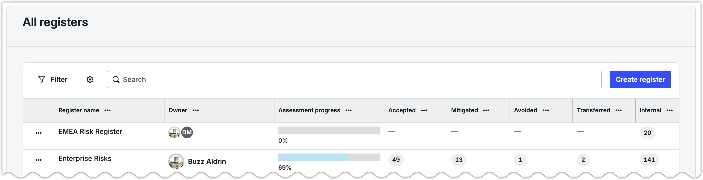
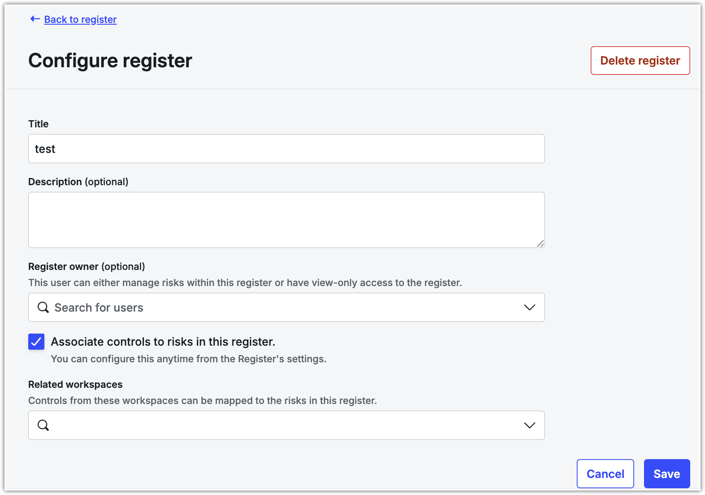
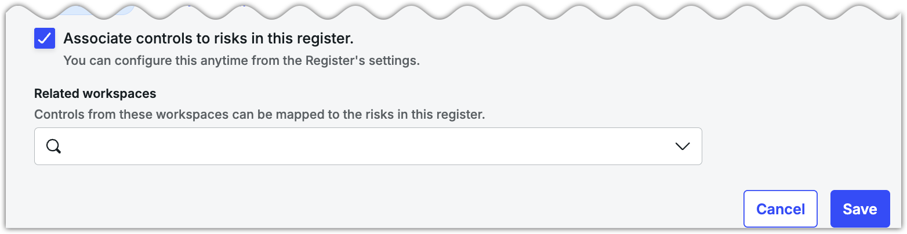
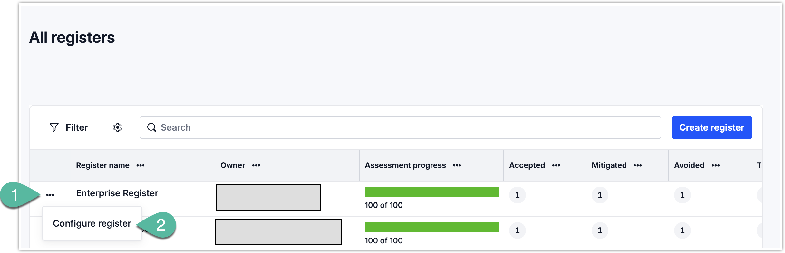
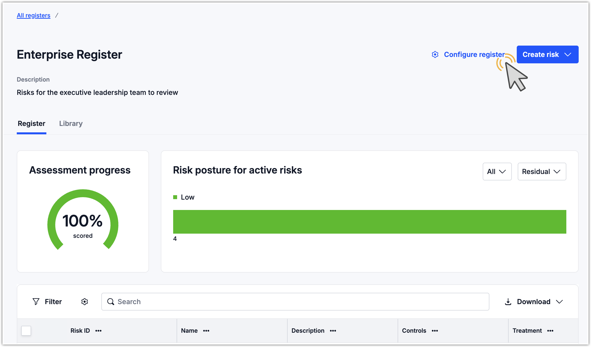
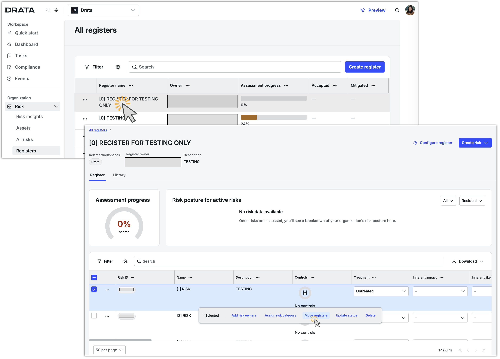
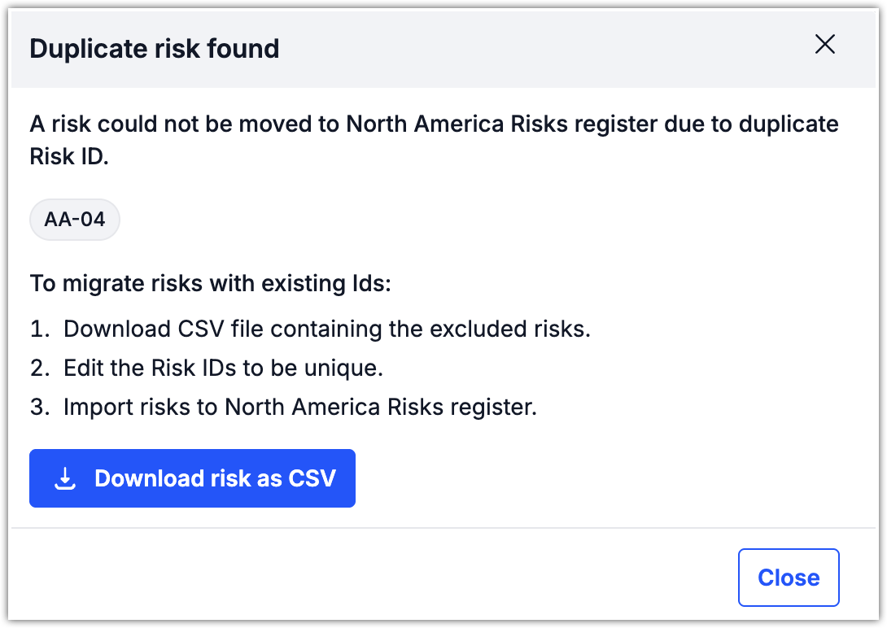
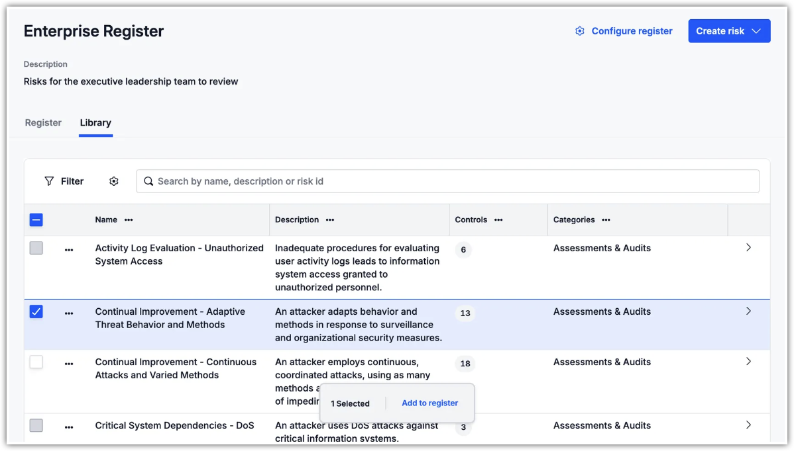
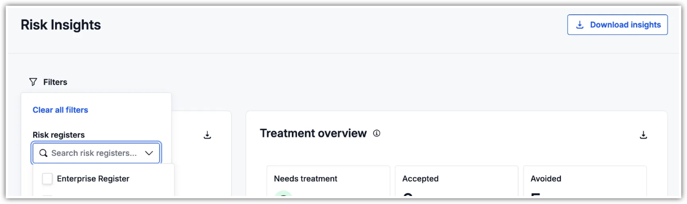

# Manage multiple risk registers (New Experience)

Source: https://help.drata.com/en/articles/13434682-manage-multiple-risk-registers-new-experience
Collection: Understand the Drata Platform › Risk
Updated: 2026-11-09
Fetched: 2026-11-22
Description: Create and maintain multiple risk registers in Drata

## Article text

Manage risk registers in Drata to organize, track, and scale your risk management program across your organization. You’ll learn how to create, update, delete, and populate risk registers and understand how multiple registers work with Risk Insights and global risk settings.

## Prerequisites

- Your Drata plan must include **Risk Management Pro** to create and manage multiple risk registers.
- Only **Admins** and **Risk Managers** can create, configure, or delete a risk register.
- Only the following users can move risks between registers:
   - **Admins**
   - **Risk Managers**
   - **Risk Register Owners** with access to **two or more registers**

Assigning both Admin and Risk Manager roles to a single user can lead to permission conflicts. It is recommended to remove the Risk Manager role if the user already has the Admin role to avoid redundancy and unexpected behavior.

**Note:Risk Managers with restricted view** can see and manage only the risks they own, and cannot add new risks, change risk ownership, or create new registers.

## What you can do with multiple risk registers

With Multiple Risk Registers, you can:

- Create, update, and delete up to 100 risk registers in your account.
- Bulk move risks between registers.
- Use the Risk Register Owner role to assign register-specific ownership and management responsibilities.
- Separate risks by region, product line, business unit, or any other structure that fits your organization.
- Transition from a single register to multiple registers, or reorganize registers over time as your program evolves.

## How workspaces work with registers

Risk + Workspaces gives you more flexibility in how your registers relate to your workspaces. With this functionality, you can:

- Associate a register with zero, one, or many workspaces.
- Map controls to risks in any workspace the register is connected to.
- Automatically give Workspace Managers access to the registers that apply to their workspace.

You do not need to create one register per workspace. A single register can be associated with multiple workspaces, depending on how you want to organize your program.

## Create a new risk register

1. Navigate to **Risk** > **Registers**.
2. Select **Create register**.
   
3. Enter a **Title** (required).
4. **Optional:** Enter a **Description** and assign one or more **Register owners**.
   
5. **Associate Workspaces:** If workspaces are enabled for your account, you must link them to the register to enable control mapping.
   - Select the **Associate controls to risks in this register** checkbox.
   - Select the desired **Workspace(s)** from the list.
   - **Note:** Only workspaces you have permission to access will be displayed.
   

**Important permissions and ownership details:**

- You can assign **multiple register owners** to a single risk register.
- Only users with the **Risk Register Owner** role can be assigned as register owners. You can grant this role from the **Settings >Role administration** page.

## Update a risk register

You can update a register’s settings at any time. To update a register:

- Select **Configure register** from either:
   - The register list view:
      
   - The register detail page.
      

From there, you can update the register’s details and ownership.

## Delete a risk register

Before you can delete a risk register, all risks in the register must be deleted or moved to another register.

To delete a register:

1. Remove all risks from the register by either:
   - deleting risks in bulk, or
   - moving risks to another register in bulk.
2. Select **Configure register**.
3. On the register settings page, select **Delete register**.

## Move Risks Between Registers (Bulk)

Use the bulk move feature to transfer risks while preserving all associated data and history.

**Before you begin:**

- **Unique Risk IDs:** Risks must have a unique Risk ID within the target register.
- **Source vs. Target:** Risks will be removed from the "source" register once they are successfully moved to the "target" register.

Instructions

1. Navigate to **Risk** > **Registers**.
2. Open the "**source" register** containing the risks you want to move.
3. Select the checkboxes for the risks you wish to transfer.
4. Select **Move to Register**.
   
5. In the modal, choose your **Target register** and select **Move risks**.

Once complete, the risks will be moved to the target register, and will be removed from the starting register. All data will be retained on the risks, but the register association will be different.

### Risk ID requirements when moving risks

If the system detects duplicate Risk IDs in the target register, the following occurs:

- **Successful Moves:** Risks without ID conflicts are moved immediately.
- **Blocked Moves:** Risks with duplicate IDs remain in the source register.
- **Error Reporting:** A CSV file is automatically generated listing all risks that failed to move.

**To resolve ID conflicts:**

1. Open the downloaded **CSV file**.
2. Assign new, unique **Risk IDs** to the conflicting risks.
3. **Upload** the updated risks directly to the target register.
4. **Delete** the original conflicting risks from the source register to prevent duplicates.

## Create a single risk or in bulk

Users with **Admin**, **Risk Manager**, or **Risk Register Owner** permissions can add risks individually or in bulk.**Note:** Risk Register Owners must be assigned to the destination register to perform bulk uploads.

1. Navigate to **Risk** > **Registers**.
2. Select **Add** and choose your creation method from the dropdown:
   - **Create a single risk:** Enter the risk details into the form and select **Save**.
   - **Create/update risks in bulk:** Upload your CSV file and follow the on-screen prompts to map your data and complete the import.

## Copy risks from the Library to the Register

**Admins**, **Risk Managers**, and **Risk Register Owners** can copy risk templates from the library into a register.

To copy risks from the library:

1. Navigate to **Risk** > **Registers**.
2. Select the **Library** tab.
3. Select the risk templates you want to copy.
4. Add the selected risks to the register in bulk.

Each risk template can be copied from the library to a register **once**.

## Risk Insights

If your account includes multiple risk registers, users with access to multiple registers can filter data by risk register on the **Risk Insights** page

- By default, Risk Insights displays data from **all registers**.
- You can filter the dashboard to show data from **one or more specific registers**.
- **Risk Register Owners** can filter only by the registers they own.

This allows you to analyze trends and metrics at the register level while maintaining a unified view of risk across your organization.

## Risk Settings

Risk settings apply universally across all registers. Scoring settings and categories are applicable to all registers at once. Only Admins and Risk Managers are able to manage the Risk Settings.

## Training Videos

Explore [Risk Register training videos](https://help.drata.com/en/articles/13443423-risk-register-training-video-new-experience) for Admins and Risk Managers, including scenarios with multiple registers and restricted access. **You must be logged into Drata to access these videos.**

## Images

- [image 01] ../../images/ux/risk/manage-multiple-risk-registers-new-experience--01.png
- [image 02] ../../images/ux/risk/manage-multiple-risk-registers-new-experience--02.png
- [image 03] ../../images/ux/risk/manage-multiple-risk-registers-new-experience--03.png
- [image 04] ../../images/ux/risk/manage-multiple-risk-registers-new-experience--04.png
- [image 05] ../../images/ux/risk/manage-multiple-risk-registers-new-experience--05.png
- [image 06] ../../images/ux/risk/manage-multiple-risk-registers-new-experience--06.png
- [image 07] ../../images/ux/risk/manage-multiple-risk-registers-new-experience--07.png
- [image 08] ../../images/ux/risk/manage-multiple-risk-registers-new-experience--08.png
- [image 09] ../../images/ux/risk/manage-multiple-risk-registers-new-experience--09.png

## Related articles

- [Understanding the Drata Risk Register](understanding-the-drata-risk-register.md)
- [Import Risk in Bulk (New Experience)](import-risk-in-bulk-new-experience.md)
- [Risk management in Drata: An overview](risk-management-in-drata-an-overview.md)
- [Risk Management Training Videos (New Experience)](risk-management-training-videos-new-experience.md)
- [Manage Risk Across Workspaces](manage-risk-across-workspaces.md)
