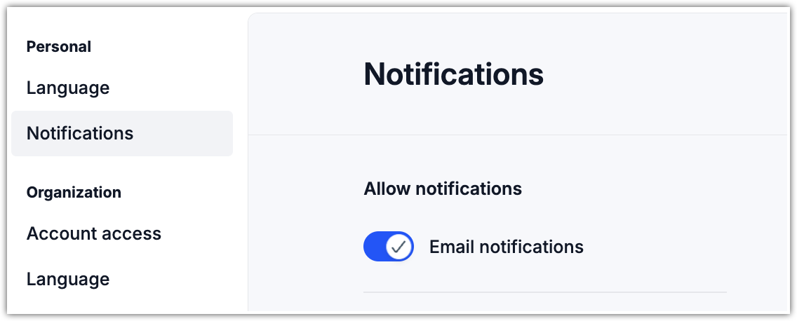

# Manage Notifications for Required Approvals and Control Updates

Source: https://help.drata.com/en/articles/13380918-manage-notifications-for-required-approvals-and-control-updates
Collection: Understand the Drata Platform › Controls
Updated: 2026-11-14
Fetched: 2026-11-22
Description: Set up and manage notifications to keep control owners and approvers informed about required approvals and control changes.

## Article text

## Overview

Notifications help control owners and approvers stay informed about required approval stages, evidence changes, and updates to their controls. Setting up notifications ensures reviews happen on time, approvals are not missed, and control readiness is maintained without manual follow-ups.

Notifications are tied to the required approvals lifecycle, so changes to a control—such as adding evidence or requesting changes—can trigger alerts to the appropriate users.

## Prerequisites

- **Integrations:** [Microsoft Teams](microsoft-teams-integration-guide.md) or [Slack](slack-integration-guide-communication-and-uar.md) must be connected before related notifications can be configured
- **Permissions:**
   - Only **Administrators** can configure Microsoft Teams or Slack notifications
   - Ensure your user role has read-only disabled to update email notification preferences

## Email Notifications

**Goal**: Receive notifications by email for required approval activity and control updates.

### Set up email notifications

1. Go to** Settings page.**
2. Under the Personal header, select the **Notifications page**.
3. Enable **Allow notifications**.
   
4. Scroll down to configure more notification types you want to receive.
5. Choose a delivery frequency (**Daily** or **Weekly**) where applicable.

### Available email notifications for Controls

| **Notification Type** | **What it notifies** |
|---|---|
| Evidence updates on controls | Notifies control owners when there are changes to control evidence. |
| Approval updates on controls | Control owners and approvers are notified when there are changes to the control approval status. |
| Status change for controls assigned to me | Receive summaries of assigned controls. |
| Internal note added to a control | Get notified when a new internal note is added to a control. |

---

## Microsoft Teams Notifications

**Goal:** Send notifications about required approvals and control updates to a Microsoft Teams channel or directly to personnel.

### Set up Microsoft Teams notifications

1. Go to **Settings page.**
2. Under the Organization header, select the **Notification rules page.**
3. Select **Create notification rule**.
4. Select the Teams channel for notifications.

> **Important Notes:**
>
> ℹ️ Microsoft Teams now supports sending direct messages to personnel for the following notification types: Personnel with Pending Actions, Required Approvals, Control Evidence Updates, and Workflow Updates. When direct messaging is enabled, notifications are sent to both the destination channel and directly to the personnel.
>
> ⚠️ Direct messages are sent through the **Drata App** in Microsoft Teams—not to a user's personal chat. Ensure the Drata App is installed in Microsoft Teams before enabling this option. Learn more at [Microsoft Teams integration guide](microsoft-teams-integration-guide.md).
>
> ⚠️ Microsoft Teams does not support sending notifications to private channels.

---

## Slack Notifications

Goal: Send notifications about required approvals and control updates to Slack.

### Set up Slack notifications

1. Go to **Settings page > Organization > Notification rules**
2. Select **Create notification rule.**
3. Paste a slack channel or search and select one.

> ⚠️ Direct messages are sent through the **Drata App** in Slack—not to a user's personal chat. Ensure the Drata App is installed and added to any private channels before enabling this option. Learn more at [Slack integration guide](slack-integration-guide-communication-and-uar.md).

---

## How notifications relate to required approvals

Notifications are closely tied to the required approvals workflow. For example:

- Moving a control to **Needs approval** notifies approvers
- Requesting changes notifies control owners
- Adding evidence after approval may reset the approval stage and trigger new notifications

This ensures the right people are notified when action is required.

## Images

- [image 01] ../../images/ux/settings/manage-notifications-for-required-approvals-and-control-updates--01.png

## Related articles

- [Create Workflow for Control](create-workflow-for-control.md)
- [Manage Required Approval and Control Readiness](manage-required-approval-and-control-readiness.md)
- [Organization settings: Notifications rules](organization-settings-notifications-rules.md)
- [Section 5: Control Owners](section-5-control-owners.md)
