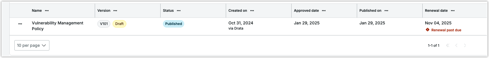
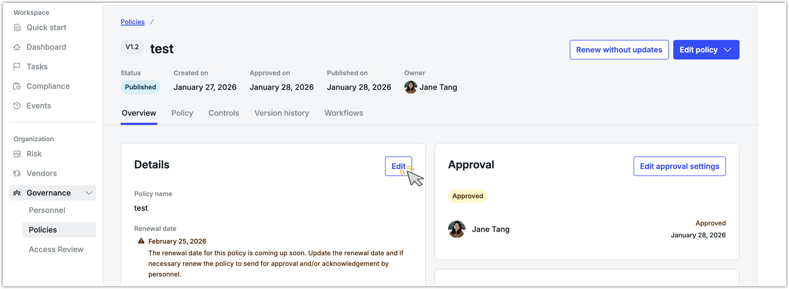
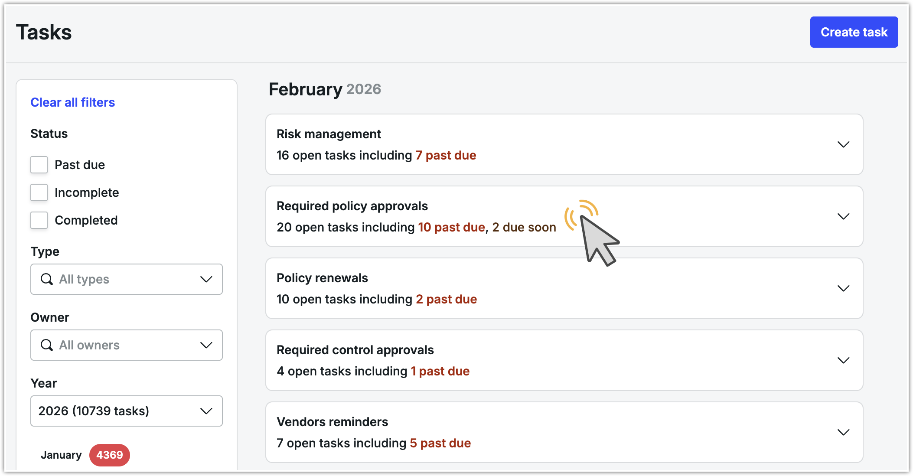

# Manage policy renewals

Source: https://help.drata.com/en/articles/13551591-manage-policy-renewals
Collection: Understand the Drata Platform › Policies
Updated: 2026-11-09
Fetched: 2026-11-22

## Article text

Policy renewals help ensure your policies remain current, reviewed on time, and compliant with applicable frameworks. In Drata, every policy includes a renewal date that determines when a policy must be reviewed, updated, or acknowledged again.

Renewal dates affect compliance tests, tasks, and audit readiness, making them a key part of ongoing policy management.

## Why policy renewals matter

Policy renewals help your organization:

- Meet framework requirements for periodic policy review or acknowledgment
- Generate tasks for upcoming policy reviews or acknowledgments
- Keep policy-related compliance tests passing

Different frameworks have different renewal expectations. Some require only review, while others require personnel acknowledgment. Drata supports both scenarios. If you are using an external policy management system, ensure that policies are configured correctly within that connection to align with framework requirements.

## View and update renewal dates

You can track and update renewal dates in multiple places:

- **Policies table**: Go to the Policies page and scroll to the Renewl date column in the table.
   
- **Policy details**: Open a policy and view the renewal date in the **Overview** tab.

If a policy’s renewal date is in the past and the policy isn’t **Published**, you must update the renewal date before continuing.

When a renewal date is overdue, these actions are blocked:

- Finalizing a draft
- Approving the policy
- Saving changes to an approved policy
- Publishing the policy

## Update an overdue renewal date

Many frameworks require annual review or acknowledgment. Set renewal dates early enough to allow time for review, approval, and acknowledgment before deadlines.

1. Open **Governance → Policies**.
2. Open the policy.
3. In the **Overview** tab, select **Edit** in the Details section.
   
4. Enter a future renewal date.
5. Select **Save**.

## Policy renewals, tasks, and compliance tests

Drata automatically creates tasks based on policy renewal dates. You can track these tasks on the **Tasks** page to ensure reviews and acknowledgments happen on time. To track acknowledgment dates, navigate to the **Personnel section** in Drata. Use the **Compliance Overview** feature to view and download acknowledgment records, ensuring accurate and reliable data.

## Policy renewal scenarios

### Scenario 1: Personnel acknowledgments during policy renewals

Use this workflow when personnel must re-acknowledge a policy on a recurring basis (for example, annually).

**What you do:**

1. Review the policy to confirm it is still accurate.
2. Update the renewal date to the next acknowledgment deadline.
3. Publish the policy and notify personnel to acknowledge it.

**Outcome:**

- Personnel acknowledgment is required
- Compliance tests track acknowledgment status

**Note about audit packages**: Audit packages display acknowledgment status for the **latest published version** of a policy. This design ensures that audit reports reflect your organization’s current.

Since audit packages reflect the current published policy state, organizations that need to reference acknowledgment timing for an earlier version should retain exported documentation for that version as part of their audit records.

**Recommended practice**
Before renewing a policy with re-acknowledgment, export the relevant acknowledgment report or audit package for the current version and retain it in your audit documentation.

---

### Scenario 2: Renew a policy without content updates

If a policy remains valid and doesn’t require changes, you can renew it without updating content.

To use this option:

- The policy must be **Published**
- No Draft version can exist
- You must be the **Policy Owner**

**Renew without updates**

1. Open **Governance → Policies**.
2. Open the published policy.
3. Select **Renew without updates** in the header.
4. In the renewal modal:
   - Select a new renewal date.
   - Choose whether personnel acknowledgment is required.
      - **Yes**: The Notify personnel modal appears.
      - **No**: Acknowledgment is assumed if personnel acknowledged a previous version.
   - Choose whether approval is required.
      - **Yes**: The policy moves to **Needs approval**.
      - **No**: The policy is published immediately.
5. Select **Renew** to confirm.

**Outcome**

- A new minor version is created
- The **Published date** updates to the renewal confirmation date
- Approval and acknowledgment occur only if selected

## Images

- [image 01] ../../images/ux/policies/manage-policy-renewals--01.png
- [image 02] ../../images/ux/policies/manage-policy-renewals--02.png
- [image 03] ../../images/ux/tasks/manage-policy-renewals--03.png

## Related articles

- [Annual Compliance Review](annual-compliance-review.md)
- [Pre-Audit Checklist: How to Prepare for Your Audit with Drata](pre-audit-checklist-how-to-prepare-for-your-audit-with-drata.md)
- [Policy Center Overview](policy-center-overview.md)
- [View and edit a policy](view-and-edit-a-policy.md)
- [Section 5: Policy Owners](section-5-policy-owners.md)
