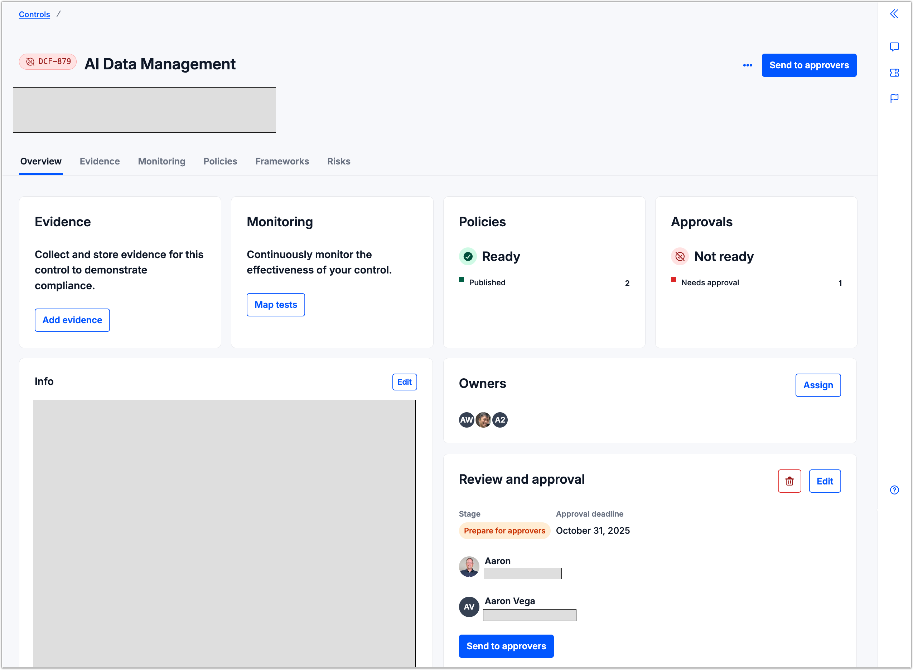
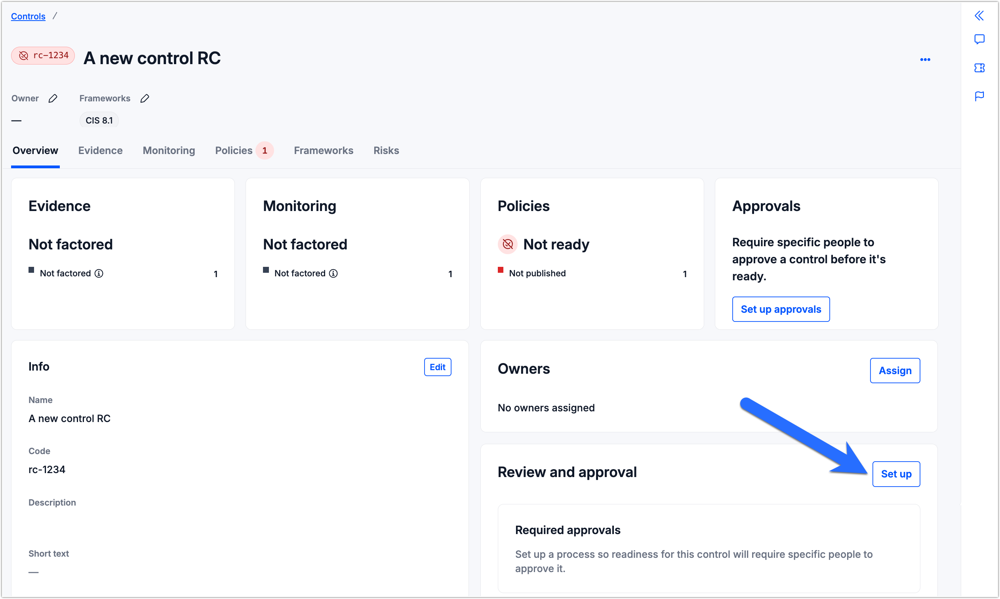
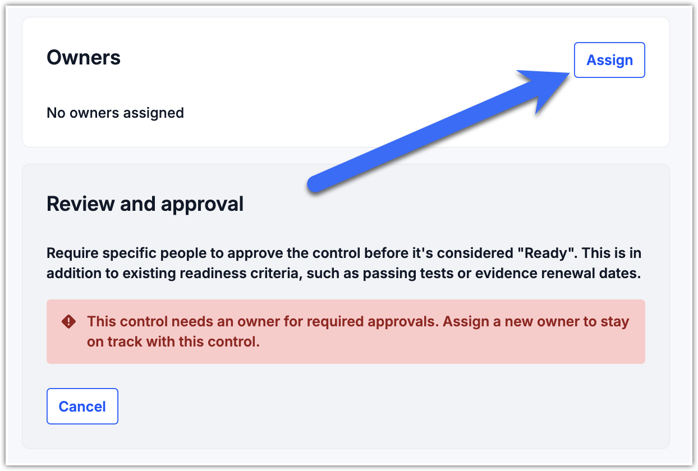
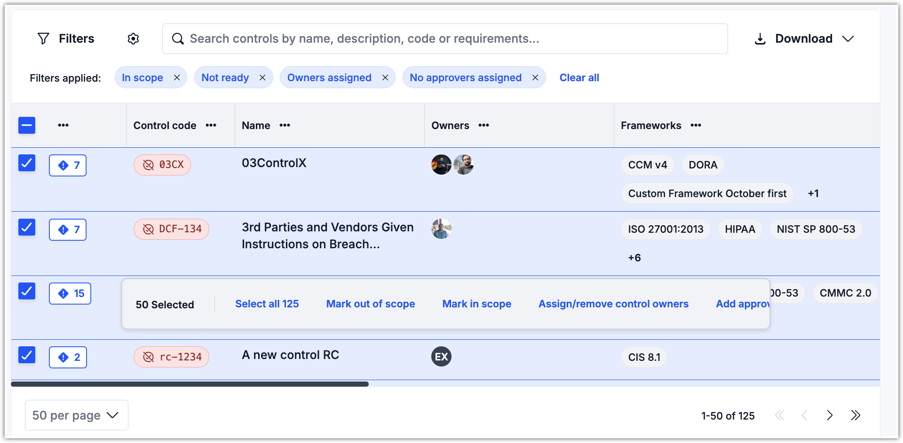
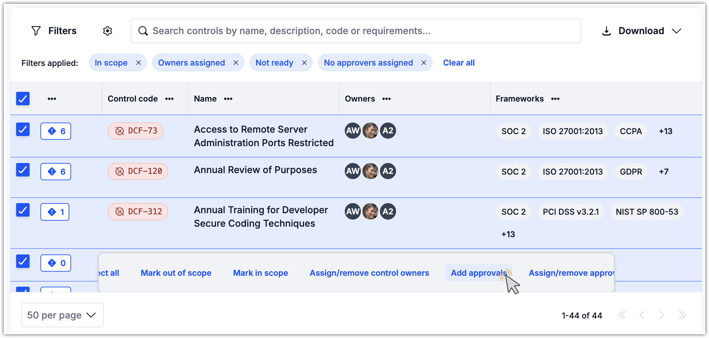
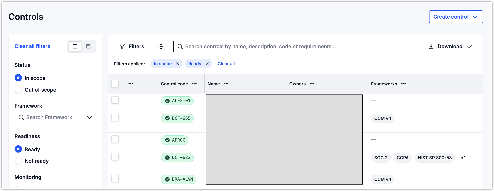

# Manage Required Approval and Control Readiness

Source: https://help.drata.com/en/articles/13380564-manage-required-approval-and-control-readiness
Collection: Understand the Drata Platform › Controls
Updated: 2026-11-09
Fetched: 2026-11-22
Description: Learn how to set up, manage, and delete required approvals for controls, and understand how approval stages affect control readiness.

## Article text

## Overview

When a control **requires approval**, it must be reviewed and approved by designated approvers before it can be marked **Ready**. Required approvals add a governance step to ensure controls are not only implemented, but formally reviewed.

The goal is to confirm that a control is **ready, reviewed, and auditable**.

With required approvals, you can:

- Require approval before a control becomes Ready
- Assign approvers and approval deadlines
- Track approval stages and history
- Remove approvals if they are no longer needed

### Prerequisite

Only users with write access to the Controls page can manage required approvals. This can include restricted roles, but cannot include read-only roles.

- **Eligible roles:** Administrators, Information Security Leads, Workspace Managers, Control Managers
- **Approvers:** Only assigned approvers can approve a control or request changes
- **Owner and approvers:** Control owners and approvers may be the same person
- **Auditors:** Auditors with read-only access can view approvals but cannot take action

## Required Approval Stages

When a control requires approval, it moves through the following stages.

1. Prepare for approvers
2. Needs approval
3. Changes requested
4. Approved

Select a control and scroll to the Review and approval section to view its current stage.

### Prepare for approvers

- **What this means:** The control is being prepared and is not yet ready for review.
- **What to look for:** Evidence, policies, tests, and mappings are complete; readiness indicators are addressed.
- **What to do:** Control owners finalize updates and send the control to approvers when it is ready. Once the control is sent for approval, the approver is notified and a task is assigned to review the control. You can view assigned tasks on the Tasks page.

---

### Needs approval

- **What this means:** The control is ready for review and awaiting approval.
- **What to look for:** Assigned approvers and any remaining readiness gaps.
- **What to do:** Approvers review the control and either approve it or request changes.

---

### Changes requested

- **What this means:** An approver has requested changes that must be addressed before approval. The request details are recorded in **Internal notes** for visibility and accountability.
- **What to look for:** Request details in Internal notes and an associated Drata task
- **What to do:** Control owners make the requested updates in the **Evidence** tab and resubmit the control for approval.

---

### Approved

- **What this means:** The control has been reviewed and approved
- **What to look for:** Approval deadline and upcoming re-approval reminders
- **What happens next:**
   - 14 days before the deadline, the control returns to **Needs approval**
   - If a scheduled update fails, an event is logged
   - Mapping a new policy resets the control to **Prepare for approvers**

---

## Set up required approvals for a single control

1. Go to the **Controls** page.
2. Select a control to open its details.
3. In the **Review and approval** section, select **Set up**.
   
4. Verify the control has at least one control owner. If no owner is assigned, you must add one before proceeding.
   
5. Add one or more approvers. If multiple approvers are added, only one approval is required.
6. Set an approval deadline.
7. Select **Save**.
8. When ready, select **Send to approvers** to begin review.

## Bulk required approvals setup for multiple controls

1. From the Controls page, select one or more controls.
   - Ensure all selected controls have owners assigned.
   - Filter by **No approvers assigned**, if needed.
   
2. Select **Add approvals**.
   
3. Assign approvers and set approval deadlines.
4. Select **Save**.

⚠️ If any selected control does not have an owner, an error message identifies it. Add owners before retrying.

## Delete required approvals

You can remove required approvals if they are no longer needed.

1. Open the control.
2. Go to the **Review and approval** section.
3. Select the trash icon.

When selecting controls in bulk, you can choose to **Delete approvals** rather than select **Add approvals**.

Deleting approvals:

- Does not remove internal notes, events, or approval history
- Removes the approval requirement for readiness
- Allows the control to follow standard readiness rules

You can reapply required approvals at any time.

---

## How approvals affect control readiness

Controls without required approvals follow standard readiness rules. Controls with required approvals must:

- Meet all readiness requirements **and**
- Be approved by assigned approvers

👉 **Only after both conditions are met does the control status update to Ready.**

This ensures readiness reflects both implementation and governance. You can filter controls on the Controls page to see which are Ready or not.

---

## Common scenarios and what happens

### Adding evidence after approval

Adding evidence to an approved control changes its approval stage depending on where the update is made.

- **From the Controls page:**
   - *Send to approvers:* Resets to **Needs approval** and notifies approvers
   - *Still working:* Resets to **Prepare for approvers** without notifying approvers

---

### Missing approvers

If all approvers are removed or leave the organization:

- A banner indicates a new approver is required
- The control cannot be approved until an **approver is assigned**

You can find these controls by filtering for:

- **No approvers assigned**
- Select any of these stages: **Prepare for approvers**, **Needs approval**, **Changes requested**, **Approved**

---

## Key takeaways

- Required approvals add a **review layer** before controls become Ready
- Only approvers can approve controls or request changes
- Approval status directly affects readiness
- Changes after approval often require re-approval
- All activity is logged for audit transparency

## Images

- [image 01] ../../images/ux/controls/manage-required-approval-and-control-readiness--01.png
- [image 02] ../../images/ux/controls/manage-required-approval-and-control-readiness--02.png
- [image 03] ../../images/ux/controls/manage-required-approval-and-control-readiness--03.png
- [image 04] ../../images/ux/controls/manage-required-approval-and-control-readiness--04.png
- [image 05] ../../images/ux/controls/manage-required-approval-and-control-readiness--05.png
- [image 06] ../../images/ux/controls/manage-required-approval-and-control-readiness--06.png

## Related articles

- [Manage Notifications for Required Approvals and Control Updates](manage-notifications-for-required-approvals-and-control-updates.md)
- [Policy Center Overview](policy-center-overview.md)
- [Understanding the Approval Process](understanding-the-approval-process.md)
- [Manage tasks in Drata](manage-tasks-in-drata.md)
- [Section 5: Control Owners](section-5-control-owners.md)
