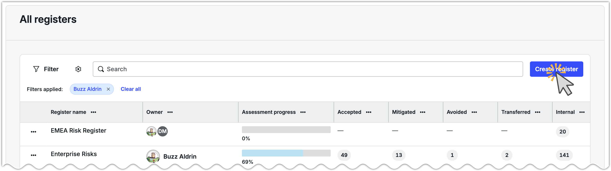
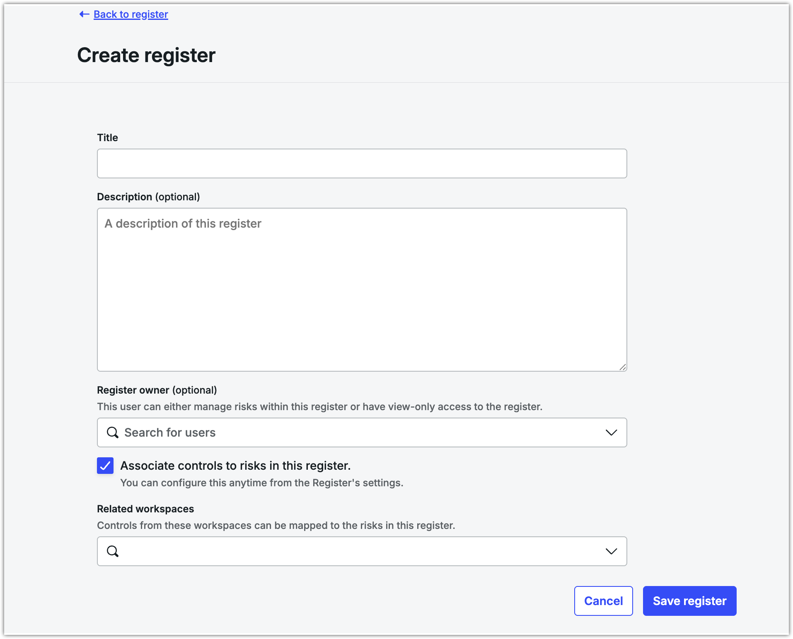
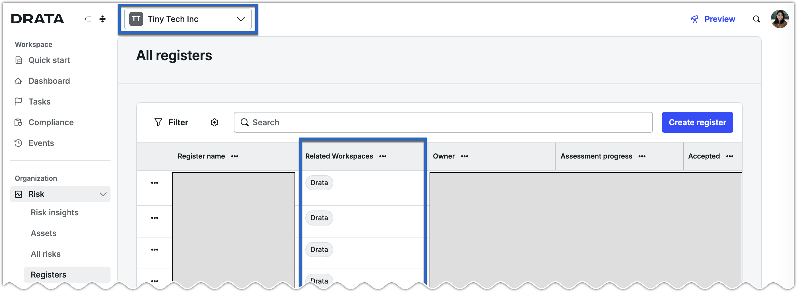
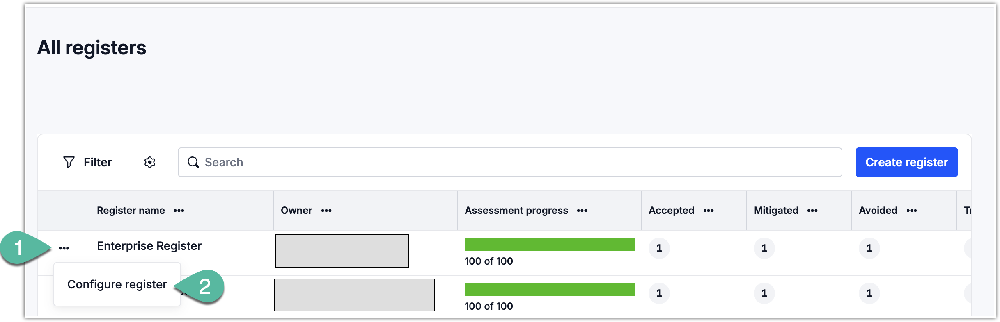
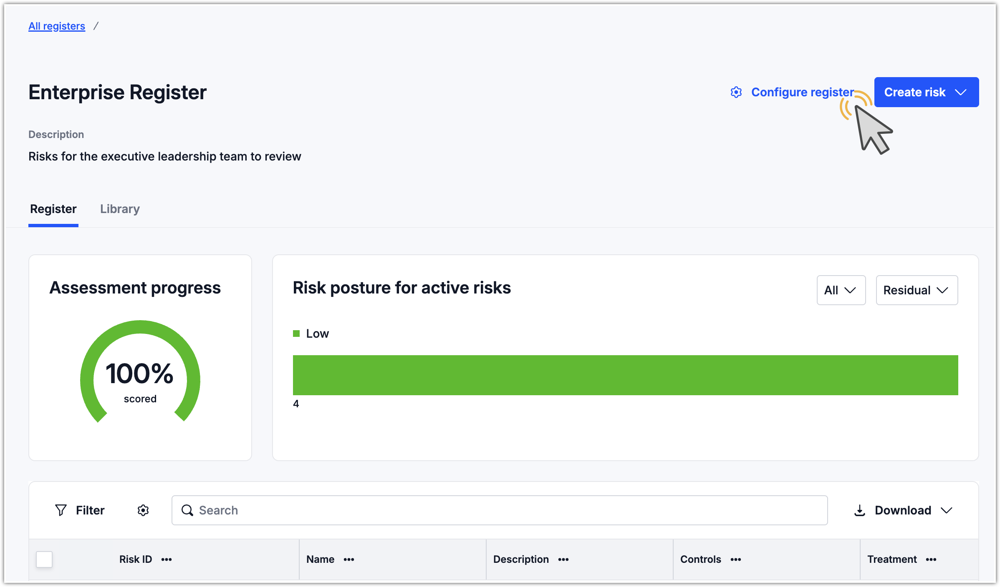
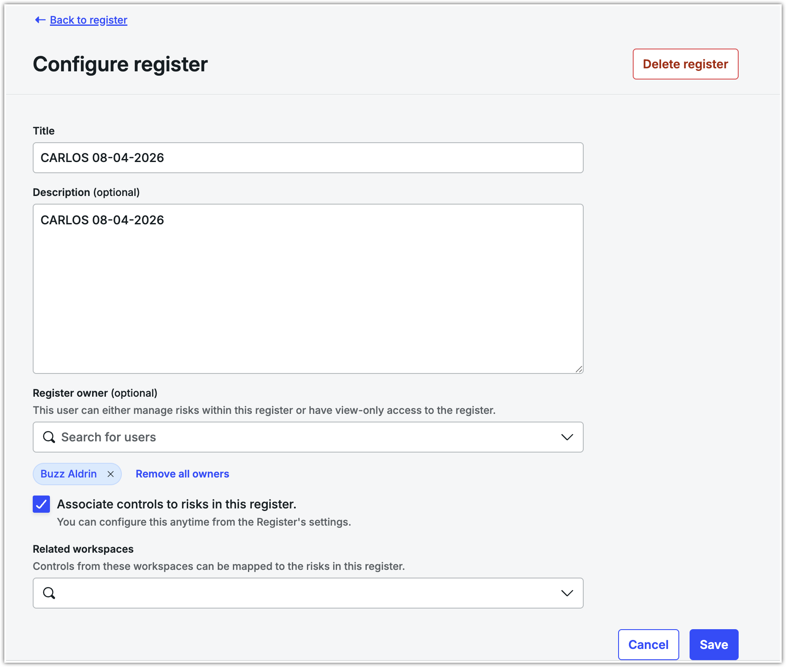
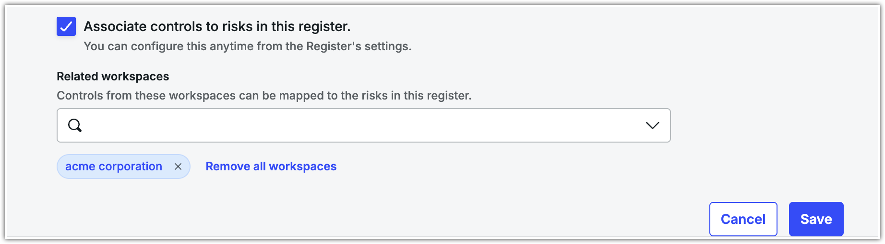

# Manage Risk Across Workspaces

Source: https://help.drata.com/en/articles/14895259-manage-risk-across-workspaces
Collection: Understand the Drata Platform › Risk
Updated: 2026-07-29
Fetched: 2026-11-22
Description: Manage risk across your Drata workspaces to organize, track, and scale your risk management program.

## Article text

By using multiple risk registers and workspaces, you can associate a register with one or more workspaces. This allows you to map controls from specific workspaces to the risks within a particular register.

## Prerequisites

### Plan requirements

Your Drata plan must include **Workspaces and Risk Management Pro**.

### Role requirements

- Only **Admins** and **Risk Managers** can create, configure, or delete a risk register.
- Only Workspace Managers can associate workspaces with a register.
   - A user must be assigned as a manager to **Workspace X** to link it to any register.
   - You will need to create a register and associate it to one or many workspaces, however you are not required to create a register per workspace—a single register can be associated to all workspaces.

> **⚠️ Role Compatibility Warning Note: **
>
> Do not assign both **Admin** and **Risk Manager** roles to a single user. This can cause permission conflicts. If a user is an **Admin**, remove the **Risk Manager** role to ensure consistent behavior.
>
> [Learn more about Multiple Risk Registers here.](manage-multiple-risk-registers-new-experience.md)

The ability to move risks between registers is restricted to the following roles:

- **Admins**
- **Risk Managers**
- **Risk Register Owners** with access to two or more registers.

**Restricted View**: Risk Managers with a restricted view can only see and manage risks they own. They cannot add risks, change ownership, or create new registers.

| **If you want to...** | **You need these roles** |
|---|---|
| **Create or Delete a Register** | Admin or Risk Manager |
| **Create, Edit, or Delete a Risk** | Admin, Risk Manager or Workspace Manager |
| **Link "Workspace A" to a Register** | Admin or Risk Manager |
| **Move Risks between Registers** | Admin or Risk Manager + Risk Register Owner (if owner of both registers), OR Workspace Manager (if both registers are linked to their workspaces) |
| **View a Register** | - Admin or Risk Manager can view all registers. - Risk Register Owners can only view registers they own. - Workspace Managers can only view registers linked to their workspaces. - Risk Manager with Restricted view can only see registers where they are the owner of risks assigned to that register. |

## Create a Risk Register and associate a workspace

You can create up to 100 risk registers per account. You are not required to create a unique register for every workspace; a single register can be associated with all workspaces if desired.

To create a risk register:

1. Go to **Risk > Registers**.
2. Select **Create register**.
   
3. When creating a new register:
   - Enter a title (required)
   - Add a description (optional)
   - Assign one or more register owners (optional)
   - Check the “**Associate controls to risks in this register**” box and select the workspace(s) you want to associate with this register.
      - Only the workspaces the user has access to will be available in the list.
   
4. Select **Save register**.

### Important permissions and ownership details

- You can assign **multiple register owners** to a single risk register.
- Only users with the **Risk Register Owner** role can be assigned as register owners. You can grant this role from the **Settings >Role administration** page.
- **Workspace Managers** can only see registers which are related to their workspaces.

### Important workspace-related details

- Even when you are in a specific workspace (e.g., "Tiny Tech Inc"), the **All registers** view displays every register you are authorized to see, regardless of its workspace association. This ensures a centralized, "full-picture" view of your organization's risk landscape.
   

- Associate a single register with all workspaces for centralized management or create separate registers for specific departments and frameworks. There is no requirement to maintain a one-to-one ratio between registers and workspaces.

## Update a risk register

You can update a register’s settings at any time. To update a register:

- Select **Configure register** from either the **Register list view** or the **Register detail page**
   - *The register list view image*
      
   - *The register detail page image*
      

From there, you can update the register’s details, ownership and workspace association.

## Add or remove a workspace from a register

You can map a register to one or more workspaces, which allows you to map controls from that workspace to risks in a particular register.

### Add a Workspace

1. Select **Configure register**.
2. Select the **Associate controls to risks in this register** checkbox.
3. Select the workspaces to associate with the register.
4. Select **Save**.

Once you do, the risks in that register can be associated to controls from the workspaces selected.

---

### Remove a Workspace

1. Select **Configure register**.
2. Under **Related workspaces**, select the **X** next to a workspace name, or select **Remove all workspaces**.
   
3. Save your changes.

**⚠️ Note**:

- Removing a workspace **unmaps all associated controls from the risks** in that register.
- **Workspace Managers** for that workspace will also lose access to the register.

---

## Training Videos

Explore [Risk Register training videos](https://help.drata.com/en/articles/13443423-risk-register-training-video-new-experience) for Admins and Risk Managers, including scenarios with multiple registers and restricted access. **You must be logged into Drata to access these videos.**

## Images

- [image 01] ../../images/ux/risk/manage-risk-across-workspaces--01.png
- [image 02] ../../images/ux/risk/manage-risk-across-workspaces--02.png
- [image 03] ../../images/ux/workspaces/manage-risk-across-workspaces--03.png
- [image 04] ../../images/ux/risk/manage-multiple-risk-registers-new-experience--04.png
- [image 05] ../../images/ux/risk/manage-multiple-risk-registers-new-experience--05.png
- [image 06] ../../images/ux/risk/manage-risk-across-workspaces--06.png
- [image 07] ../../images/ux/risk/manage-risk-across-workspaces--07.png

## Related articles

- [Risk management in Drata: An overview](risk-management-in-drata-an-overview.md)
- [Manage multiple risk registers (New Experience)](manage-multiple-risk-registers-new-experience.md)
- [Create and Manage Workspaces](create-and-manage-workspaces.md)
- [Create and Manage Workspace Tickets](create-and-manage-workspace-tickets.md)
- [Risk categories in Drata](risk-categories-in-drata.md)
