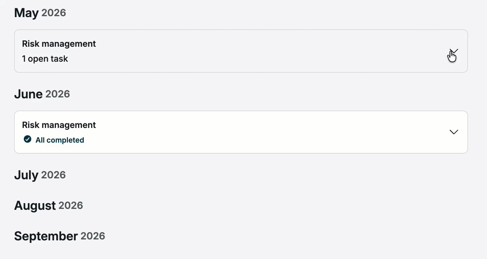
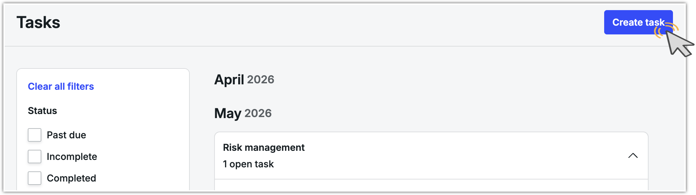
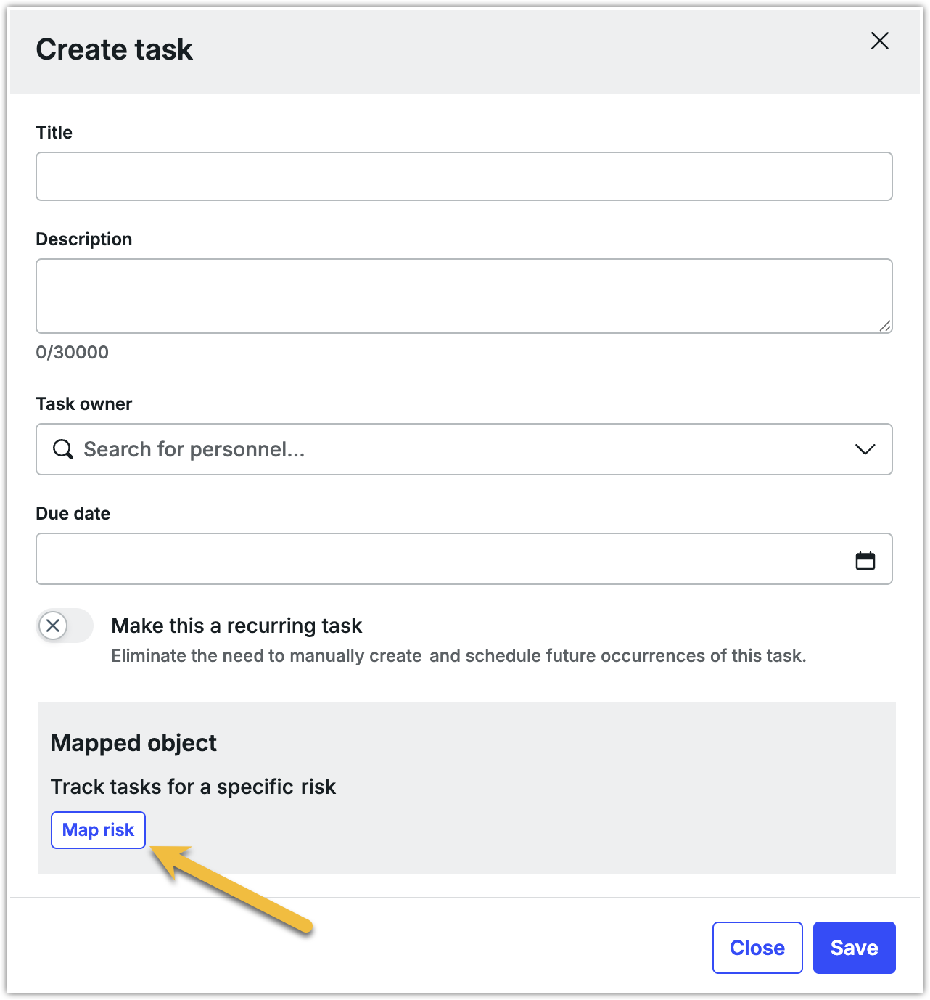
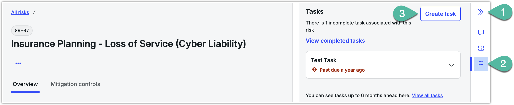

# Manage Risk Tasks in Drata (New Experience)

Source: https://help.drata.com/en/articles/14435209-manage-risk-tasks-in-drata-new-experience
Collection: Enhancing your workflow › Tasks
Updated: 2026-04-02
Fetched: 2026-11-22

## Article text

As a Risk Manager, the **Tasks** page is your central command center for tracking and completing risk-related remediation. This page ensures that your risk management activities remain organized, documented, and audit-ready.

## What You Can Do on the Tasks Page

The Tasks page is designed to help you stay ahead of your compliance obligations. Use this page to:

- **Monitor Progress:** View upcoming, due, or overdue remediation work via the interactive monthly timeline.
- **Filter Your Workflow:** Quickly sort tasks by **Owner**, **Type**, or **Timeframe** to focus on what matters most.
- **Maintain Traceability:** Create custom tasks mapped directly to specific risks, ensuring every action is tied to the correct record for audit purposes.

## Understanding Task Types

While Drata manages various compliance tasks (like policy renewals and evidence reviews), Risk Managers primarily interact with two types:

| **Task Type** | **Description** | **Permissions Required** |
|---|---|---|
| **Risk Task** | A custom task linked specifically to a risk record. | **Read:** View tasks. **Write:** Create, manage, and complete tasks. |
| **General Task** | A standalone task not associated with a specific Drata object. | **Read:** View general tasks. **Write:** Edit details and mark as complete. |

## How to Complete a Risk Task

Completing tasks accurately ensures your risk posture is always up to date.

1. Navigate to the **Tasks** page in the left sidebar.
2. Locate the task and select the **down arrow** to expand its details.
   
3. **Identify the desired action:**
   - **If you see a "Review in Risk Management" button:** Click it. This opens the related risk in the **Risk Management** page. Complete the required remediation there; the task will remain linked for traceability.
   - **If you see a "Mark complete" button:** The task can be marked complete directly from the Tasks page without further navigation.

---

## How to Create a Risk Task

You can initiate a risk task from two different locations, depending on your preferred workflow:

### Option 1: From the Tasks Page

1. Select **Create Task**.
   
2. During setup, use the **Map to Risk** dropdown to select the relevant risk record.
   
3. Define the **Owner**, **Due Date**, and optional **Recurrence** (e.g., for quarterly risk reviews).

### Option 2: From the Risk Management Page

1. Select the **Risk > All Risks** page and then select the specific risk you want to manage.
2. Click the **arrow icon** on the far right side of the risk row to open the details side panel.
3. From this panel, you can:
   - **Create a Task:** Click the task icon to link a new action item directly to this risk.
   - **Collaborate:** Leave internal comments or create synced tickets (like Jira or ServiceNow) to track remediation progress with other teams.

## Permissions & Visibility

Your view of the Tasks page may vary based on your organization's administrative settings:

- **Read-only Access:** You can view, filter, and download task data but cannot create or modify tasks.
- **Restricted View (Enabled):** You will only see risks you own and tasks specifically assigned to you.
- **Restricted View (Disabled):** You have visibility into all risks and tasks across the organization.

## Images

- [image 01] ../../images/ux/tasks/manage-risk-tasks-in-drata-new-experience--01.gif
- [image 02] ../../images/ux/tasks/manage-risk-tasks-in-drata-new-experience--02.png
- [image 03] ../../images/ux/tasks/manage-risk-tasks-in-drata-new-experience--03.png
- [image 04] ../../images/ux/risk/manage-risk-tasks-in-drata-new-experience--04.png

## Related articles

- [Risk managers overview](risk-managers-overview.md)
- [Risk management in Drata: An overview](risk-management-in-drata-an-overview.md)
- [Manage tasks in Drata](manage-tasks-in-drata.md)
- [Create and Manage Tickets in Drata](create-and-manage-tickets-in-drata.md)
- [Drata Controls (DCFs) Training Video (New Experience)](drata-controls-dcfs-training-video-new-experience.md)
