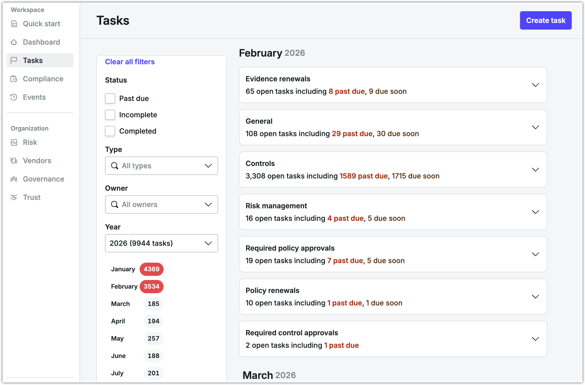

# Manage tasks in Drata

Source: https://help.drata.com/en/articles/13688199-manage-tasks-in-drata
Collection: Enhancing your workflow › Tasks
Updated: 2026-11-09
Fetched: 2026-11-22
Description: Learn how to track, create, complete, and manage automated and custom tasks in Drata to support continuous compliance operations.

## Article text

The Tasks page helps you track and manage work that supports audit readiness and day-to-day compliance workflows, including:

- Policy renewals
- Control approvals
- Evidence reviews
- Vendor management
- Risk-related remediation

In the New Drata Experience, Tasks are designed to reduce workflow friction by keeping actions consistent and easy to complete across modules.

## Tasks timeline and organization

The Tasks page displays a monthly timeline of tasks grouped by month and type.

- Overdue tasks are highlighted for visibility
- Select a month to view detailed task lists
- Use filters to organize tasks by owner, type, or timeframe

 (links to https://downloads.intercomcdn.com/i/o/am69aeco/2049514783/e27ca0006483bc67f46018e17bf8/image.png?expires=1780185600&signature=9db2a3501c59963af5108bc93c3159bb4c487c4a6dbca307f41735ce704f6169&req=diAjH8x%2FmYZXWvMW3nq%2BgTfX1e5Is8h21DrhlNB%2FelIfGosYyZBGtjUxTSDZ%0AIoCJFynSZtEaeGoRAhYwfWb953c%3D%0A)

This consistent task surface supports enterprise-scale programs by helping teams prioritize work across large datasets and multiple stakeholders.

## How tasks are created

Tasks in Drata are created in two ways:

- **Automated tasks** → Created by Drata when compliance events occur
- **Custom tasks** → Created manually by users

If a task is not completed by its due date, it is marked as **Past due** until resolved.

### Automated tasks

Automated tasks are generated by Drata to support predictable compliance workflows. Users cannot create these manually.

Common automated task types include:

- **Policy renewals**
   Assigned to the policy owner to ensure policies are reviewed on schedule.
- **Control approvals**
   Assigned when a control requires approval as part of audit readiness.
- **Evidence tasks**
   Assigned when evidence reaches an expiration or review date.
- **Vendor reviews**
   Assigned when a vendor assessment or update is due. In some cases, vendor tasks may not have an assigned owner.

### Custom tasks

Custom tasks are created manually to support workflows specific to your organization. When creating a custom task, you define:

- Task owner
- Due date
- Recurrence (optional)

Examples include:

- **General tasks:** Internal audits, training assignments, or compliance review meetings.
- **Risk tasks:** Remediation actions mapped directly to risks.
- **Control tasks:** Follow-up actions linked to specific controls.

### Mapped tasks (in-context workflows)

Mapped tasks are custom tasks linked directly to a risk or control, improving traceability and reducing navigation backtracking.

- **Risk tasks**
   Linked to risks and reviewed from the Risk Management experience. Only users with the Risk Manager role can manage these tasks.
- **Control tasks**
   Linked to controls and reviewed directly from the Controls experience.

You can create mapped tasks in two ways:

- From the **Tasks** page, map the task during creation
- From the **Risk Management** or **Controls** detail page, create a task in context

## Create, edit, or delete custom tasks

To create a custom task:

1. Go to the **Tasks** page
2. Select **Create task**
3. Enter a title and description
4. Assign an owner
5. Set a due date
6. (Optional) Enable recurrence and configure frequency

For existing tasks, you can:

- Update task details, owner, or due date
- Change recurrence settings
- Map tasks to risks or controls
- Delete tasks that are no longer needed

## Complete tasks

To complete a task:

1. Go to the **Tasks** page
2. Expand the task to view details

Completion actions vary depending on task type:

- If a checkmark appears, select it to mark the task complete
- If a **Review** button appears, select it to open the related object detail page in Drata

## Images

- [image 01] ../../images/ux/tasks/manage-tasks-in-drata--01.png

## Related articles

- [Risk managers overview](risk-managers-overview.md)
- [Risk management in Drata: An overview](risk-management-in-drata-an-overview.md)
- [Manage Risk Tasks in Drata (New Experience)](manage-risk-tasks-in-drata-new-experience.md)
- [Bulk Import Custom Tasks](bulk-import-custom-tasks.md)
