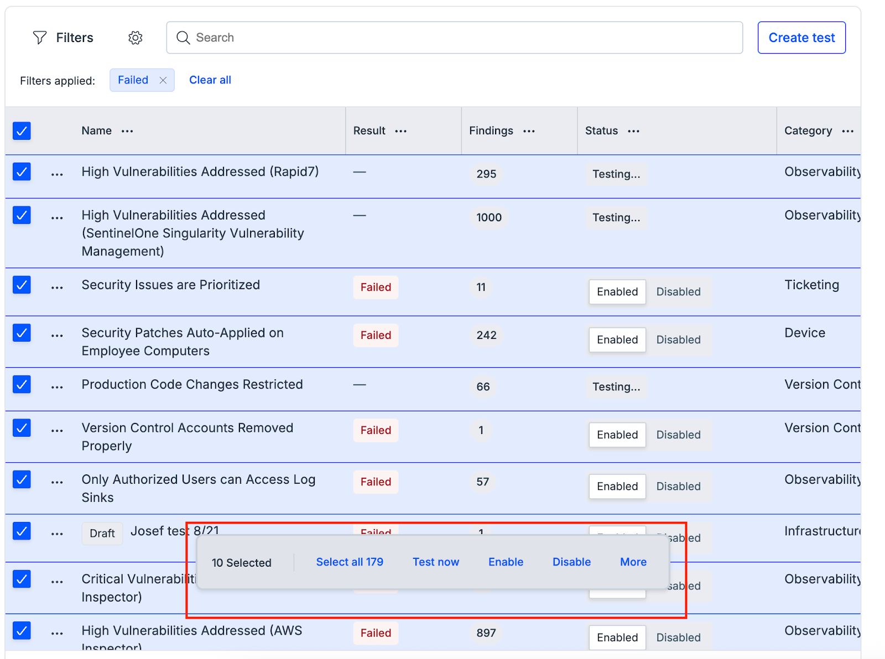

# Manage Tests in Monitoring Page

Source: https://help.drata.com/en/articles/13392191-manage-tests-in-monitoring-page
Collection: Understand the Drata Platform › Monitoring
Updated: 2026-11-09
Fetched: 2026-11-22
Description: Manage individual and bulk test actions in Drata's Monitoring page, and understand test details including findings, exclusions, history, and controls.

## Article text

You can manage tests individually or in bulk from the Monitoring table. Bulk actions save time by letting you apply updates to several tests at once.

Tests run automatically on a regular schedule. You can also run tests whenever you'd like.

## Manage multiple tests (bulk actions)

To apply an action to more than one test:

1. Select one or more tests using the checkboxes in the Monitoring table.
2. Choose one of the following actions.

- **Test now:** Runs all selected tests immediately. Results typically appear within a few minutes.
- **Enable tests:** Turns on the selected tests so they run daily with Autopilot or can be run on demand.
   - If a test is mapped to a control, its results contribute to control readiness.
   - Enabling a test does not change historical results; it only affects future runs.
- **Disable tests:** Turns off the selected tests.
   - Disabled tests do not run or contribute to readiness until re-enabled.
   - You must provide a business rationale when disabling a test. This rationale remains visible in Monitoring for audit transparency.
   - Disabled tests can be re-enabled at any time, and readiness is recalculated once they are active again.
- **Publish tests:** Applies to custom draft tests.
   - Draft tests can exist in two states:
      - **Published version:** The version Autopilot runs.
      - **Draft version:** The editable version.
   - When you publish a draft, the next Autopilot run automatically uses the updated version.
- **Export tests to CSV:** Downloads a CSV file with details for the selected tests, including Name, Description, Status, Result, Category, and mapped Control ID.
   - The export respects your current selections and filters.

## Manage a single test from the Monitoring table

You can also manage an individual test directly from the Monitoring table.

- Select the **ellipsis (⋯)** on a test row to run the test.
- Each test in the Monitoring table includes an **Enable/Disable** toggle that lets you manage the test directly from the row.

This allows you to quickly take action on a single test without selecting multiple rows.

## Manage a single test from the test details page

For more detailed management, open a test's details page.

1. Select a test name in the Monitoring table.
2. From the test details page, select **Test now** to run the test.
3. Additional actions are available depending on the test type and configuration.

Managing tests from the details page is useful when you need to review test information, results, or mappings before taking action.

## Images

- [image 01] ../../images/ux/monitoring/manage-tests-in-monitoring-page--01.png

## Related articles

- [Monitoring Overview](monitoring-overview.md)
- [Filter and search tests in Monitoring (New Experience)](filter-and-search-tests-in-monitoring-new-experience.md)
- [View and Manage Test Details (New Experience)](view-and-manage-test-details-new-experience.md)
- [Disable a Test](disable-a-test.md)
- [Understanding Monitoring in Drata Training Video (New Experience)](understanding-monitoring-in-drata-training-video-new-experience.md)
