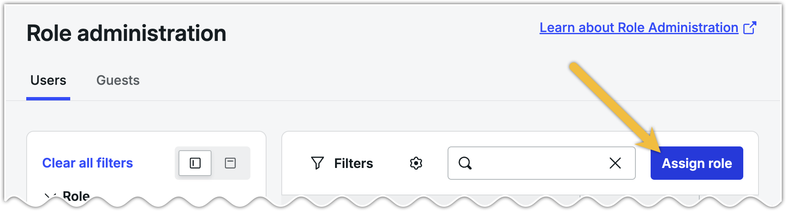
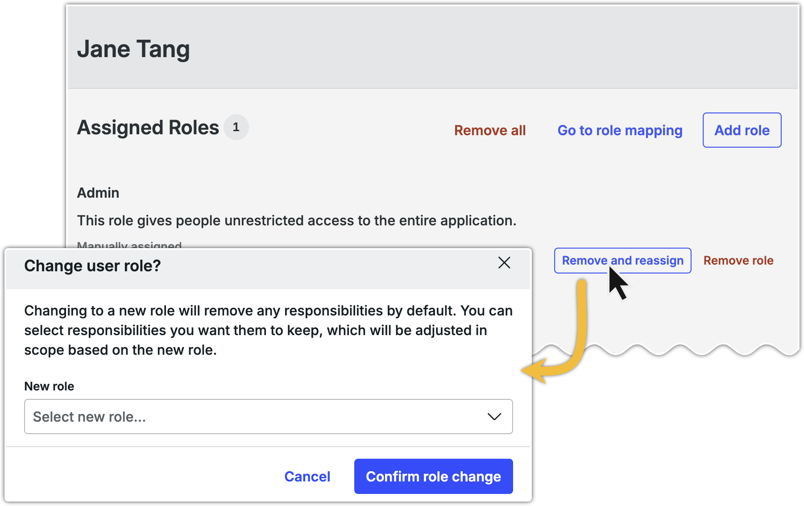
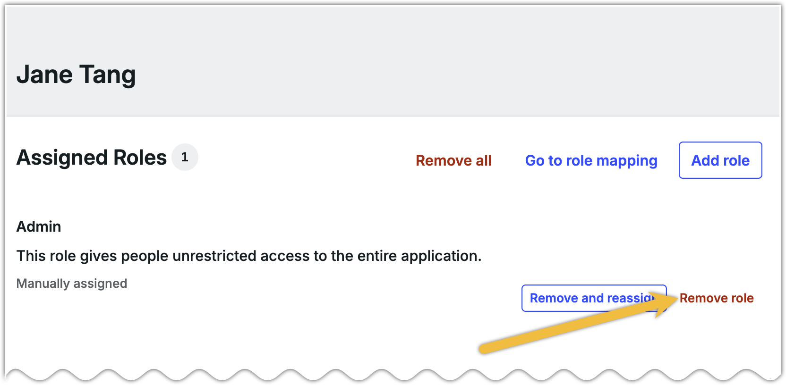

# Manage user roles in Drata

Source: https://help.drata.com/en/articles/13604055-manage-user-roles-in-drata
Collection: Settings › Role Administration
Updated: 2026-11-09
Fetched: 2026-11-22
Description: Use this article to assign, change, or remove roles for users in your organization.

## Article text

**Required role:** Admin. Only Admins can assign, change, or remove roles.

## How roles work

Drata uses role-based access control (RBAC) to give users access to specific areas of the platform based on their responsibilities.

- Users can have **multiple roles** at the same time
- Access is **additive** — when a user has multiple roles, they receive the combined permissions of all assigned roles
- The **Admin role supersedes all other roles** — if a user is assigned Admin, their other roles become redundant
- Some roles include **read-only** or **restricted view** access options.

### Read-only access and restricted view

Some roles in Drata can be configured with additional access restrictions. Only Admins can configure these settings.

#### Read-only access

Read-only access allows a user to **view, filter, and download** data available to their role — but they cannot make edits, create records, or perform write actions of any kind.

- **Who it applies to:** Any role can have read-only access enabled.
- **Default:** Disabled — users have full read and write access by default.
- **Experience:** Read-only is a toggle that Admins turn on or off per user in Role Administration.

#### Restricted view

Restricted view limits a user's access to **only the items they own or are assigned to** — instead of seeing everything available to their role.

- **Who it applies to:** Control Managers and Risk Managers only.
- **Default:** Disabled — users have full access by default.
- **Experience:** Read-only is a toggle that Admins turn on or off per user in Role Administration.

| **Role** | **What restricted view limits** |
|---|---|
| **Control Manager** | Can only access controls they own or are assigned to for tasks or required approvals |
| **Risk Manager** | Can only access risks they own or are assigned to for tasks |

Turn off restricted view to allow the user to access **all** controls or risks across the organization, not just the ones they are responsible for.

## Before you assign a role

Before assigning any role, confirm the following:

- The user must already exist in your Drata account. If they have not been invited yet, invite them first.
- You must have the Admin role to assign, change, or remove roles.

### Assign a role

1. Go to Settings → Role administration.
2. Select **Assign role**.
   
3. Search for and select the Personnel and the desired role.
4. Confirm the assignment.

### Remove and reassign a user's role

Changing a role updates the user's access and permissions immediately. When you change a role, any objects (such as controls or tasks) that the user owned under their previous role are reassigned to you.

1. Go to **Settings → Role administration**.
2. Find and select the **user**.
3. Review the **Assigned Roles** section, which lists all roles currently assigned to the user.
4. If there are multiple roles, expand the role you want to change
5. Select the **Remove and reassign **button. Then, select the new role that you would like to assign.
   
6. Select **Remove role** to remove the role from the user.
   

As part of assigning or updating a role, you can configure read-only access or restricted view for roles that support these options.

---

## Images

- [image 01] ../../images/ux/settings/manage-user-roles-in-drata--01.png
- [image 02] ../../images/ux/settings/manage-user-roles-in-drata--02.png
- [image 03] ../../images/ux/settings/manage-user-roles-in-drata--03.png

## Related articles

- [Role Administration & RBAC](role-administration-rbac.md)
- [Drata MCP — Setup & Usage Guide](drata-mcp-setup-usage-guide.md)
- [Roles and permissions overview (New Experience)](roles-and-permissions-overview-new-experience.md)
- [Manage Risk Across Workspaces](manage-risk-across-workspaces.md)
- [Read-Only and Restricted-View Roles](read-only-and-restricted-view-roles.md)
