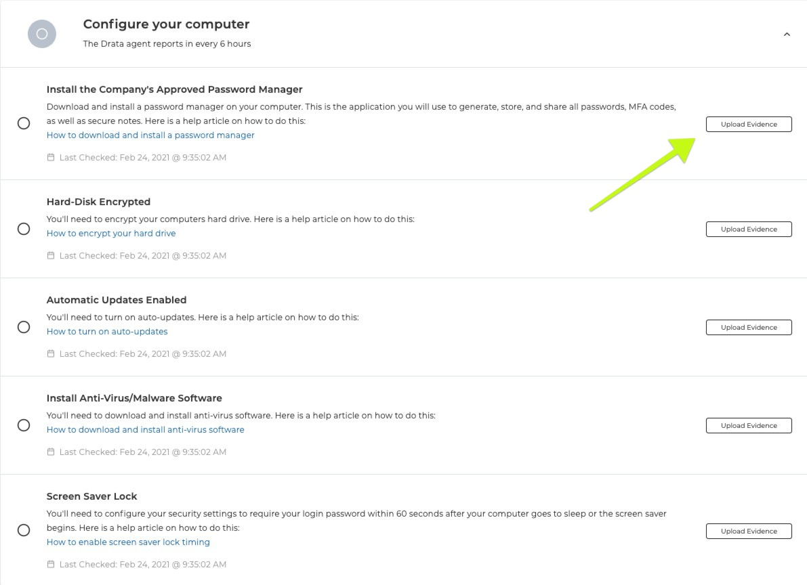
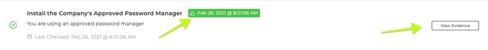
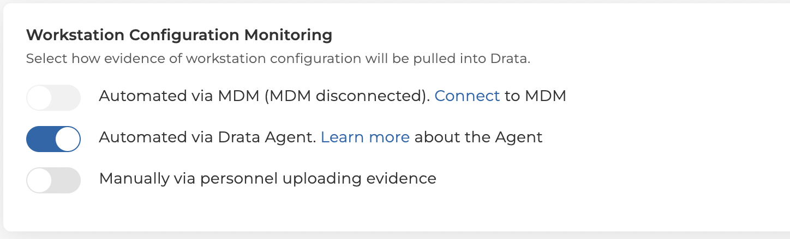

# Manual evidence uploads for personnel compliance checks

Source: https://help.drata.com/en/articles/4972218-manual-evidence-uploads-for-personnel-compliance-checks
Collection: Personnel Management › Device Compliance
Updated: 2026-08-05
Fetched: 2026-11-22
Description: Employees have the option to load manual evidence if not using the Drata Agent

## Article text

**HERE'S WHY**

Some companies may opt not to utilize the Drata agent or may allow some employees not to do so. This functionality still allows evidence collection for companies to showcase their employee compliance.

**HERE'S HOW**

When an employee lands on their onboarding page, they will proceed through accepting their policies and completing their background check. If your company is not using the Drata Agent, you can skip that step and under 'Configure your computer' each configuration item will have the option to upload evidence to show proof it is completed.

When you click 'Upload Evidence' a modal will open where you can upload a file. Note: It is advised that the date and time are included in the screenshot loaded into the system.

Once the evidence is successfully uploaded, you will see a green box with a date and timestamp in Drata as well as the option to 'View Evidence'.

If you do not see the 'Upload Evidence' button, your company's Drata admin will need to enable manual evidence uploads for employees. The Workstation Configuration Monitoring card is on the Internal Security page, which is found by clicking the company logo in the bottom left. Toggle the setting on for 'Manually via personnel uploading evidence.'

## Images

- [image 01] ../../images/ux/personnel/manual-evidence-uploads-for-personnel-compliance-checks--01.jpg
- [image 02] ../../images/ux/personnel/manual-evidence-uploads-for-personnel-compliance-checks--02.jpg
- [image 03] ../../images/ux/settings/manual-evidence-uploads-for-personnel-compliance-checks--03.png

## Related articles

- [Personnel Offboarding Evidence](personnel-offboarding-evidence.md)
- [Manually Export Evidence Data from Drata](manually-export-evidence-data-from-drata.md)
- [Personnel Overview](personnel-overview.md)
- [Organization settings: Internal Security](organization-settings-internal-security.md)
- [Manually map proof of a background check](manually-map-proof-of-a-background-check.md)
