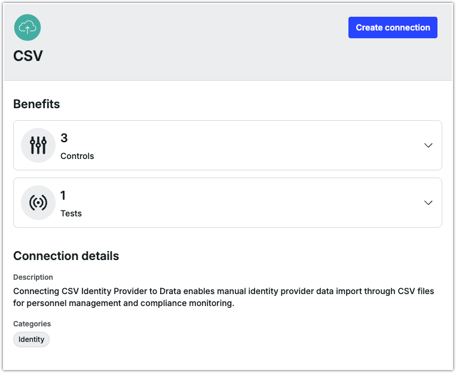

# Manual Import (CSV) Identity Provider Integration Guide

Source: https://help.drata.com/en/articles/8231902-manual-import-csv-identity-provider-integration-guide
Collection: Connection Support › Identity (IdP) Guidance
Updated: 2026-08-05
Fetched: 2026-11-22
Description: In this article, you learn how to upload personnel data into Drata using a CSV file when your organization uses an unsupported Identity Provider.

## Article text

The Manual Import connection allows you to upload your personnel into Drata using a CSV file. This option is helpful when your organization uses an Identity Provider (IdP) that Drata does not yet support. Export your personnel data from your IdP (on-prem or cloud-hosted), format it according to the required CSV specification, and upload it into Drata.

## Key Capabilities

- Upload personnel into Drata using a CSV file
- Populate identity fields such as name, email, job title, and MFA status
- Manage contractors vs. employees
- Track personnel creation dates for compliance
- Enable authentication setup through Enterprise SSO after personnel import

If you choose this connection method, CSV import becomes your sole IdP connection and cannot be combined with a synced integration (such as Okta or Google Workspace).

## Prerequisites & Data Access

- **CSV formatting required:** Your CSV must include all required column headers and conform to Drata’s field rules.
- **Multi-domain not supported:** Email addresses must use a single domain. Multi-domain configurations (e.g., `@company.com` and `@subsidiary.com`) are not supported with this method.
- **Manual updates required:** Any personnel changes (new hires, terminations, role changes) require generating and uploading a new CSV.

- **Drata Role requirements:** To connect, you must be assigned one of the following Drata roles: **Admin, Workspace Managers, DevOps Engineer**.
- If you have the **Access Reviewer** role, you can only view the Connections page.

## Understand the CSV fields and expected formats

1. Use the [CSV template](https://cdn.drata.com/templates/idp/csv_idp_example.csv) to upload your data.
2. Do not change the column order. Changing the column order will result in errors.
3. All columns must be included.

For field values, ensure the CSV follows the table below:

| **Column Name** | **Field Type** | **Required** | **Max Length** | **Description** |
|---|---|---|---|---|
| id | string | yes | 191 | Primary ID in the IdP  Accepted values: - Numbers - Alpha strings - Alphanumeric string with dashes ([GUID/UUID format](https://en.wikipedia.org/wiki/Universally_unique_identifier)) |
| first_name | string | yes | 191 | First name of user  Accepted values: Alphanumeric with special characters (space, ', -, I, ., ,, +, :, _, #, &, /, (, [) |
| last_name | string | yes | 191 | Last name of user  Accepted values: Alphanumeric with special characters (space, ', -, I, ., ,, +, :, _, #, &, /, (, [) |
| email | string | yes | 191 | Email of the user |
| avatar_url | string | no | 768 | Full public URL to the user's avatar image |
| is_contractor | boolean or binary | yes | 16 | Indicate if user is a contractor  Accepted values: 1, 0, yes, no, true, false (case-insensitive) |
| mfa | boolean or binary | yes | 16 | Indicate if user enabled MFA for their IdP  Accepted values: 1, 0, yes, no, true, false (case-insensitive) |
| job_title | string | no | 191 | Job title of the user  Accepted values: Alphanumeric with special characters (space, ', -, I, ., ,, +, :, _, #, &, /, (, [) |
| customer_id | string | no | 191 | Alternate ID for the user  Accepted values: - Numbers - Alpha strings - Alphanumeric string with dashes ([GUID/UUID format](https://en.wikipedia.org/wiki/Universally_unique_identifier)) If the `customer_id` has a leading zero, Excel might remove the leading zero. |
| created_at | date | yes | 191 | Date the user was created in the IdP  Accepted values: - [ISO 8601 (strict or not)](https://en.wikipedia.org/wiki/ISO_8601)    - Example: 2019-10-31 09:00:00 - [American US date format](https://en.wikipedia.org/wiki/Date_format_by_country#United_States)    - Example: 01/18/2022 - [RFC 3339](https://datatracker.ietf.org/doc/html/rfc3339)    - Example: 2022-01-18T15:30:00Z Not Accepted values: - European date format    - day-Month-year - written out long or short date format    - Thursday, January, 18th - Epoch Time |

## Step-by-Step Setup

### Step 1: Upload Your CSV to Connect

1. In Drata, go to the **Connections** page
2. Search for and select CSV connection.
   
3. Start the connections process
4. Download the CSV template and fill in the required fields
5. Upload the completed file

**Expected outcome**: Personnel from the CSV file are created in Drata, and identity monitoring is enabled.

### Step 2: Upload Personnel

To update personnel information or add new users:

1. Return to the **Connections** page and find your connected CSV connection
2. Click the **edit icon**
3. Upload a new, updated CSV file and save changes

**Expected outcome**: Drata updates the personnel list based on the new CSV file.

## Login Authentication

This data is used to populate your personnel on Drata. To have your personnel authenticate into their "My Drata" page, you'll need to connect your authentication system to our [Enterprise Single Sign-On connection](single-sign-on-connection.md).

- **NOTE**: You must have an Identity Provider (IdP) connected to Drata first, before making an SSO connection for sign-in. All Drata logins, including admins, are enforced by and restricted to what syncs from the IdP. The SSO connection option will be disabled on the Connections page until an IdP is connected.

## CSV Upload Issues

If you run into issues when uploading your CSV, an email will be sent out to you with the subject line: "[Drata] CSV IdP Upload Issues..." which contains the issues that the CSV file has. Resolve the issues and re-upload the CSV file.

The most common issues are: incorrect file, mislabeled column headers, or field formatting issues (example: email missing @).

## Images

- [image 01] ../../images/integrations/csv-import/manual-import-csv-identity-provider-integration-guide--01.png

## Related articles

- [Google Workspace Integration Guide](google-workspace-integration-guide.md)
- [Populating and Managing Personnel Data in Drata (Concept Guide)](populating-and-managing-personnel-data-in-drata-concept-guide.md)
- [Bulk Import Personnel Training Records (New Experience)](bulk-import-personnel-training-records-new-experience.md)
- [Integrate Multiple Identity and HRIS Connections](integrate-multiple-identity-and-hris-connections.md)
- [Bulk Import Assets](bulk-import-assets.md)
