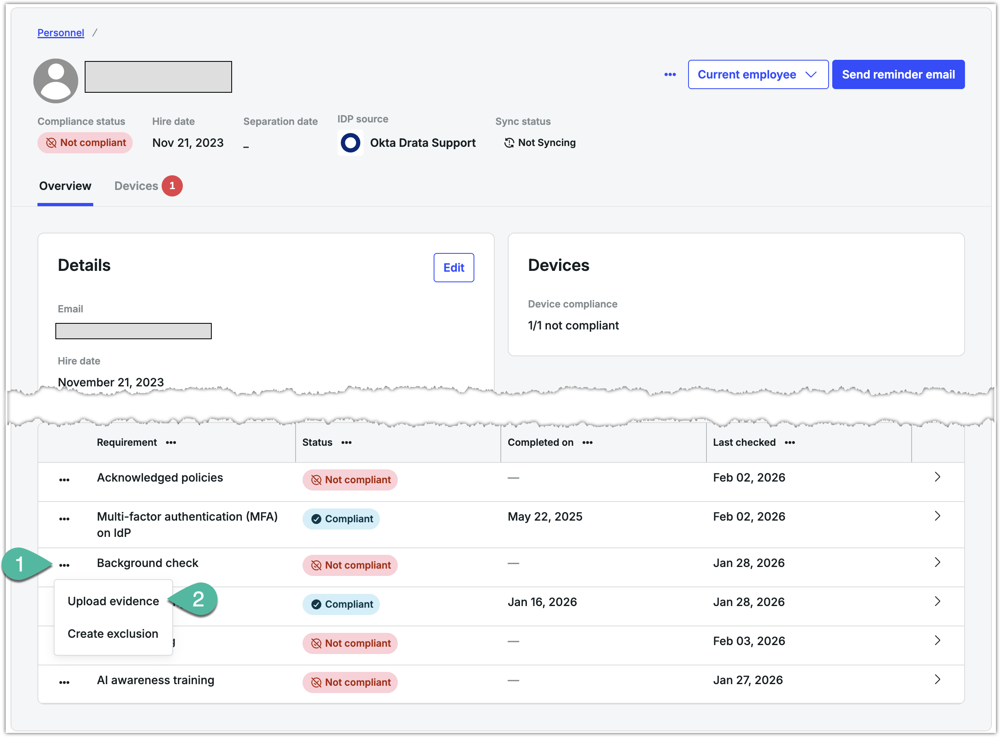

# Manually map proof of a background check

Source: https://help.drata.com/en/articles/13613216-manually-map-proof-of-a-background-check
Collection: Personnel Management › Employee Onboarding
Updated: 2026-11-09
Fetched: 2026-11-22
Description: Manually map or upload background check evidence for employees in Drata when using a non-integrated provider.

## Article text

If you don't use a background check provider integrated with Drata, you can manually upload or map an evidence showing that a background check was completed for an employee.

## Prerequisites

- You must be an **Administrator** or **Information Security Lead** in Drata

## Upload background check evidence for an employee

You can store background check documentation in a secure file system (such as Google Drive, Dropbox, or an internal repository) and map directly to it from Drata.

1. Log in to Drata.
2. Go to **Governance → Personnel**.
3. Select the employee you want to update.
4. Locate **Background check** and select the ellipse and then Upload evidence.
   
5. In the **Add background check** modal, complete the following:
   - **Background check URL:** Enter a URL to the evidence. The link must be accessible to your Drata administrators and, where required by law, the employee.
   - **Completion Date:** Enter the date the background check was completed.
6. Select **Save**.

Once saved, the evidence is associated with the employee for compliance monitoring and audit review.

---

## What you can add as proof

The **Location of the background check** field should point to documentation that demonstrates a background check was completed. Common options include the following.

- Reports, certificates, or screenshots from a background screening provider
- Evidence showing completion status, completion date, and provider name or method used

---

## Compliance guidelines and best practices

**Ensure appropriate access**

- Links must be accessible to your Drata administrators
- Employee access is required only where mandated by law

**Protect sensitive data**

Do **not** link to documents containing unnecessary personal information, such as Social Security numbers, dates of birth, or full legal names when not required.

Drata does not support the hosting of raw background check files.

---

## Partner Offers & Discounts

Drata has direct partnerships with leading background check providers such as Checkr and Amiqus for **first time and new customers**. Check out [more partner offers and discounts](https://drata.com/partner/find/tech-directory?collections=partner-discountoffers,partner-offers-discounts-pod).

- **Checkr**: Global background checks. Get $100 credit by using the code `DRATA100` when creating your account through Drata.
- **Amiqus**: Focused on UK background checks. Visit [https://amiqus.co/partners/amiqus-x-drata](https://amiqus.co/partners/amiqus-x-drata) to get 10% off your first 3 months. **Note:** Amiqus cannot be directly integrated with Drata.

## Images

- [image 01] ../../images/ux/personnel/manually-map-proof-of-a-background-check--01.png

## Related articles

- [Manual evidence uploads for personnel compliance checks](manual-evidence-uploads-for-personnel-compliance-checks.md)
- [Certn Integration Guide (Background Check)](certn-integration-guide-background-check.md)
- [Background Check Management](background-check-management.md)
- [Organization settings: Human Resources Settings (New Experience)](organization-settings-human-resources-settings-new-experience.md)
- [Bulk Import Personnel Background Checks (New Experience)](bulk-import-personnel-background-checks-new-experience.md)
