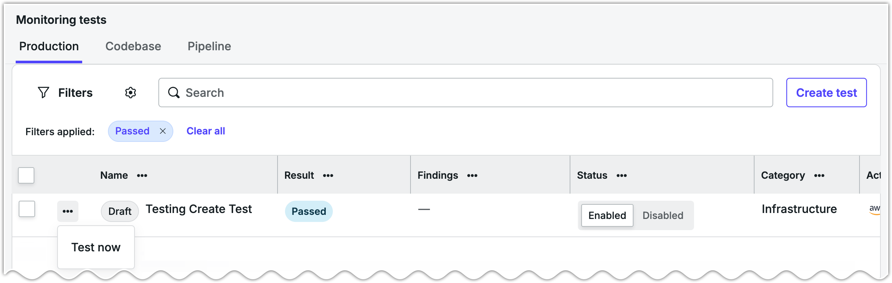

# Manually Running a Control Test

Source: https://help.drata.com/en/articles/4797007-manually-running-a-control-test
Collection: Understand the Drata Platform › Monitoring
Updated: 2026-11-09
Fetched: 2026-11-22
Description: Tests automatically run every evening (PST) in Drata, but you're also able to manually trigger them anytime

## Article text

If you've made updates in the system or to configuration(s) across your tech stack, you may want to re-run the test for a security control (or many) manually to ensure you're still compliant.

NOTE: All tests are run every evening at 7:00pm PST. This feature allows manual testing at any time.

## Before you begin

Only account administrators or information security leads have access to this section within Drata.

## Manually Running a Control Test

1. Navigate to the Monitoring page.
2. Select the ellipsis next to the desired test.
3. Select Test now.
   

## Images

- [image 01] ../../images/ux/monitoring/manually-running-a-control-test--01.png

## Related articles

- [Test 86: MFA on Identity Provider](test-86-mfa-on-identity-provider.md)
- [Test 65: Security Patches Auto-Applied](test-65-security-patches-auto-applied.md)
- [GCP Integration Guide (Manual)](gcp-integration-guide-manual.md)
- [Map Tests to Controls](map-tests-to-controls.md)
- [Disable a Test](disable-a-test.md)
