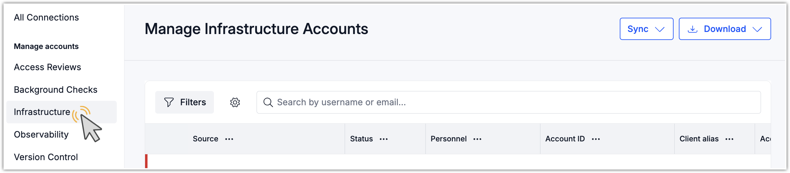
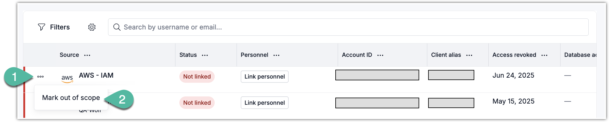

# Map accounts to personnel in Drata (New Experience)

Source: https://help.drata.com/en/articles/13317861-map-accounts-to-personnel-in-drata-new-experience
Collection: Understand the Drata Platform › Connections
Updated: 2026-06-12
Fetched: 2026-11-22
Description: Learn how to map accounts to personnel in Drata, handle service and system accounts and mark accounts out of scope.

## Article text

> **New Experience**
> This article applies to the **New Experience**.

## Overview

When accounts are first synced into Drata, they may not be automatically mapped to personnel. Mapping accounts to personnel helps Drata:

- Understand who has access to systems
- Accurately evaluate access-related compliance requirements
- Maintain a clear audit trail
- Reduce audit follow-up questions

## Prerequisite

- Personnel are synced into Drata from your **[identity provider](https://help.drata.com/en/collections/16504711-identity-idp-guidance)**. If no identity provider is connected:
   - The Personnel dropdown may not have options to select from.

## How to map an account to personnel

For accounts that represent access held by an individual employee:

1. From the **Connections** page, open the relevant **Manageaccounts** page.
   
   *This example shows the Infrastructure page, but the same actions are available across all account management pages.*
2. Locate the account you want to map.
3. In the **Personnel** column, select the appropriate employee.

Once mapped, the account is associated with that person. If ownership changes later, you can select the ellipse to un-map the account and remap it to a different employee.

## Handling service and non-human accounts

Not all accounts belong to a specific individual. Common examples include:

- Service accounts
- Automation users
- System-generated identities

These accounts should **not** be mapped to personnel. Instead, they can be marked **out of scope** with a documented business rationale.

### How to mark an account out of scope

1. Open the relevant **Manageaccounts** page.
2. For the desired account, select the **ellipse > Markout of scope**.
   
3. Provide a brief rationale explaining why the account does not represent individual access.

Once an account is marked out of scope:

- It cannot be mapped to personnel
- The rationale remains visible for audit purposes
- You can view the rationale or mark the account back in scope from the same **ellipsis (⋯)** menu

## Images

- [image 01] ../../images/ux/connections/manage-connected-infrastructure-accounts--01.png
- [image 02] ../../images/ux/connections/map-accounts-to-personnel-in-drata-new-experience--02.png

## Related articles

- [Populating and Managing Personnel Data in Drata (Concept Guide)](populating-and-managing-personnel-data-in-drata-concept-guide.md)
- [Confirm your personnel](confirm-your-personnel.md)
- [Personnel exclusions](personnel-exclusions.md)
- [Mark personnel as Out of Scope (New Experience)](mark-personnel-as-out-of-scope-new-experience.md)
- [Managing Personnel Compliance in Drata Training Video (New Experience)](managing-personnel-compliance-in-drata-training-video-new-experience.md)
