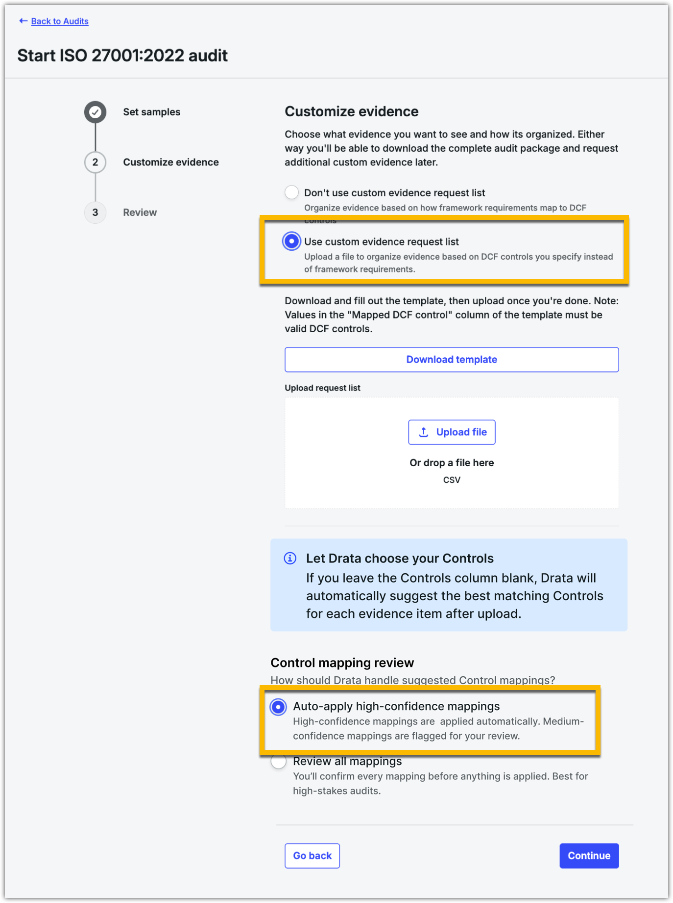
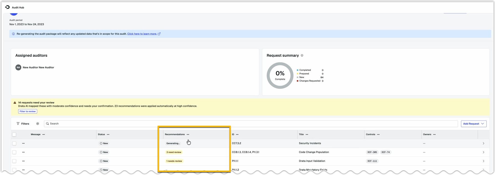
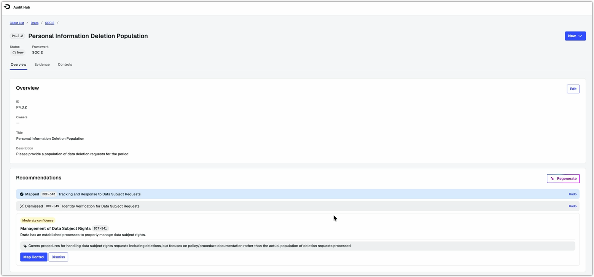
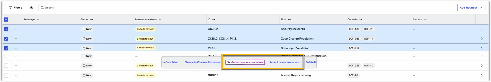

# Map audit requests to DCF controls with AI

Source: https://help.drata.com/en/articles/16144674-map-audit-requests-to-dcf-controls-with-ai
Collection: The Auditor Experience
Updated: 2026-07-30
Fetched: 2026-11-22

## Article text

AI control recommendations suggest the controls most relevant to each audit request. For any request that does not already have a control mapped to it, Drata can analyze the request and recommend matching controls, each with a confidence level and a plain-language explanation. This saves you from manually searching the control library for every request, so you can move from request collection to evidence review faster.

Note: This feature applies only to DCFs and does not apply to custom controls.

## How it works

During an audit, auditors create evidence requests that tell the organization you are auditing what to provide, such as "Provide evidence that access to production systems is reviewed quarterly." For each request that does not already have a control mapped to it, Drata reads the request title and description and recommends the controls that best satisfy it, so auditors or organizations do not have to search the control library by hand.

Once a control is mapped to a request, the evidence tied to that control can be surfaced with the request. Better mapping leads to faster review and less manual back-and-forth during the audit.

## Prerequisites

To set up recommendations for a new audit, you need:

- Access to the Auditor Portal or logged in as an internal auditor.
- An audit request list to upload. You can also download the template while creating the audit.
- At least one request with the Mapped DCF control column left blank. Drata generates recommendations only for requests that do not already have a control mapped.

**Roles and permissions**

- Auditors with write-enabled can view and act on AI control recommendations.
- Auditors with read-only mode can view recommendation cards but cannot act on them.

**Additional notes**

- This feature applies only to DCFs and does not apply to custom controls.

## Set up recommendations for a new audit

Complete this task when you start a new audit and want Drata to recommend controls for your requests. This feature applies only to DCFs and does not apply to custom controls.

1. Log in to the Auditor Portal as an auditor or logged in as an internal auditor.
   - If you are an internal auditor, go to the Audit pages.
2. Start the new-audit wizard and begin creating a new audit.
3. In the** Customize evidence step**, select **Use custom evidence request list.**
4. Upload your request list and leave the Mapped DCF control column blank for any request that should receive AI control recommendations.
   - For each blank entry, Drata suggests the best-matching control for that evidence item.
5. Choose a control mapping review option.
   - Select **Auto-apply high-confidence mappings** (recommended) to apply High-confidence mappings automatically while leaving Moderate-confidence mappings for review.
      1. For this guide, we assume you selected this option.
   - Select **Review all mappings **to confirm every mapping before it is applied.
6. Finish creating the audit. Drata saves your review option and uses it when it processes the uploaded requests.

After you save, a** Recommendation column** appears on the requests table. The Recommendations column will either have Generating or Needs review.

- Generating: Drata is still analyzing the request and generating recommendations.
- Needs review: One or more controls did not auto-map because it was not marked as high confidence and needs your confirmation. You can approve or reject each one.

A banner also appears at the top of the audit. When generation finishes, it confirms how many recommendations were auto-applied and how many still need your review. You can view the auto-applied controls in the Controls column.

High-confidence recommendations are applied automatically only when you select **Auto-apply high-confidence mappings**. When you select **Review all mappings**, no controls are applied until you approve them.

## Review and act on a recommendation

Complete this task after Drata generates recommendations, when you want to review a request and decide whether to apply its suggested controls.

1. In your Audit, Open the request that needs your review. The Recommendation column shows how many controls are waiting for you to approve or reject.
   
2. Scroll to the Recommended section. This section displays the AI recommendations for the request.
3. Review each recommendation card.
   - Compare the control name, DCF code, description, confidence badge, and AI rationale with the request to decide whether the suggested control is relevant.
   - Select Map Control to attach the suggested control to the request.
   - Select Dismiss when the suggested control is not relevant.
   - After you map or dismiss a recommendation, the card changes to a temporary Mapped or Dismissed row. Select Undo on that row to restore the card.
4. Select Regenerate if you want to see the recommendations that you dismissed previously.

To confirm what is already applied, open the Controls column for the request.

## Generate or accept recommendations in bulk

Complete this task when you want to work through several requests at once instead of one at a time.

1. Go to the Requests section of your audit.
2. Checkmark the requests you want to act on.
3. Select Generate to create recommendations for the selected requests, or select Accept recommendations to apply them.

Bulk acceptance applies all available recommendations, including both High and Moderate confidence. Use it after you have reviewed the recommendations and confirmed they are relevant.

## Review recommendations for a FieldGuide-connected audit

Use this workflow only when your audit is connected to FieldGuide. It differs from the standard workflow because FieldGuide sends the requests to Drata, so you do not upload a request list through the new-audit wizard.

1. Wait for requests to sync from FieldGuide to Drata. Drata generates recommendations when eligible requests sync.
2. Open the connected audit after the requests have synced.
3. Review the request-to-control mappings to see which controls Drata mapped automatically during the initial sync.  Drata will automatically map high-confidence controls.
   - Note: There is no manual toggle. FieldGuide connected audits automatically process and map high-confidence connections immediately.
4. Review the remaining recommendations using the single-request or bulk workflows in this guide.

## Event Tracking

Go to the Events page to review key actions taken during the audit setup and control-mapping process, including:

- The control mapping review option selected during audit setup.
- Controls that Drata mapped automatically, whether from the setup option or a bulk action.
- Recommendations accepted in bulk.
- Controls removed from a request.

## Images

- [image 01] ../../images/ux/audits/map-audit-requests-to-dcf-controls-with-ai--01.png
- [image 02] ../../images/ux/audits/map-audit-requests-to-dcf-controls-with-ai--02.png
- [image 03] ../../images/ux/audits/map-audit-requests-to-dcf-controls-with-ai--02.png
- [image 04] ../../images/ux/audits/map-audit-requests-to-dcf-controls-with-ai--04.png
- [image 05] ../../images/ux/audits/map-audit-requests-to-dcf-controls-with-ai--05.png

## Related articles

- [Pre-Audit Checklist: How to Prepare for Your Audit with Drata](pre-audit-checklist-how-to-prepare-for-your-audit-with-drata.md)
- [Set up the Drata + Fieldguide integration in Audit Hub](set-up-the-drata-fieldguide-integration-in-audit-hub.md)
- [Work in a Fieldguide-connected audit in Audit Hub](work-in-a-fieldguide-connected-audit-in-audit-hub.md)
- [Framework Mapping Agent: AI-Assisted Control Mapping for Custom Frameworks](framework-mapping-agent-ai-assisted-control-mapping-for-custom-frameworks.md)
- [AI-Assisted Custom Control Mapping to GRC Objects](ai-assisted-custom-control-mapping-to-grc-objects.md)
