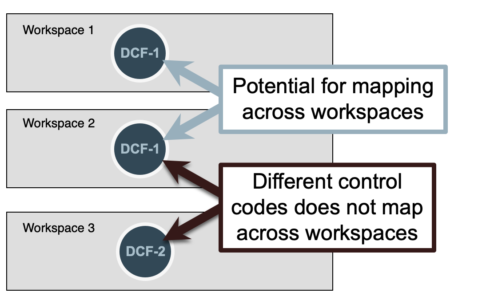
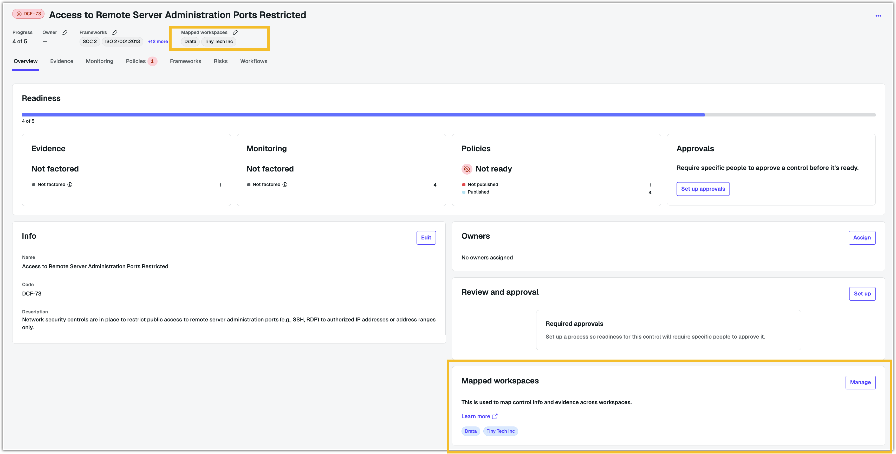
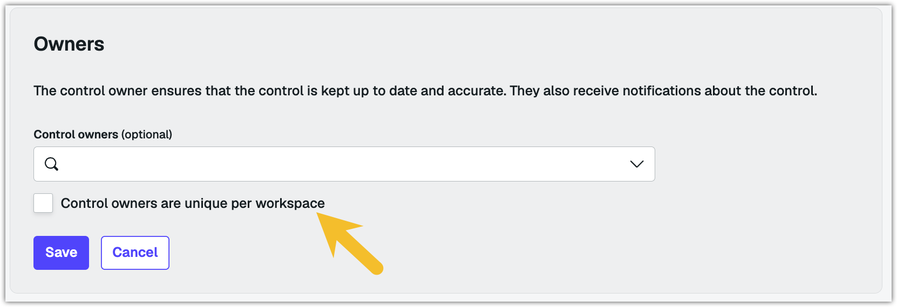
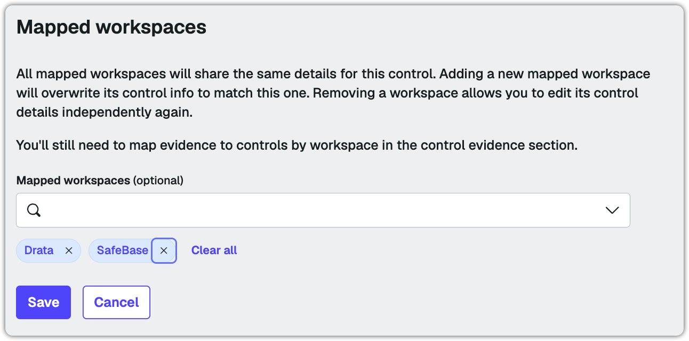
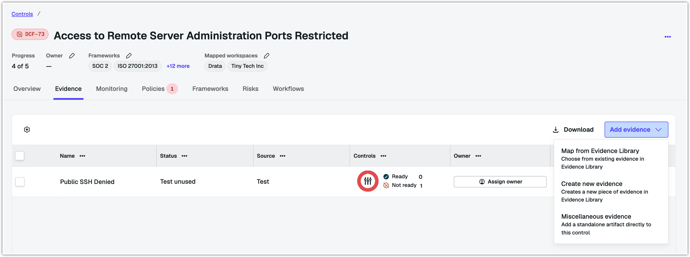
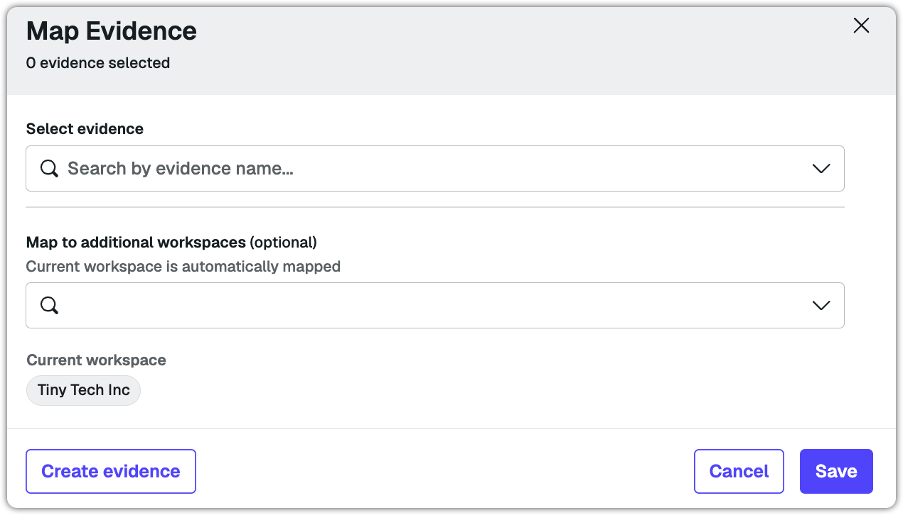

# Map Controls, Policies, and Evidence Across Workspaces

Source: https://help.drata.com/en/articles/13604414-map-controls-policies-and-evidence-across-workspaces
Collection: Getting Started › Workspaces
Updated: 2026-11-09
Fetched: 2026-11-22
Description: Learn how to map control info, policies, and evidence for the same control across multiple Workspaces, and what stays independent even after you map them.

## Article text

## Prerequisites

Before you can map controls across Workspaces:

- Workspaces must be enabled on your account.
- You must have one of the following roles:
   - Admin
   - Workspace Manager
   - Control Manager
   - Information Security Lead

**Workspace Manager limitations:**

- A Workspace Manager can only map or unmap Workspaces they're assigned to — so a Workspace Manager assigned to just one Workspace can't map controls across Workspaces at all.

## What mapping controls across Workspaces does

Mapping lets you link the same control across two or more Workspaces so you manage its control info, policies, and evidence in one place. Instead of updating that information separately in every Workspace, you make the update once and select the Workspaces you want those changes to apply to as well. Read further down for more information.

This is useful when:

- You manage multiple products or business units.
- The same control applies in more than one Workspace.
- You want to avoid duplicating evidence and policies.

**How control mapping works**

- Controls can be mapped only if the same control code exists in more than one Workspace (for example, Drata control DCF-1, or a custom control like ABC-10, that exists in both Workspace A and Workspace B).
- Mapping connects the control across those Workspaces, so you can:
   - Share control info
   - Map policies
   - Map evidence
- You can unmap a Workspace from this control mapping at any time.

**What can be mapped within a control**

Only these control sections can be mapped across Workspaces:

- Control info and Control Owner
- Policies
- Evidence in the Evidence Library (aka Evidence page)

**Test instances stay separate.** Mapping a control does not merge or share its test instances or monitoring results. Each Workspace keeps and runs its own test instances, independent of any control mapping.

**I mapped the controls. Why isn't the information just populating? **Mapping connects the controls going forward — it doesn't copy anything over automatically at the moment you map them. Once mapped, the next update you make to control info, a policy, or evidence in one Workspace will apply to the other mapped Workspaces. To sync existing information, make (or re-save) that update once after mapping, and it will carry over from there.

---

## Map or unmap controls across workspaces

Before you start, make sure the control exists in more than one Workspace. If it only exists in one Workspace, you won't have the option to map it — the mapping steps below won't be available.

Mapping a control is essentially saying: these are the same control, living separately in two (or more) Workspaces, and you want them to stay in sync instead of doing the same work twice.

1. Go to the Controls page and select the specific control you would like to map to other workspaces.
2. Select the **Manage** button for Mapped workspace section.
   - **If there's no Mapped Workspaces section at all:** this control's code doesn't exist in any other Workspace yet, so there's no Workspace to map it to — the section only appears once a match exists elsewhere.
3. Add or remove Workspaces.
   - The Workspace dropdown only lists Workspaces where a control with the exact same control code already exists. You can't select a Workspace that doesn't have a matching-code control.

**Result:** The control is now mapped across the Workspaces you selected. Because it's mapped, any future update you make to that **control's info** automatically applies to the mapped workspaces. Being mapped is also what unlocks the next two flows: you can now configure policy and evidence mappings for this control across workspaces.

**Exception for Control Owners: **The Owners section has its own separate checkbox — **Control owners are unique per workspace**. By default (unchecked), the same control owner(s) apply to the control in every mapped Workspace. If you check that box, owners are no longer shared through the mapping — you assign owners separately for the control in each Workspace instead.

### Unmap a control from a workspace

At any time, you can remove a Workspace from a control's mapping. Unmapping only removes that one Workspace from the group — it doesn't delete anything.

When you unmap a Workspace, the control becomes its own independent instance in that Workspace. To unmap a workspace:

1. Go to the control's Mapped Workspaces section.
2. Select the **x** next to the Workspace you want to remove.
3. Save.

---

## Map policy across multiple workspaces

Once a control is mapped, you can replicate that control-to-policy relationship across other applicable Workspaces, instead of mapping the control and policy relationship separately in every applicable Workspace.

1. Select the specific control you want to map the evidence to.
2. Select the Policies tab and then Map policies button.
3. Select the policy and select the Workspaces you want this policy mapped to, and save.

**Result:** The same policy is now mapped to that control in each selected Workspace. You can add or remove Workspaces from this policy mapping at any time.

**Why map a policy, if policies already exist in every Workspace?** Policies aren't Workspace-specific — a policy created in Workspace B is already available to select from in every other Workspace. Mapping doesn't create or copy the policy itself; it creates the **control-to-policy relationship**, and lets you replicate that relationship to other applicable Workspaces in one step instead of manually attaching the same policy to the same control in each Workspace separately.

**When to map it to other Workspaces:** Only when the same policy genuinely governs that requirement in the other Workspace too — mapping it there makes it count toward that Workspace's control readiness as well. If Workspace B has a genuinely different policy covering that requirement, don't map your policy there; leave Workspace B's own policy attached instead.

**Requirement:** You can only replicate a policy mapping to Workspaces where the control itself is already mapped (Refer to Map or unmap controls across workspaces section for more information). If the control isn't mapped in a given Workspace, that Workspace won't be selectable in step 4 — you'll need to attach the policy to that control manually in that Workspace instead.

---

## Map evidence across multiple workspaces

Use this workflow so a single piece of Evidence Library evidence can satisfy the same control in multiple Workspaces at once.

Ensure that the evidence is uploaded in the Evidence page — that makes it easier to map that evidence across multiple Workspaces for that specific control.

1. Select the specific control you want to map the evidence to.
2. Select the Evidence tab and click **Add evidence**.

The **Add evidence** menu on a control has three options, and only one of them lets you map to additional Workspaces at all:

- **Map from Evidence Library** — the only option with a "Map to additional workspaces" field. Use it to extend an existing Evidence Library item's mapping to other Workspaces in the same action.
   
- **Create new evidence** — adds a new item to the Evidence Library, but only attaches it to the control in your current Workspace. No Workspace selector is offered here.
- **Miscellaneous evidence** — adds a standalone artifact directly to this one control. No Workspace selector here either, and this artifact never becomes part of the Evidence Library at all.

**Result**: The evidence is mapped in all the workspaces you selected. Once evidence is mapped across Workspaces:

- Updates to the evidence apply to every control it's mapped to.
- It behaves similarly to a mapped policy.

**Important:** Updates to mapped evidence may impact the readiness of every control it's mapped to, in every Workspace where it's mapped.

---

## What this does not do

Mapping controls across Workspaces does not:

- Merge the Workspaces into one Workspace.
- Give a user access to Workspaces they are not authorized to access.
- Automatically make every evidence type, test instance, monitoring result, ticket, or event identical across Workspaces.
- Remove the need to configure or operate Workspace-specific tests and connections.
- Create a global control that applies to every Workspace in the Account.

---

## Summary

Mapping controls across Workspaces helps you:

- Reduce duplication
- Maintain consistency
- Update evidence and policies once instead of multiple times, for the specific Workspaces you've chosen to map

This feature is designed for teams managing shared compliance requirements across a bounded set of Workspaces — it does not change how unmapped Workspaces, controls, or evidence behave.

## Images

- [image 01] ../../images/documentation/map-controls-policies-and-evidence-across-workspaces--01.png
- [image 02] ../../images/ux/controls/map-controls-policies-and-evidence-across-workspaces--02.png
- [image 03] ../../images/ux/controls/map-controls-policies-and-evidence-across-workspaces--03.png
- [image 04] ../../images/ux/controls/map-controls-policies-and-evidence-across-workspaces--04.png
- [image 05] ../../images/ux/controls/map-controls-policies-and-evidence-across-workspaces--05.png
- [image 06] ../../images/ux/evidence/map-controls-policies-and-evidence-across-workspaces--06.png

## Related articles

- [Are Your Controls Ready? Understanding the Relationship Between Policies, Evidence, and Controls](are-your-controls-ready-understanding-the-relationship-between-policies-evidence-and-controls.md)
- [Evidence Overview](evidence-overview.md)
- [Map evidence and policies to controls (New Experience)](map-evidence-and-policies-to-controls-new-experience.md)
- [Map policies to controls in Drata](map-policies-to-controls-in-drata.md)
- [Identify What Can Be Shared Workspace Resources](identify-what-can-be-shared-workspace-resources.md)
