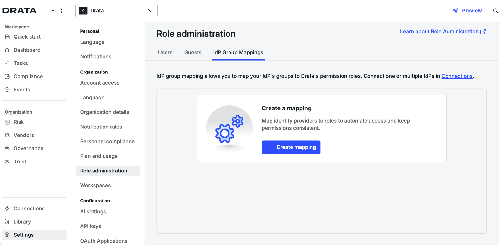
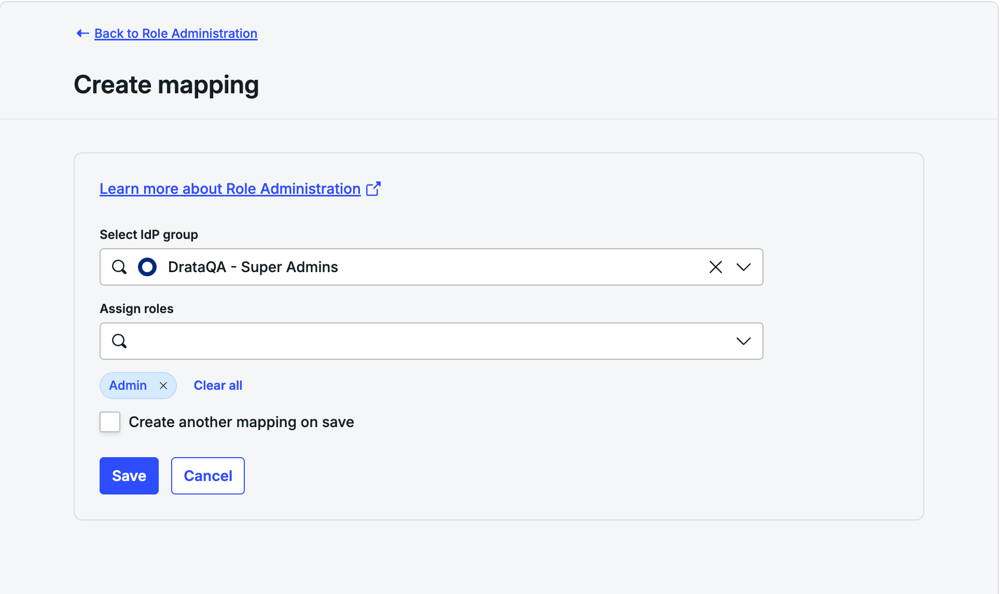
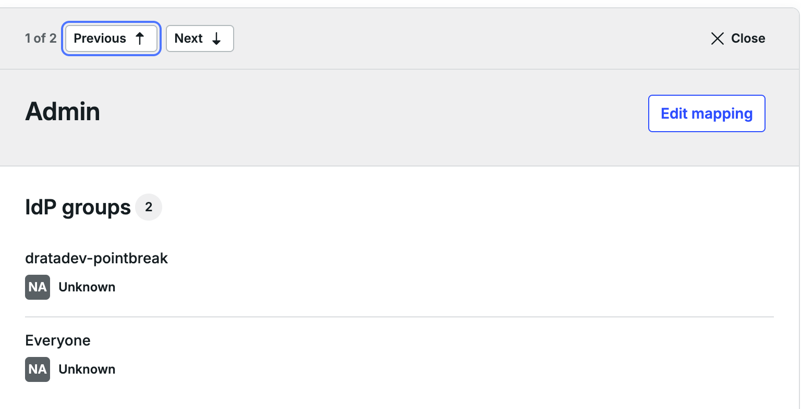
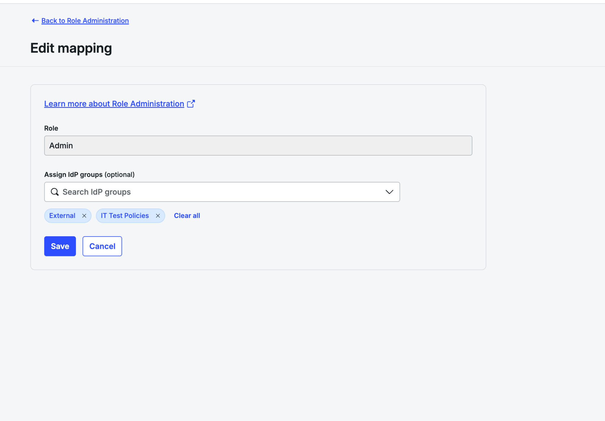

# Map IdP Groups to Drata Roles

Source: https://help.drata.com/en/articles/15235029-map-idp-groups-to-drata-roles
Collection: Settings › Role Administration
Updated: 2026-05-22
Fetched: 2026-11-22

## Article text

## Overview

Drata's **IdP Groups to Roles** feature lets you automatically assign roles to your Drata users based on their group membership in your identity provider (IdP). When a user is added to or removed from an IdP group, their Drata role assignments update automatically — no manual intervention required.

This feature is available for any IdP that supports groups or an SCIM connection with Drata.

---

## How It Works

Once you've mapped one or more IdP groups to Drata roles, Drata keeps those role assignments in sync with the groups:

- **Adding a user to a group** → the user is granted the corresponding Drata role(s)
- **Removing a user from a group** → the corresponding Drata role(s) are automatically revoked

A single IdP group can be mapped to multiple Drata roles. If a user belongs to multiple groups that each map to different roles, those roles are additive — the user will hold all roles granted across all of their groups.

---

## Prerequisites

Before setting up group-to-role mappings, ensure the following:

- Your organization has an active IdP or SCIM connection configured to Drata
- Your IdP is configured to push **group membership** data to Drata
- You have **Admin** access in Drata

---

### Setting Up Group-to-Role Mappings

1. In Drata, navigate to **Settings**.
2. Select **Role Administration**.
3. Locate the **IdP Group Mappings** section.
   
4. Click **Create Mapping**.
5. Select the **IdP group** you want to map from the dropdown (groups synced from your IdP via SCIM will appear here).
6. Select one or more **Drata roles** to assign to members of that group.

Click **Save**.

Repeat for each group you want to map by clicking the “Create another mapping on save” checkbox.

Edit Mapping

1. In order to edit a mapping, click on the group mapping inside the table
2. Inside the panel, click on “Edit mapping”
   
3. Assign any additional groups or remove any IdP groups from the mapping
   

Click **Save **

---

### Role Behavior

| **Scenario** | **Result** |
|---|---|
| User is added to a mapped IdP group | User receives the corresponding Drata role(s) |
| User is removed from a mapped IdP group | Corresponding Drata role(s) are revoked |
| User belongs to multiple mapped groups | User holds all roles across all mapped groups (additive) |
| One group is mapped to multiple roles | Users receives all mapped roles simultaneously |

---

## Frequently Asked Questions

**What happens if a user is manually assigned a role in Drata that conflicts with their IdP group mapping?**

IdP group-derived roles and manually assigned roles are independent. A user can hold both simultaneously. If you want role assignments to be exclusively managed via IdP groups, we recommend removing any manually assigned roles that overlap..

**Can I map multiple IdP groups to the same Drata role?**

Yes. Multiple groups can map to the same role.

**What if an IdP group is deleted or renamed?**

If a group is deleted or renamed in your IdP, the mapping in Drata may become invalid. We recommend reviewing your group mappings in **Settings > Role Administration** after making structural changes to groups in your IdP.

**What occurs if a mapped IdP group includes an existing Workspace Manager?**

The **Workspace Manager** role is unique to specific workspaces and cannot overlap with other roles within that same workspace. If a mapping attempts to grant a new role to an individual already serving as a Workspace Manager in your active workspace, Drata will trigger a confirmation window identifying the impacted users.

Proceeding with the mapping will revoke their Workspace Manager status in the active workspace to apply the new role. Any Workspace Manager permissions they possess in separate workspaces will remain intact.

**Is it possible for a user to hold the Workspace Manager role in multiple workspaces?**

Yes. Since this role is scoped individually for each workspace, a user may be a Workspace Manager in one area while maintaining different permissions elsewhere. Deleting this role only modifies the specific workspace you are currently managing; to clear it from other locations, you must enter those workspaces and adjust settings manually.

**Why does the Workspace Manager role still appear in the Users table after removal?**

The **Users** table displays a comprehensive view of permissions across every workspace a user can access. If the Workspace Manager role was only deleted in one workspace but persists in another, it will continue to be listed to reflect those remaining assignments.

**Why does a warning appear when assigning Workspace Manager to a user with existing roles?**

Since **Workspace Manager** is an exclusive role within a single workspace, granting it to a user will automatically replace any other roles they currently hold there. Drata provides an alert banner and a required confirmation box to ensure these changes are intentional before they are finalized.

---

## Images

- [image 01] ../../images/ux/settings/map-idp-groups-to-drata-roles--01.png
- [image 02] ../../images/ux/settings/map-idp-groups-to-drata-roles--02.png
- [image 03] ../../images/ux/settings/map-idp-groups-to-drata-roles--03.png
- [image 04] ../../images/ux/settings/map-idp-groups-to-drata-roles--04.png

## Related articles

- [1Password Integration Guide](1password-integration-guide.md)
- [Your Drata Domain](your-drata-domain.md)
- [Manage user roles in Drata](manage-user-roles-in-drata.md)
- [Scope personnel to a Workspace](scope-personnel-to-a-workspace.md)
- [Enterprise SCIM Integration Guide](enterprise-scim-integration-guide.md)
