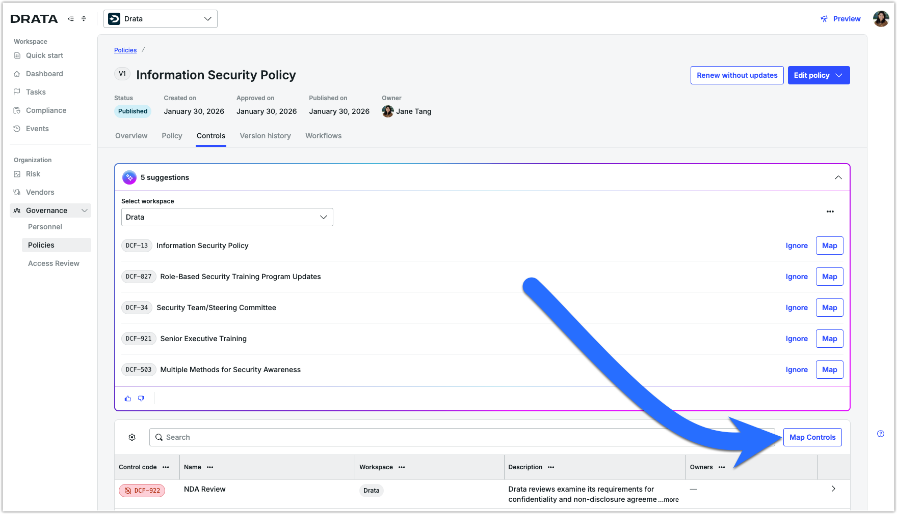
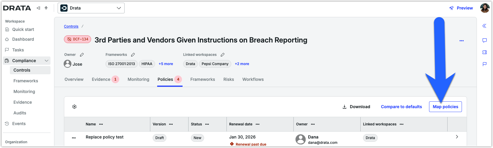

# Map policies to controls in Drata

Source: https://help.drata.com/en/articles/13557067-map-policies-to-controls-in-drata
Collection: Understand the Drata Platform › Policies
Updated: 2026-11-09
Fetched: 2026-11-22
Description: Mapping policies to controls allows Drata to evaluate control readiness and run policy-related compliance tests.

## Article text

When a policy is mapped to a control, Drata can:

- Track which policies support each control requirement
- Include policies in control readiness evaluations
- Run policy-related compliance tests where applicable

## Prerequisites

For accounts without workspaces, the following roles can map policies to controls: Admin, Information Security Lead, Policy Manager, Control Manager (Controls page only).

For workspace-enabled accounts: Admin, Information Security Lead, Workspace Manager.

## Map from the Policies page

1. Open the **Policies** page.
2. Select a policy.
3. Open the **Controls** tab.
4. Select **Map Controls**.
5. Select the controls you want to associate.

## Map from the Controls page

1. Open the **Controls** page.
2. Select the control you want to update.
3. Go to the **Policies** tab.
4. Select **Add**.
5. Choose one or more policies to map. To create a new policy during this step, select **Create a new policy**.
6. Select **Save**.

## Images

- [image 01] ../../images/ux/policies/map-policies-to-controls-in-drata--01.png
- [image 02] ../../images/ux/controls/map-policies-to-controls-in-drata--02.png

## Related articles

- [The Drata Control Framework & Requirement Relationship](the-drata-control-framework-requirement-relationship.md)
- [AI-powered control suggestions for policies](ai-powered-control-suggestions-for-policies.md)
- [Apply Default Mappings for Controls](apply-default-mappings-for-controls.md)
- [External Policy: Use BambooHR to manage your policies](external-policy-use-bamboohr-to-manage-your-policies.md)
- [Map Controls, Policies, and Evidence Across Workspaces](map-controls-policies-and-evidence-across-workspaces.md)
