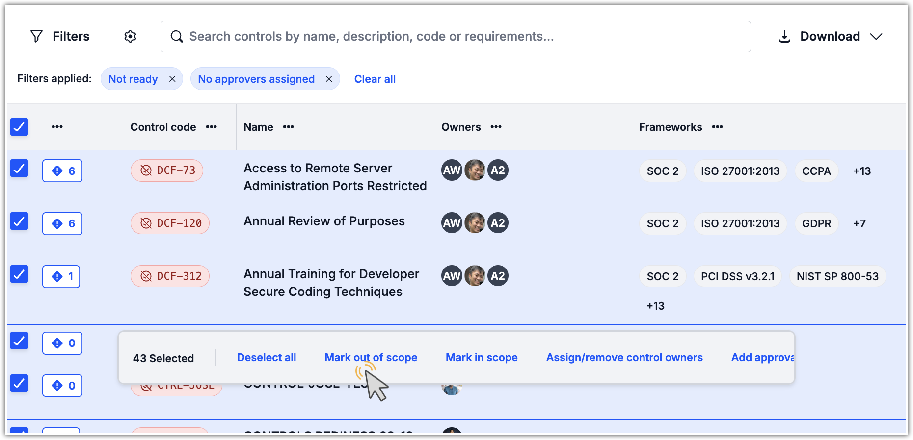

# Mark Controls In or Out of Scope

Source: https://help.drata.com/en/articles/13381764-mark-controls-in-or-out-of-scope
Collection: Understand the Drata Platform › Controls
Updated: 2026-11-09
Fetched: 2026-11-22

## Article text

Not all controls are required for every audit. Drata allows you to mark controls as **In Scope** or **Out of Scope** so your audit reflects only the controls your organization plans to use.

Marking controls out of scope helps you:

- Focus on relevant audit requirements
- Reduce noise during audit preparation
- Clearly document which controls are intentionally excluded

## Prerequisites

Only the following roles can mark controls in or out of scope:

- **Administrators**
- **Information Security Leads**

## Mark controls out of scope

To mark one or more controls as out of scope:

1. Go to the **Controls** page.
2. Select one or more controls from the list.
3. Mark the selected controls as **Out of Scope**.

The selected controls are excluded from audit scope and readiness calculations where applicable.

---

## Mark controls in scope

To mark controls back in scope:

1. Go to the **Controls** page.
2. Select one or more controls.
3. Mark the selected controls as **In Scope**.

Once marked in scope, controls are included again in audit preparation and readiness tracking.

## What to expect after changing scope

- **Out-of-scope controls** remain visible but are excluded from audit scope
- **In-scope controls** contribute to readiness and audit workflows

- **Control scope is global.**
   - When you mark a control In/Out of Scope from the Controls page, it affects all frameworks that control is mapped to
   - If the control is mapped to multiple frameworks, the scope change applies to **all** of them.
- **Framework behavior is driven by mappings and requirements.**
   - A framework’s control count and readiness are based on **in‑scope controls that are mapped to in‑scope requirements** in that framework.
   - Adding or removing a control from a framework’s requirements only affects that specific framework.

## Can I delete a control in Drata?

To ensure continuous compliance and maintain a robust audit trail, **controls cannot be deleted** in Drata's new experience.

When preparing for an audit, auditors require a complete history of your compliance posture. Deleting a control would erase historical data that might be necessary to prove past compliance. If a control is no longer relevant to your organization, or if it was created by mistake, you can mark the control as out of scope instead.

> 🎓 **Want to learn more?** Dive deeper into this topic and see it in action! Check out our dedicated Controls course over at the **[Drata Academy](https://academy.drata.com/controls-monitoring-1)**.

## Images

- [image 01] ../../images/ux/controls/mark-controls-in-or-out-of-scope--01.png

## Related articles

- [Manage Scope and Exclusions in Drata](manage-scope-and-exclusions-in-drata.md)
- [Create, Edit, and Manage Controls](create-edit-and-manage-controls.md)
- [Export Control-to-Requirement Mappings](export-control-to-requirement-mappings.md)
- [Mark personnel as Out of Scope (New Experience)](mark-personnel-as-out-of-scope-new-experience.md)
- [Marking Requirements In and Out of Scope](marking-requirements-in-and-out-of-scope.md)
