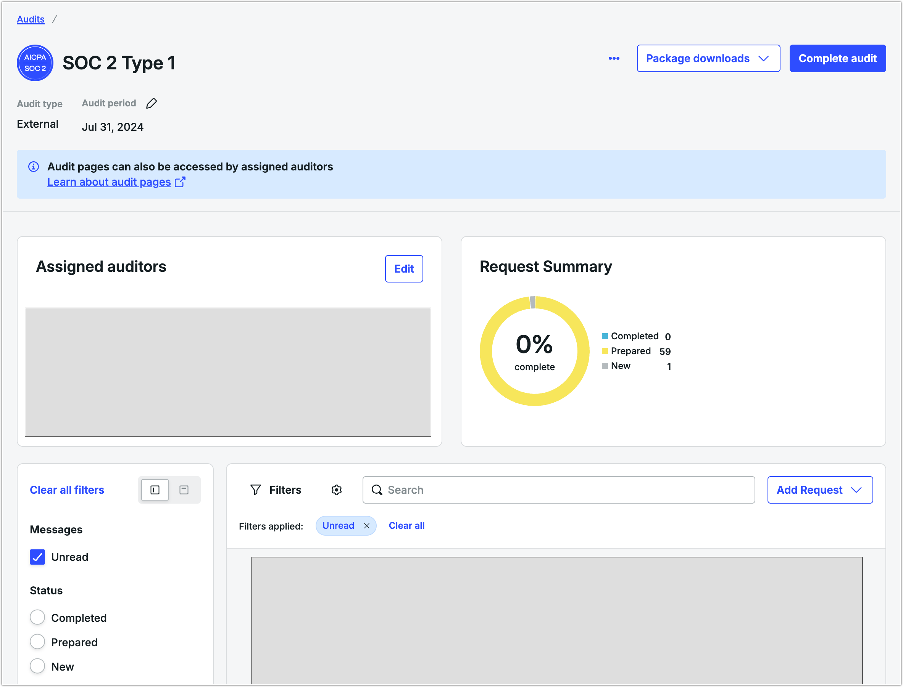

# Mark messages as read or unread in your audits (New Experience)

Source: https://help.drata.com/en/articles/13557358-mark-messages-as-read-or-unread-in-your-audits-new-experience
Collection: The Auditor Experience
Updated: 2026-11-09
Fetched: 2026-11-22

## Article text

Drata supports collaboration between customers and auditors by making audit communication visible to the entire audit team. Messages can be marked as **read** or **unread** at the team level to ensure nothing is missed during an active audit.

---

### Who can mark messages

The following roles can mark messages as read or unread for the team:

- **Auditors**
- **Admins**
- **Workspace Managers**

Other users can view messages but cannot change their read/unread status.

---

## Mark a message as read

1. Go to the **Compliance > Audits** page.
2. Select the audit you want to work on.
3. Select **Open audit**.
4. Scroll down to the table and filter by **Unread messages**.
   
5. Select a request with unread messages.
6. Select **Mark as read for team**.

Once marked:

- The unread notification is cleared for all team members.
- The message is considered reviewed at the audit level.

---

## Images

- [image 01] ../../images/ux/audits/mark-messages-as-read-or-unread-in-your-audits-new-experience--01.png

## Related articles

- [Mark personnel as Out of Scope (New Experience)](mark-personnel-as-out-of-scope-new-experience.md)
- [Using the Drata Audit Portal (New Experience)](using-the-drata-audit-portal-new-experience.md)
- [Audits page overview (New Experience)](audits-page-overview-new-experience.md)
- [Internal audits in Drata (New Experience)](internal-audits-in-drata-new-experience.md)
- [Pre-audit evidence packages in Drata (New Experience)](pre-audit-evidence-packages-in-drata-new-experience.md)
