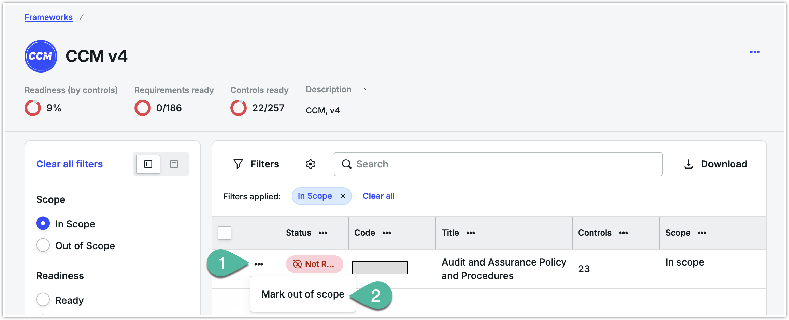
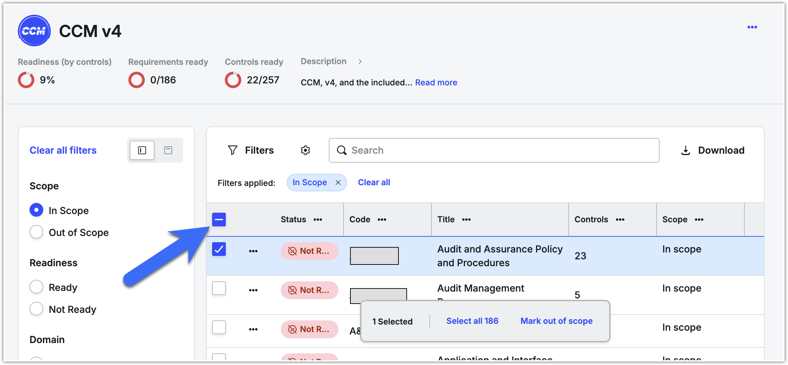
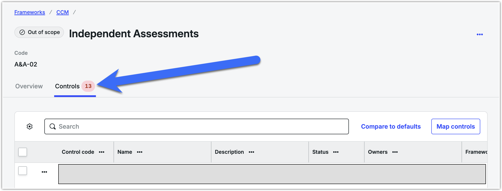

# Marking Requirements In and Out of Scope

Source: https://help.drata.com/en/articles/13765784-marking-requirements-in-and-out-of-scope
Collection: Framework Information › General
Updated: 2026-11-09
Fetched: 2026-11-22
Description: How to scope framework requirements to match your environment.

## Article text

Mark framework requirements as **In Scope** or **Out of Scope** to ensure your readiness calculations reflect only what applies to your organization. Only in-scope requirements contribute to a framework's readiness percentage.

## Prerequisites

- **Required Drata role**: Admins, Information Security Leads, or Workspace Managers with write access to Frameworks can update requirement scope. This permission allows them to modify requirements and change scope for the frameworks they manage.

## Open Framework page

1. In the left navigation, go to **Compliance > Frameworks**.
2. Select a framework to open its detail page.
3. Use the **Requirements** table to view all requirements, mapped controls, readiness status, and scope.

## Mark Requirements Out of Scope

Use this process when one or more requirements do not apply to your environment, for example, a data center requirement for a cloud-only organization.

1. Go to **Compliance > Frameworks**.
2. Select a framework and scroll to the requirements table.
3. Filter the table by **Scope: In Scope**.
4. To mark a single requirement out of scope, select the ellipsis next to the requirement.
    (links to https://downloads.intercomcdn.com/i/o/am69aeco/2083474358/f258918074daeb741d4fd490ab97/image.png?expires=1780120800&signature=421b0f8138cf8a3d99ea2bb193fffa1a03038b3b995fa6e451c1a98aeddafbfa&req=diAvFc15mYJaUfMW3nq%2BgZrVNE0al6LQ3xPu3cbGmwwkDSn9sFVRSUocVX4Z%0AOrIgKHJ9e5e6QDQxuKPk8FmIXkA%3D%0A)
5. To select multiple requirements, select the checkbox in the column header to select all requirements currently visible in the table.
    (links to https://downloads.intercomcdn.com/i/o/am69aeco/2083511375/fccb61ad127b7e5a08f4dbb7ba69/image.png?expires=1780120800&signature=b73629c06ae020b3b2289be9cd35e5f02bfa444d8ea51f9054b9e193b2ddfd66&req=diAvFcx%2FnIJYXPMW3nq%2BgVY%2BVPxs0GdtdZ36Tb%2FKjCdJ%2BAHTEkTAK%2BfIQ6yN%0AiQrJJeOumD61AM4vw6CxBOOPEpc%3D%0A)
6. Select **Mark Out of Scope**.
7. In the confirmation dialog, review the number of requirements being updated.
8. Provide a business rationale. This field is required. If multiple requirements are selected, the same rationale is applied to all of them.
9. Select **Confirm**.

Drata removes these requirements from readiness calculations and treats them as excluded for the selected framework.

### Controls Affected by Scope Changes

When you mark requirements Out of Scope, Drata evaluates controls mapped to those requirements. If a control is mapped to only one requirement and that requirement is marked **Out of Scope**, the control is automatically marked **Out of Scope**.

 (links to https://downloads.intercomcdn.com/i/o/am69aeco/2083457975/e88da25f1a52933556aea56580ae/image.png?expires=1780120800&signature=90cf4ae2dffabedcb9bd2c57e416f1731c5effefb25ca79d61ed41347cafaab2&req=diAvFc17mohYXPMW3nq%2BgTv9PqlEj9ZEsZEI3A52Y7ezXIltbeBVZG8TQ8PH%0ARAeIwgR5Ooe1pfKlxruLOTyIfMA%3D%0A)

## Mark Requirements In Scope

Use this process to include requirements in readiness calculations and treat them as applicable to your environment.

1. In the framework's **Requirements** table, filter by **Scope: Out of Scope**.
2. Select the requirements to include.
3. From the table actions, select **Mark In Scope**.
4. Confirm the change.

## How Requirement Scope Affects Framework Readiness

- Only in-scope requirements count toward a framework's readiness percentage.
- A control is considered in scope if it is mapped to at least one in-scope requirement.
- If all requirements mapped to a control are marked Out of Scope, the control is marked Out of Scope.

## Images

- [image 01] ../../images/ux/frameworks/marking-requirements-in-and-out-of-scope--01.png
- [image 02] ../../images/ux/frameworks/marking-requirements-in-and-out-of-scope--02.png
- [image 03] ../../images/ux/frameworks/marking-requirements-in-and-out-of-scope--03.png

## Related articles

- [Framework Requirements](framework-requirements.md)
- [Level Picker for Frameworks with Tiered Requirements](level-picker-for-frameworks-with-tiered-requirements.md)
- [Custom Framework](custom-framework.md)
- [Mark Controls In or Out of Scope](mark-controls-in-or-out-of-scope.md)
- [APRA CPS 230: Set Up Guidance (APRA-Regulated Entity vs. Material Service Provider)](apra-cps-230-set-up-guidance-apra-regulated-entity-vs-material-service-provider.md)
