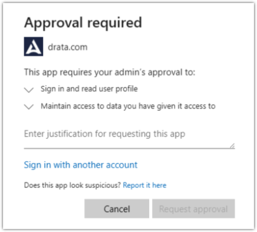
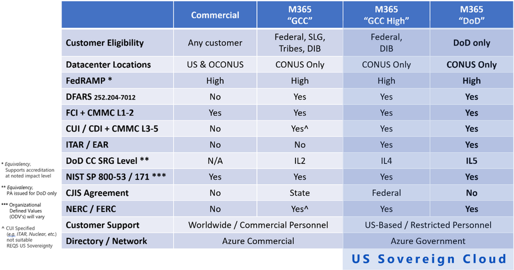

# Microsoft 365 Integration Guide

Source: https://help.drata.com/en/articles/4797766-microsoft-365-integration-guide
Collection: Connection Support › Identity (IdP) Guidance
Updated: 2026-10-23
Fetched: 2026-11-22
Description: Making the initial connection to Microsoft 365

## Article text

Connecting Microsoft 365, a type of IdP connection, to Drata enables the synchronization and provisioning of accounts for all your company's personnel. This can be the first integration you complete to ensure compliance monitoring of your personnel.

## Key Capabilities

- **Identity synchronization:** Automatically imports user accounts and group memberships from Microsoft 365.
- **Automated access monitoring:** Enables Drata to validate identity, MFA, and email uniqueness requirements.
- **Compliance readiness:** Gathers identity evidence to support access control and identity management testing.

## Prerequisites & Data Access

- **Admin Access: **
- Ensure your company’s Microsoft 365 Global Admin account’s email domain matches the domain used during the initial Drata tenant setup.
- Ensure you have access to your company's Microsoft 365 Global Admin account.
- **Domain Matching**
- If your organization uses multiple email domains, contact Drata Support to have multi-domain syncing enabled.
- **Group-based sync:**
- If syncing only specific groups, you must have one or more Microsoft 365 groups created in **Azure Entra ID**.
- You will need the **Group Object ID** for each group you want to sync.
- To find this, go to the **Azure portal → Entra ID → Groups → Select a group → Copy the Object ID**.- **Direct Membership Requirement:** Drata only syncs users who are direct members of the specified Microsoft 365 group. Nested or indirect group memberships are not recognized during the sync process.
- **Entra Security Groups Limitation:** Entra Security groups are not supported for scoping in Drata. If an Entra Security group is used, Drata will bypass the restriction and sync all users. To ensure proper scoping, always use a Microsoft 365 group.

### Permissions & Data Table

| **Permission/Scope** | **Why It’s Needed** | **Data Accessed (Read Only)** |
|---|---|---|
| Directory.Read.All | Reads directory objects for personnel sync | User and group metadata |
| Reports.Read.All | Retrieves audit and activity reports | Login and access reports |
| User.Read.All | Reads user profiles and basic information | Personnel records and identity details |
| User.Read | Reads user profiles and basic information | Personnel records and identity details |
| Policy.Read.All | Reads policy settings applied to users | Security and compliance policy configurations |
| AuditLog.Read.All | Reads audit logs for compliance events | Access and authentication activity |

## Step-by-Step Setup

### Step 1: Find Group Object ID in Azure Entra ID

To **sync only specific groups**, you’ll need the Group Object ID from Microsoft 365:

1. Go to the Azure portal.
2. Navigate to **Entra ID → Groups**.
3. Select the group you want to sync.
4. Copy the **Object ID** from the group’s overview page.
5. Paste this value into the **Only people from specific groups** field in Drata. **Note:** Drata only syncs users who are direct members of the specified group. Nested or indirect memberships are not recognized.

### Step 2: Prepare Microsoft 365

1. Ensure you are logged in as a **Global Admin** in your Microsoft 365 tenant.
2. Confirm that the **email domain** used for the Global Admin matches the one used for your Drata tenant setup.

### Step 3: Connect Microsoft 365 to Drata

1. In Drata, go to the **Connections** page
2. Search for and select Microsoft 365 within your available connections.
3. Start the connection process.
4. Choose which Microsoft 365 field Drata should use to match user accounts for sync and authentication:

- **UPN (User Principal Name):** Recommended for most organizations. Uses the directory’s unique user identifier, which is often the same as the email address.
- **Email Address:** Maps users by their primary email address. Use this when email is the preferred identity value, especially in multi-domain environments.

1. Choose which personnel to sync:

- **Everyone:** Sync all users from your Microsoft 365 directory.
- **Only people from specific groups:** Enter the **Group Object ID** for selective sync. For complex conditions, use **Microsoft’s Dynamic Groups** feature. **Note:** Drata only syncs users who are direct members of the specified group. Nested or indirect memberships are not recognized.

1. Drata will prompt you to authenticate and grant permissions through Microsoft Graph.

**When editing group scope on your Microsoft 365 Identity connection:**

- Include your Drata administrator in the selected group(s) — otherwise you risk losing admin access to Drata.
- Users not included in the selected group(s) will not sync to Drata.
- If personnel are already synced via this connection, removing a user from the group(s) can move them to Former Employee status.- Changing the group associated with Drata will trigger a re-evaluation of user membership during the next sync. Users who are not direct members of the new group will be marked as former users.
- Avoid using Entra Security groups for scoping, as Drata will bypass restrictions and sync all users. Always use a Microsoft 365 group for proper scoping.

### Step 4: Review Required Permissions

Drata will create the Enterprise Application in your Microsoft environment upon authenticating with the following scopes and permissions. Ensure you have the Microsoft Global Admin role and are a Drata Admin.

When connecting, Drata requests the following **read-only Microsoft Graph scopes**:

- `Directory.Read.All`
- `Reports.Read.All`
- `User.Read.All`
- `Policy.Read.All`
- `AuditLog.Read.All`

These scopes provide the necessary read-access for user synchronization and compliance evidence collection without granting write or modification capabilities.

## Update Identity Mapping After Connection

Users can now update an existing Microsoft 365 connection to change whether Drata syncs identities using **UPN** or **Email Address** directly from the Drata interface.

To update the identity mapping:

1. In Drata, navigate to **Connections**.
2. Select your **Microsoft 365** connection and edit the setup details.
3. Update the **User Identity Mapping** field to either **UPN** or **Email Address**.
4. Save your changes to apply the updated mapping.

## Grant Microsoft 365 Organization Consent (Required)

If personnel encounter an **“Approval required”** message when signing in, your Microsoft 365 admin must complete the organization consent step. [Refer to the Microsoft document to learn more.](https://learn.microsoft.com/en-us/entra/identity/enterprise-apps/configure-admin-consent-workflow)

If the consent screen does not appear, the admin should:

1. Log out of Drata and log back in using the same Microsoft 365 admin account, or
2. Open Drata in an incognito/private window and restart the connection flow.

This creates a **fresh Microsoft 365 session**, which ensures the “Consent on behalf of your organization” screen appears as expected. Once the consent is approved, the Microsoft 365 connection will complete successfully and users will be able to log in.

## Government Support for Microsoft 365 GCC High

**Note**: The Microsoft 365 GCC High integration supports Identity Provider sync, Authentication, and User Access Reviews (UAR), including Enterprise Applications, with the same functionality as the commercial Microsoft 365 integration.

Drata supports Microsoft 365 GCC High for your Identity Provider Connection. See image below to better understand standards for usage of the varied Microsoft 365 Identity solutions.

## Images

- [image 01] ../../images/integrations/microsoft-365/microsoft-365-integration-guide--01.png
- [image 02] ../../images/documentation/microsoft-365-integration-guide--02.png

## Related articles

- [Azure Integration Guide](azure-integration-guide.md)
- [Azure Repos (DevOps) Integration Guide](azure-repos-devops-integration-guide.md)
- [HR Cloud Integration Guide](hr-cloud-integration-guide.md)
- [Legacy: Microsoft Intune Integration Guide (Windows)](legacy-microsoft-intune-integration-guide-windows.md)
- [Microsoft Intune Integration guide](microsoft-intune-integration-guide.md)
