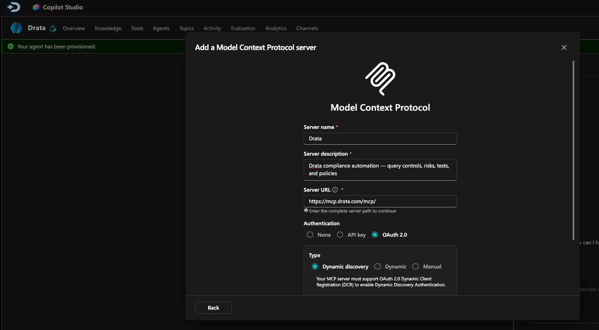

# Microsoft Copilot MCP Integration Guide

Source: https://help.drata.com/en/articles/15369685-microsoft-copilot-mcp-integration-guide
Collection: Settings
Updated: 2026-06-30
Fetched: 2026-11-22

## Article text

This guide walks you through adding the Drata MCP server to Microsoft Copilot Studio so you can query Drata directly from your Copilot agent.

## Prerequisites

- Microsoft 365 Copilot license (Copilot Studio access)
- Drata Admin role
- Drata MCP OAuth configuration already set up in **Drata → Settings → MCP Configuration** with the scopes you want to grant

## Setup Steps in Drata

1. Go to **Settings**.
2. Select **MCP Configuration**.
   - You must be an administrator in Drata to access this page.
3. **Enter a name for the OAuth configuration:** Microsoft Copilot MCP
4. **Enter a description of the configuration**: Drata MCP connector — securely connects Microsoft Copilot to your Drata workspace so users can query controls, risks, policies, monitoring tests, and frameworks in natural language, with role-scoped access enforced by OAuth.
5. Set an expiration date for the configuration: Company choice (This would require re-authentication once API keys near expiration)
6. Select the scopes you want to configure: Read Only for now, Drata will eventually expand to write capabilities and we can always adjust scope at a later date.
7. After you configure the scopes, follow the setup instructions for your specific MCP client.

Drata provides a remote hosted MCP server at:

- **US**: [https://mcp.drata.com/mcp/](https://mcp.drata.com/mcp/)
- **EU**: [https://mcp-euc1.drata.com/mcp/](https://mcp-euc1.drata.com/mcp/)
- **APAC**: [https://mcp-apse2.drata.com/mcp/](https://mcp-apse2.drata.com/mcp/)

**⚠️ Important note**: End users can access only the intersection of the OAuth scopes you configure and the permissions granted by their assigned roles. Users cannot access anything beyond what their roles inside the application allow while using the Drata MCP.

Learn more at [MCP Configuration (New Experience](drata-mcp-setup-usage-guide.md)).

## Setup Steps in Microsoft Copilot Studio

1. Sign in to Copilot Studio at[copilotstudio.microsoft.com](https://copilotstudio.microsoft.com/).
2. Go to **Agents** and click **Create** → **Blank agent**. Name it Drata.
3. Open the agent. From the left nav, move off **Overview** to **Tools** (the third option).
4. Click **Add a tool**, then at the top of the dialog click **Add new MCP**.
5. Fill in the fields using the values from your Drata MCP configuration:
   - **Server name:** Drata
   - **Server description:** Drata compliance automation — query controls, risks, tests, and policies
   - **Server URL:** your regional Drata MCP endpoint
      - US: [https://mcp.drata.com/mcp/](https://mcp.drata.com/mcp/)
      - EU: [https://mcp-euc1.drata.com/mcp/](https://mcp-euc1.drata.com/mcp/)
      - APAC: [https://mcp-apse2.drata.com/mcp/](https://mcp-apse2.drata.com/mcp/)
6. Under **Authentication**, select **OAuth 2.0**. Leave **Dynamic discovery** selected as the Type.
7. Click **Create**.
8. Sign in to Drata when prompted to authorize the connection.

Done! Copilot Studio will automatically discover the tools and resources exposed by the Drata MCP server, and you can test the agent in the preview panel right away.

## Best Practices

- Always mention "Drata" by name in prompts so the orchestrator routes to the MCP (e.g., "Which controls are missing evidence in Drata?").
- Be specific — include framework names, time ranges, or owners when relevant.
- Users only see the intersection of the OAuth scopes you configured in Drata and the permissions of their Drata role.

## Images

- [image 01] ../../images/integrations/microsoft-copilot/microsoft-copilot-mcp-integration-guide--01.png

## Related articles

- [Microsoft 365 Integration Guide](microsoft-365-integration-guide.md)
- [Miro Integration](miro-integration.md)
- [Microsoft Defender Vulnerability Management Integration Guide](microsoft-defender-vulnerability-management-integration-guide.md)
- [Twilio Integration Guide](twilio-integration-guide.md)
- [Drata MCP — Setup & Usage Guide](drata-mcp-setup-usage-guide.md)
