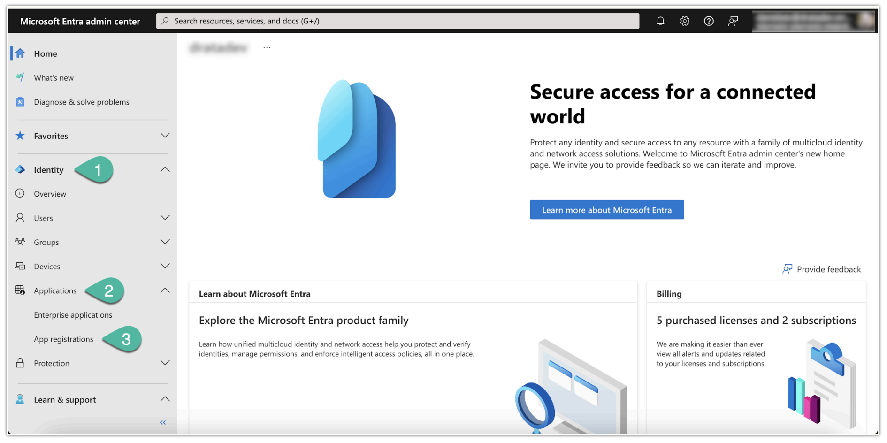
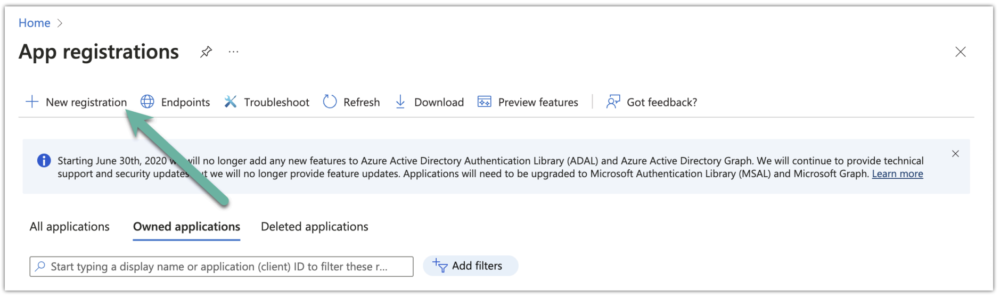
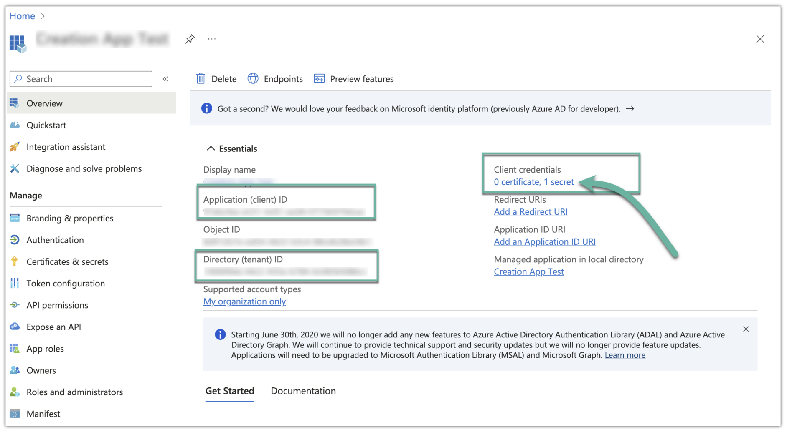
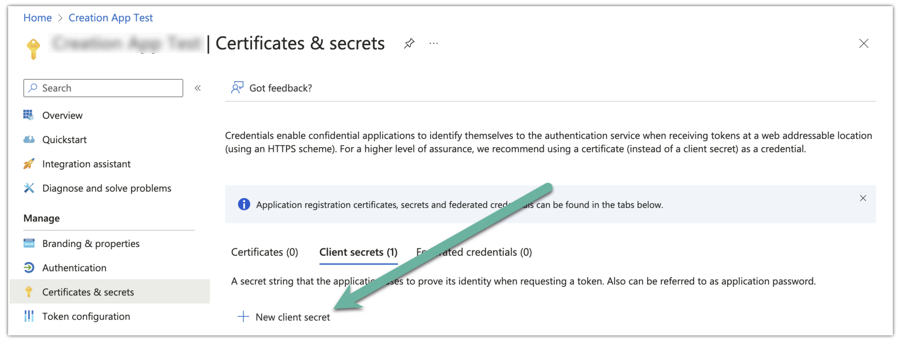
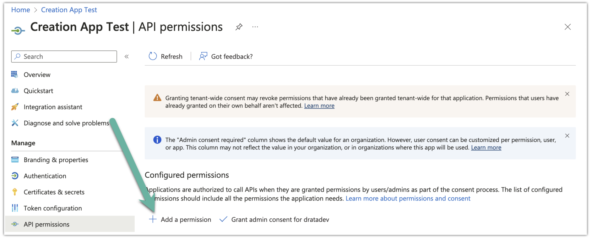
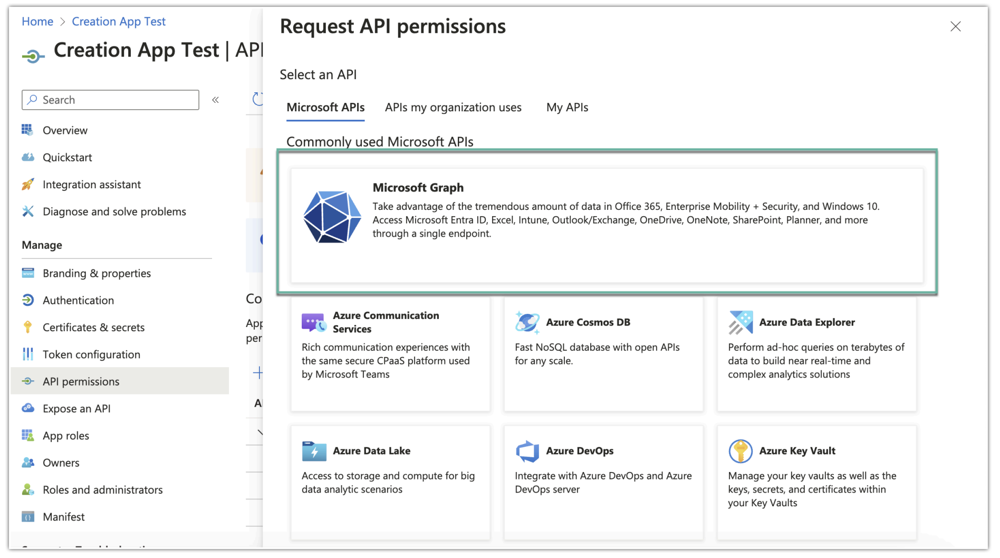
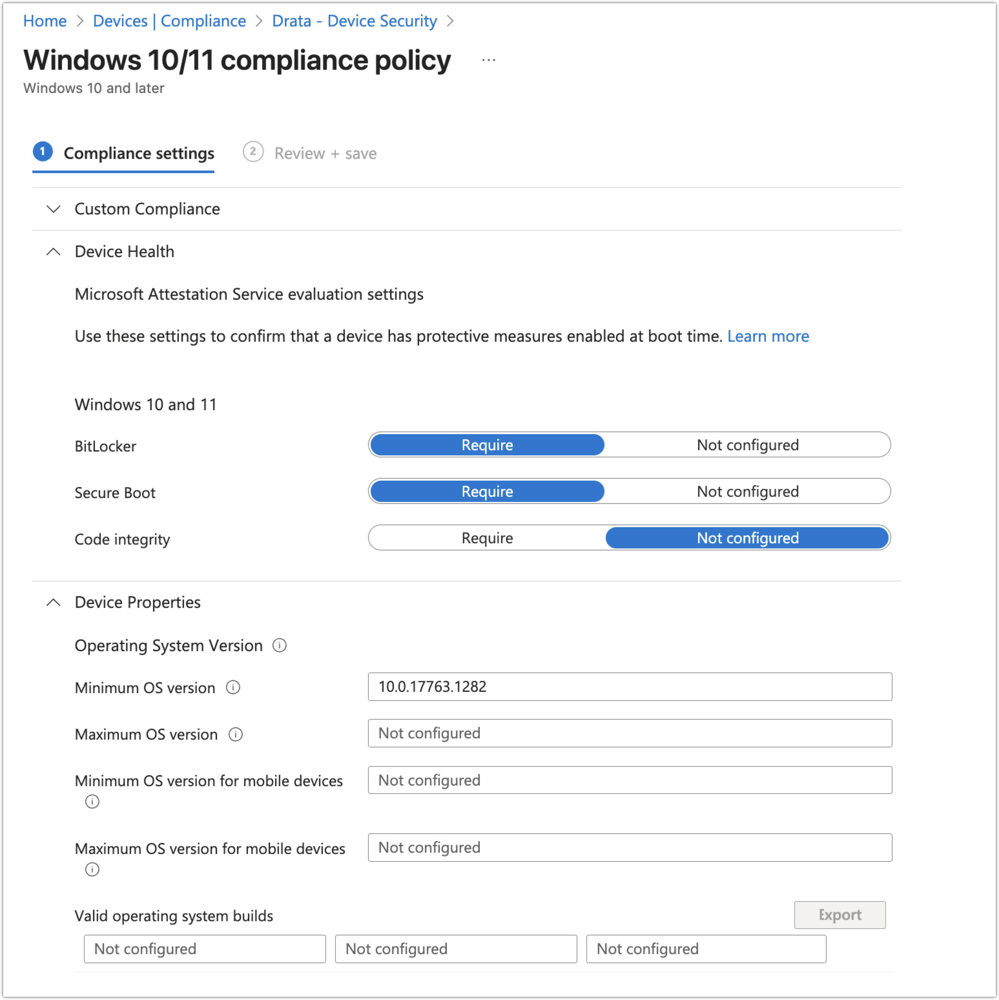
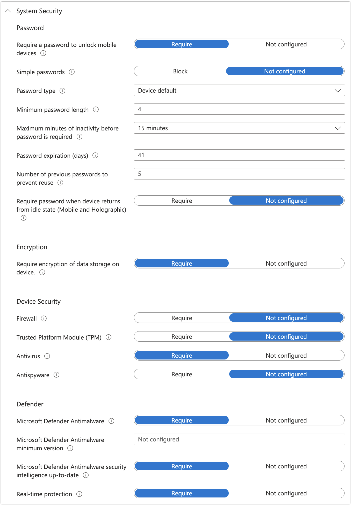
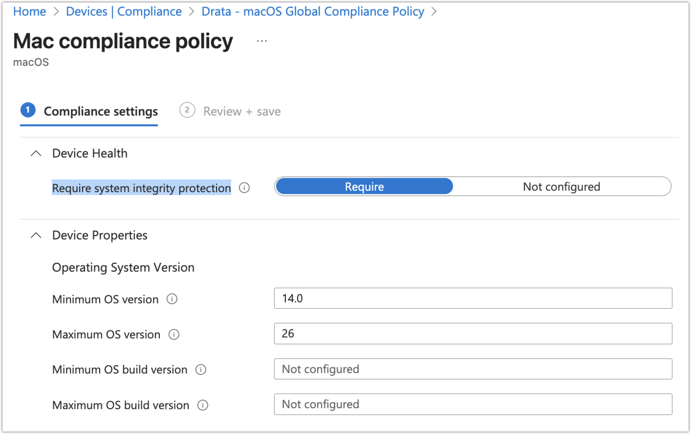
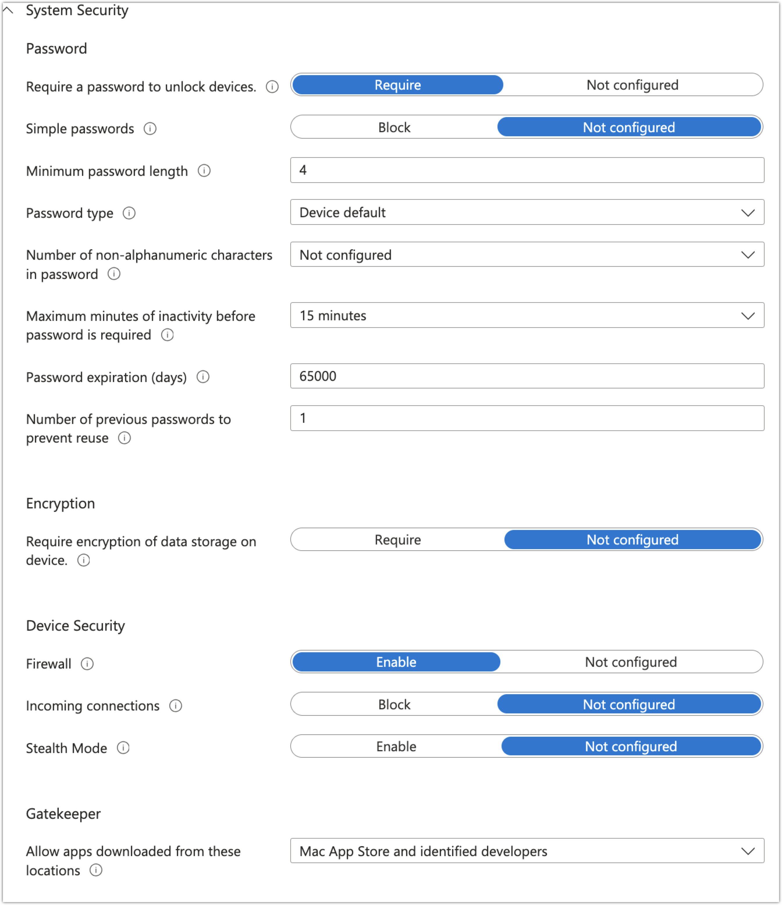

# Microsoft Intune Integration guide

Source: https://help.drata.com/en/articles/16190016-microsoft-intune-integration-guide
Collection: Connection Support › Other Guidance
Updated: 2026-11-11
Fetched: 2026-11-22
Description: Use this guide to connect Microsoft Intune to Drata so Drata can evaluate device compliance for supported policy checks.

## Article text

> This guide reflects the updated Intune connection flow introduced on May 27 and is intended for customers setting up the integration using the current experience. Discovered Apps are not supported with the new Intune integration. Managed Apps and policy selection are the supported alternative for monitoring app deployment.
>
> For the legacy version, refer to the [Legacy: Microsoft Intune Integration Guide (Windows)](legacy-microsoft-intune-integration-guide-windows.md) or [Legacy Microsoft Intune Integration Guide (Mac Devices).](legacy-microsoft-intune-integration-guide-mac-devices.md)

If you use multiple MDMs or also use the Drata Agent, refer to[Multiple MDM Support](multiple-mdm-support-new-experience.md).

If you are upgrading an existing Intune integration from the legacy version to the updated Intune version, certain device compliance checks may temporarily fail while you update how Intune compliance policies are being configured and evaluated across your device fleet.

Furthermore, results may vary from the legacy connection because the updated Intune version evaluates specific per-device settings rather than solely verifying policy deployment. Complete Steps 2 and 3 below to ensure proper configuration and accurate compliance reporting.

## Prerequisites

- **IdP Connection required:** An identity provider (IdP) connection with personnel records in Drata is required so Intune device compliance can be matched to users.
- **Microsoft Account requirement:**You need a Global Administrator account in Microsoft Entra ID or Intune.
- Devices must already be enrolled in and managed by Intune in the tenant you plan to connect.
- This guide covers both macOS and Windows devices, as they are the only supported platforms for this integration.
- Intune must be configured to be the MDM for the devices you want Drata to monitor. Microsoft Entra can list devices that are not managed by Intune.
- Each device must have a primary user in Intune, and that user's UPN or email must match the personnel record in Drata.
- Each device must have a unique serial number.

Additional Notes:

- After initial setup or policy changes, Intune may take several days to fully deploy new policies across devices.
- Drata reflects compliance only after Intune evaluates the relevant device and user as compliant.
- Review Microsoft’s documented[limitations for Windows virtual machines in Intune](https://learn.microsoft.com/en-us/intune/intune-service/fundamentals/windows-10-virtual-machines), especially if you manage non-persistent or cloned virtual desktops.
- If the Drata Agent is also installed on a device, the Drata Agent takes precedence over Intune for that device, and results can differ between the two sources. See [Multiple MDM Support](https://help.drata.com/en/articles/5990364-multiple-mdm-support).

## What you will set up

1. Create an Intune OAuth app on Entra ID and obtain the app’s Application ID (client ID), Tenant ID, and app secret.
2. Grant permissions to the app.
3. Create compliance policies within Intune for devices in scope to assess Autoupdates, Lock Screen, Firewall, Disk Encryption, and Antivirus compliance.
4. Connect your Intune instance to Drata.

## Step 1: Create an Intune OAuth app on Entra ID

1. Sign in to the[Microsoft Entra admin center](https://entra.microsoft.com/).
2. Go to** Identity > Applications > App registrations.**
   
3. Select **New registration**.
   
4. Enter the following values:
   - **Name:** Drata - Intune App
   - **Supported account types:** Accounts in this organizational directory only (single tenant)
5. Select **Register**.
6. On the app overview page, copy the following values:
   - Application (client) ID
   - Directory (tenant) ID
7. Select **Add a certificate or secret **or **<#> certificate, <#> secret**.
   
8. Select **New client secret**.
   
   - Enter a description.
   - Set **Expires** to **24 months**.
   - Select **Add**.
9. Copy the **Value** of the secret and save it somewhere secure. This will be the only time you can copy this secret key.

After creating the secret, **refresh the Certificates & secrets page** before using it. Microsoft can leave the new secret in a pending state until the page is refreshed.

Drata does not currently send a notification when this secret is nearing expiration. Track and rotate it before it expires to avoid a broken connection.

**Expected outcome:** At the end of this section, you should have the following values

- Application (client) ID
- Directory (tenant) ID
- Client secret

In Step 4, you will enter these values into Drata.

## Step 2: Grant permissions to the app

Drata uses Microsoft Graph **application** permissions for this integration.

1. In the app registration, open **API permissions**.
2. Select **Add a permission**.
   
3. Select **Microsoft Graph**.
   
4. Select **Application permissions**.
5. Add these permissions:
   - DeviceManagementManagedDevices.Read.All
   - DeviceManagementConfiguration.Read.All
   - DeviceManagementApps.Read.All if you plan to use the password manager install check
6. Select **Add permissions**.
7. Select **Grant admin consent**.
8. Confirm the permissions show as **Granted**.

Permissions Note:

These permissions are all that the current integration requires. If your app registration was set up for the legacy connection, it might also include User.Read.All and DeviceManagementScripts.Read.All.

After successfully migrating to the new Intune integration, you can remove the **User.Read.All** and **DeviceManagementScripts.Read.All** permissions from your Microsoft Entra app registration, as they are not required by the connection.

## Step 3: Create compliance policies

**Understand what Drata validates**

The Intune integration does not enforce device settings. For compliance policies, it checks whether Intune has already evaluated the relevant device and user as compliant. For the configuration-policy checks described later in this guide — password manager, and the macOS screen lock exception — Drata reads the policy's own settings directly, rather than relying on an Intune compliance verdict.

If you already have compliance policies that evaluate the required settings, you do not need to create new policies just for Drata.

**Policies per operating system**

You can implement one or multiple compliance policies for each operating system, provided all settings evaluated by Drata are properly configured and assigned. A device passes a check when Intune reports the corresponding setting as compliant for both the device and user. Note that a device displayed as compliant in the Intune summary view may still fail in Drata if a specific required setting is unconfigured, unassigned, or pending application.

### Supported checks

| **Drata test** | **What Intune should evaluate** |
|---|---|
| Test 61: User Screen Lock | Password required to unlock the device and maximum inactivity timeout |
| Test 63: Password Manager | Approved password manager installed through Managed Apps or validated through a configuration policy. For more information, refer to [Managed Apps & Configuration Policies section](#h_96803dba33). |
| Test 64: Antivirus | Antivirus-related compliance through Windows Defender, another Intune-supported antivirus setting, or Managed Apps where applicable. For more information, refer to [Managed Apps & Configuration Policies section](#h_96803dba33). |
| Test 65: Automatic Updates | Minimum OS version requirement |
| Test 66: Encryption | Windows Only: BitLocker on Windows or device encryption settings supported by Intune On macOS, Test 66 passes when Intune reports that the disk is encrypted with FileVault. |

### Create or edit a compliance policy in Intune

1. Sign in to the[Microsoft Intune admin center](https://intune.microsoft.com/).
2. Go to **Devices**.
3. Select **Compliance** under **Managed devices**.
4. Do one of the following:
   - To create a new policy, select **Create Policy**.
   - To edit an existing policy, open the policy and select **Properties** > **Edit** under **Compliance settings**.
5. For a new Windows policy:
   - Select **Platform**: Windows 10 and later
   - Select **Profile type**: Windows 10/11 compliance policy
   - Create and give it a name you desire, then click “Continue”
   - Continue in Windows Policy Setting section.
6. For a new macOS policy:
   - Select **Platform**: macOS
   - Create and give it a name you desire, then click “Continue”
   - Continue in MacOS Policy Setting section.
7. Assign the policy
   - Once configured, assign the policy to your in-scope users or devices.
   - Drata assesses compliance results from Intune—including policies assigned via Intune groups—though it does not currently display or independently validate the specific user or device group responsible for policy application.

### Windows Policy Setting

Configure the following settings for Windows devices as needed by your compliance program.

#### Device Health

- Set **BitLocker** to **Require** if you use BitLocker.
- If you do not use BitLocker, configure the encryption setting under **System Security** instead.

#### Device Properties

- Set **Minimum OS version** according to your organization’s Windows standard.
- Microsoft documents valid Windows compliance version formats in[Windows compliance settings in Intune](https://learn.microsoft.com/en-us/intune/intune-service/protect/compliance-policy-create-windows#operating-system-version).

### System Security

#### Password

- Set **Require a password to unlock mobile devices** to **Require**.
- Set **Maximum minutes of inactivity before password is required** to the value defined by your organization.
- Set **Require password when device returns from idle state (Mobile and Holographic)** to **Require**.

#### Encryption

- ##### If you are not using BitLocker, set Encryption of data storage on a device to Require.

#### Device Security

- If you use Microsoft Defender, you can skip the generic **Antivirus** requirement and configure the Defender-specific settings instead.
- If you use another antivirus product supported by Intune, set **Antivirus** to **Require**.

#### Defender

- Set **Microsoft Defender Antimalware** to **Require**.
- Set **Real-time protection** to **Require**.

### MacOS Policy Setting

Configure the following settings for macOS devices as needed by your compliance program.

#### Device Health

- Set **Require system integrity protection** to **Require**.

#### Device Properties

- Set **Minimum OS version** according to your organization’s macOS standard.
- Microsoft documents the available options in[macOS device compliance settings in Intune](https://learn.microsoft.com/en-us/intune/device-security/compliance/ref-macos-settings).

### System Security

#### Password

- Set **Require a password to unlock devices** to **Require**.
- Set **Maximum minutes of inactivity before password is required** to the value defined by your organization.

> **Why a compliance policy is the preferred way to set this** 
> A compliance policy reports the result Intune already evaluated, rather than inspecting how the setting was configured. One compliance policy also covers a passcode, screensaver, or Energy Saver requirement no matter how you set it up — so you need fewer policies overall.
>
> It also sidesteps a specific trap in configuration policies: a setting can look turned on but actually mean "don't enforce this." For example, Apple uses `-1` and Microsoft uses `0`, `null`, or a blank value to mean "disabled," even though the field looks filled in. A compliance policy skips this risk entirely — it reports Intune's already-evaluated result, so you don't have to know these edge cases to set it up correctly.

> **macOS password reset warning** 
> Adding or changing this password requirement in a macOS compliance policy resets every local account password on the device, including LAPS and Platform SSO accounts. This is Microsoft's documented behavior, not a Drata setting. Assigning or unassigning the policy triggers the reset again. Removing the password rule from an existing policy triggers one final reset.
>
> If you can't accept this reset yet, see **Alternative configuration policies for macOS screen lock** below for a fallback to use until your next scheduled password change — then migrate to the compliance policy.

#### Encryption

- Set **Require encryption of data storage on device** to **Require**.

#### Gatekeeper

- Set **Allow apps downloaded from these locations** to the value approved by your organization, such as **Mac App Store and identified developers**.

## Managed Apps and configuration policies

Intune does not natively detect browser extensions. If your password manager is deployed as a browser extension, you may need to validate it through a configuration policy instead of relying on native extension detection.

For Managed Apps, Drata uses Intune reporting for the apps you select during the Intune connection setup. If Intune reports that the selected app is present for the user and device, Drata can use that result as part of the Password Manager or Antivirus check.

To add a managed app in Intune:

1. Login to Intune [https://intune.microsoft.com](https://intune.microsoft.com)
2. Go to **Apps** > **All apps**.
3. Select **Create**.
4. Configure the application.
5. Copy the App ID for the app record.
6. Assign the app to the users and devices in scope.

For more information, refer to [Intune Manage Apps](https://learn.microsoft.com/en-us/intune/intune-service/fundamentals/manage-apps).

> **Test 64: Antivirus**
>
> In addition to the settings above, Test 64: Antivirus may be configured to pass based on a Managed Apps installation instead. This is helpful when the built-in antivirus policy settings listed in Step 3: Create compliance policies above aren't compatible with your compliance needs. If you're using an EDR integration for antivirus, don't select an Antivirus app — if none is selected, the system uses the settings described above or the appropriate EDR integration.

> **Test 63: Password Manager**
>
> The password manager test confirms whether approved business software is installed. These checks are provided by either a Managed App deployed via Intune or a configuration policy. For example, if you're using a browser extension for password manager without a corresponding desktop application, either a managed app bundle or a configuration policy check is required.
>
> A selected configuration policy counts toward this check if it force-installs a browser extension or turns on the browser's built-in password manager. This currently works for Edge or Chrome on Windows only — Safari and Edge on macOS can't be evaluated yet due to an Intune limitation. If you selected a configuration policy for this check before this change, it continues to count.
>
> Browser-specific extension deployment can vary by browser and vendor, so this guide doesn't include those steps — use your browser or vendor's own documentation (for example, Google's guide to deploying Chrome extensions with Intune).

## Alternative configuration policies for macOS screen lock

If your organization can't apply the macOS compliance password rule yet, select a macOS Settings Catalog policy under Alternative configuration policies instead. Use this only as a bridge until your next natural password reset, then migrate to the compliance policy — it isn't a supported permanent setup.

To configure these settings, go to Devices > Manage devices > Configuration > Create > New policy, select macOS as the platform and Settings catalog as the profile type.

A macOS device passes the screen lock check when a selected policy, or combination of selected policies, sets:

- Password required: Screen Saver "Ask For Password" set to True (Settings catalog > System Configuration > Screensaver), **and**
- An idle trigger, either:
   - Screen Saver User "Idle Time" (Settings catalog > User Experience > Screensaver User), or
   - Energy Saver "Display Sleep Timer" set on both battery and power adapter (Settings catalog > System Configuration > Energy Saver; neither set to Never)

Or, independently of the above:

- Declarative Device Management (DDM) Passcode "Automatic Device Lock" (Settings catalog > Declarative Device Management (DDM) > Passcode > Automatic Device Lock) on its own passes the check — the device locks after the configured idle time and requires a password.

These settings can live in one policy or be split across several selected policies. There's no minimum or maximum time threshold — Drata checks that the setting is present, not its value. Login Window Idle Time and Module Name don't count toward this check. Ask For Password Delay is recorded but never decides pass or fail. The older (non-DDM) Passcode payload isn't supported.

**Known Intune limitation**: Intune can report a policy as Succeeded even when one of its settings failed to apply on the device. If a device isn't passing as expected, confirm the setting actually applied, not just the policy status.

**Test 63: Password Manager: ** A selected configuration policy satisfies this check if it enforces the installation of a supported browser extension or enables the browser's built-in password manager. This detection method is supported exclusively for Chrome and Edge on Windows devices (Safari and Edge on macOS are not supported due to Intune platform limitations).

## Step 4: Connect your Intune instance to Drata.

After your policies are configured or confirmed, connect the Intune tenant in Drata.

If you are connecting a brand-new Intune tenant, configure the relevant Intune policies. If you connect before configuring the policies, related checks can show as failing in Drata until setup is complete.

**Note**: Only one connection per Tenant ID can be configured at a time.

1. In Drata, go to **Connections**.
2. Search for and select **Connect** on the **Intune** or **Intune GCC High** integration.
3. Enter the values that you obtained when you created the Intune OAuth app:
   - Tenant ID
   - Application ID
   - Application Secret
4. Select Next to go to the Scope step, even if you don't plan to select anything there.

The Scope step has three optional pickers:

- **Managed Apps** — search for and select the apps you want Drata to use for the Password Manager or Antivirus check.
- **Password manager apps (optional):** choose the Managed App(s) that should count as a passing result for Test 63: Password Manager.
- **Antivirus apps (optional):** choose the Managed App(s) that should count as a passing result for Test 64: Antivirus.
- **Browser extension and alternate macOS screen lock policies**: Drata prefers Intune compliance policies for these checks. Use this section only for cases compliance policies and Managed Apps can't cover:
   - Select every applicable Settings Catalog policies entry.
   - On any platform, a selected policy counts for Test 63: Password Manager if it force-installs a browser extension or turns on the browser's built-in password manager (Edge or Chrome on Windows only; Safari and Edge on macOS can't be evaluated yet).
   - On macOS only, a selected policy also counts for screen lock if it meets the settings in Alternative configuration policies for macOS screen lock, above.

Select Save.

**Scope Antivirus & Password Manager tests to additional checks:**

Select the appropriate app from the list of managed apps available on your Intune connection. Choose the app entries that match the applications and versions you want Drata to treat as a passing result.

1. **Test 63: Password Manager**: Select the managed app(s) appropriate in the “Password manager apps (optional)” dropdown
2. **Test 64: Antivirus: **Select the managed app(s) appropriate in the “Antivirus apps (optional)” dropdown
3. **(Configuration Policy) Test 63: Password Manager: **Select the configuration policy name that is set up to apply the browser extension or other mechanism for password management check. (Be sure to select all policies that indicate a passing result.)
4. ** Select Alternative Configuration Policies: **If **Alternative Configuration Policies **are available and used for Password Manager or macOS Screen Lock, select the applicable policies. Use selector tags to differentiate similarly named policies. Verify that the selected policies are assigned to in-scope devices, then select Next to save your selections and complete the connection.
5. ** Choose how devices are linked to people: **On the Intune connection settings page (**Connections > Intune > Edit**), you can configure the **User Identity Mapping** preference to specify whether Drata matches Intune devices to personnel using their **Email Address** or **UPN**. Drata attempts to match using your primary selection first and falls back to the secondary attribute if no match is found. The default mapping method is Email Address.
   If devices are unlinked or mapped to the wrong individual, verify this mapping configuration along with the device's primary user assignment in Intune. If mapping issues persist after updating these settings, contact Drata Support for assistance.

**Important:** If you use a configuration policy for Test 63, the policy itself is responsible for enforcing the correct password manager settings. Drata does not validate the policy contents. It only checks whether the configuration policy was successfully applied to the device.

## Configure Intune in Drata for employee onboarding

This prevents the Drata Agent from appearing as the default onboarding method in My Drata.

1. In Drata, go to **Settings** > **Personnel Compliance.**
2. Select the** Internal Security tab**.
3. Turn **Automated via Intune MDM **on.
4. Turn **Automated via Drata Agent** off.

## Troubleshooting

| Before modifying your connection, verify that the device is enrolled in the connected tenant, assigned the correct primary user, and associated with the appropriate operating system compliance policy, and confirm that Intune has evaluated the relevant setting. |
|---|

| **Symptom** | **What to Check** | **Recommended Action** |
|---|---|---|
| No Intune devices appear in Drata | Tenant ID, device enrollment status, application API permissions, and admin consent status. | Verify that target devices are managed within the connected tenant and that all required permissions show as Granted in Microsoft Entra ID. Contact Drata Support before disconnecting or reconnecting an active integration. |
| Connection fails or device data stops updating | Client secret expiration date and active API permissions. | Generate a new client secret in your Entra app registration, refresh the Certificates & secrets page, copy the secret Value, and update the integration credentials in Drata. **[Confirm credential update steps for current flow]** |
| Device displays as "Unknown" or compliance details show as "missing" | Primary user assignment in Intune, UPN/email alignment with Drata personnel records, and serial number uniqueness. | Assign a primary user in Intune, ensure unique serial numbers across devices, or mark unassigned devices out of scope in Drata. |
| Device linked to wrong person or unlinked | Assigned primary user in Intune and User Identity Mapping configuration in Drata. | Update the primary user assignment in Intune to the active employee and verify the UPN or Email mapping preference on the Drata Connection page. |
| Multiple compliance checks fail immediately after initial setup or migration | Compliance policy configuration and assignment status in Intune. | Ensure operating system compliance policies are properly created, assigned to in-scope devices, and fully evaluated by Intune. |
| Device compliance status changed from passing to failing after upgrading to V2 | Specific per-setting evaluation results in Intune for failing tests. | Review per-setting compliance details in Intune rather than overall status, as V2 evaluates individual settings directly. Align policy settings with Step 3 of this guide. |
| Device displays as compliant in Intune but fails compliance checks in Drata | Individual setting evaluation status for the specific failing check. | Inspect the specific setting in Intune to confirm it is configured, assigned, and reported as compliant. Contact Drata Support if the issue persists after re-evaluation. |
| Password Manager test fails to detect installed application | Managed App or Configuration Policy assignment, DeviceManagementApps.Read.All permission, and operating system compatibility. | Deploy via Managed Apps or an assigned Configuration Policy. Verify that DeviceManagementApps.Read.All permission is granted. Policy-based detection is supported on Windows (Chrome/Edge) only. |
| macOS Screen Lock check fails | Alternative Configuration Policy availability, policy settings (screen saver password and idle timer/Automatic Device Lock), and selection saving. | Confirm the selected Configuration Policy enforces a screen saver password and idle timeout or Automatic Device Lock, is assigned to target devices, and was saved by selecting Next. |
| Recent policy updates in Intune are not reflecting in Drata | Latest device check-in and policy evaluation timestamp in Intune. | Initiate a manual Sync via Devices > All devices > Bulk device actions in Intune, then allow time for the next scheduled Drata sync. |
| Unwanted devices are being evaluated by Drata | Device status in Intune and personnel association in Drata. | Drata imports active devices assigned to active personnel in the connected tenant. In Drata, go to the **Assets** page and unlink the unwanted device(s) |

## When to contact Drata Support 

If a device meets all configuration prerequisites—it is enrolled in the connected tenant, assigned the appropriate policy, and mapped to the correct user—yet continues to display unexpected compliance results, contact Drata Support.

To expedite resolution, provide the following details (ensuring sensitive data is removed):

- **Device & Check Details: **Operating system and the specific failing Drata check.
- **Intune Status: **Overall compliance status and most recent check-in timestamp.
- **Per-Setting Evaluation: **Detailed per-setting breakdown for the failing check rather than just the top-level summary.
- **Policy Configuration: **Policy name, configured settings, assignment scope, and current deployment status.
- **App & Configuration Scopes: **Selected Managed Apps or configuration policies along with any applied tags, if applicable.
- **User Mapping: **Assigned primary user and UPN, if troubleshooting missing or incorrect user linkages.
- **Timeline & Comparison: **When the issue began and details for a comparable passing device, if available.
- **Visual Evidence: **Screenshots illustrating results in both Microsoft Intune and Drata.

**Security Note: **Never include client secrets, access tokens, or credentials in your request. If an active audit is underway, notify Support so they can assist with temporary manual evidence collection during the investigation.

## Images

- [image 01] ../../images/integrations/intune/microsoft-intune-integration-guide--01.png
- [image 02] ../../images/integrations/intune/microsoft-intune-integration-guide--02.png
- [image 03] ../../images/integrations/intune/microsoft-intune-integration-guide--03.png
- [image 04] ../../images/integrations/intune/microsoft-intune-integration-guide--04.png
- [image 05] ../../images/integrations/intune/microsoft-intune-integration-guide--05.png
- [image 06] ../../images/integrations/intune/microsoft-intune-integration-guide--06.png
- [image 07] ../../images/integrations/intune/microsoft-intune-integration-guide--07.png
- [image 08] ../../images/integrations/intune/microsoft-intune-integration-guide--08.png
- [image 09] ../../images/integrations/intune/microsoft-intune-integration-guide--09.png
- [image 10] ../../images/integrations/intune/microsoft-intune-integration-guide--10.png

## Related articles

- [Legacy: Microsoft Intune Integration Guide (Windows)](legacy-microsoft-intune-integration-guide-windows.md)
- [JumpCloud Integration Guide (MDM)](jumpcloud-integration-guide-mdm.md)
- [Legacy: Microsoft Intune Integration Guide (Mac Devices)](legacy-microsoft-intune-integration-guide-mac-devices.md)
- [Hexnode UEM (macOS) Integration Guide](hexnode-uem-macos-integration-guide.md)
- [Hexnode UEM (Windows) Integration Guide](hexnode-uem-windows-integration-guide.md)
