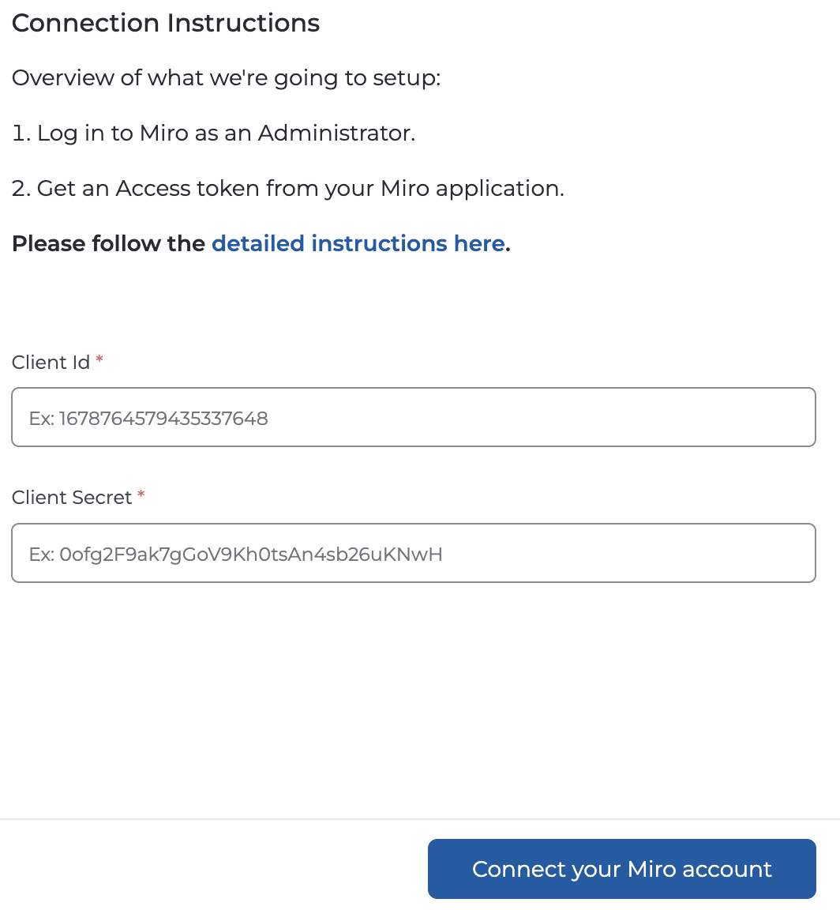

# Miro Integration

Source: https://help.drata.com/en/articles/8987864-miro-integration
Collection: Connection Support › Other Guidance
Updated: 2026-07-01
Fetched: 2026-11-22
Description: User Access Review connection: Connect Miro to Drata to review the list of users with access to Miro in your organization.

## Article text

Connect Miro to Drata in order to review the list of users with access to Miro in your organization. Get ahead of any permissions issues and stay on top of your user access reviews.

## Prerequisites & Data Access

- The required API permissions (`organizations:read` and `organizations:teams:read`) are available **for Miro Enterprise plans only**.
- Create a Miro app.
- You must have **Admin access** to your company’s Miro account.
- You can verify your role in Miro at: `https://miro.com/app/settings/company/{companyId}/users`. To learn more about configuring Miro roles, go to [Roles in Miro](https://help.miro.com/hc/en-us/articles/360017571194-Roles-in-Miro#h_01H93C2C75JDM7WJ4F9G26A7XW).
- Must be assigned one of the following Drata roles: **Admin, Workspace Managers, DevOps Engineer**.
- If you have the **Access Reviewer** Drata role, you can only view the Connections page.

### Permissions & Data Table

| Permission / Scope | Why It’s Needed | Data Accessed (Read Only) |
|---|---|---|
| `organizations:read` | Allows Drata to read Miro organization metadata and members | Organization info, users associated with the org |
| `organizations:teams:read` | Allows Drata to read teams within the Miro organization | Team membership and team-level access relationships |
| Client ID / Client Secret (Miro app) | Used by Drata to authenticate via OAuth and access Miro APIs | OAuth tokens enabling read access with the scopes above |

## Step-by-Step Setup

### Step 1: Verify Your Miro Role

1. Log in to **Miro**.
2. Go to:
   `https://miro.com/app/settings/company/{companyId}/users`
3. Confirm that your user has **Admin** (or relevant admin-level) access to the company account.

**Expected outcome:** You’ve confirmed you have the correct permissions to configure the integration.

### Step 2: Create a Miro Application and Get Client ID & Secret

1. In Miro, create a new **application** (custom app).
2. During app configuration:
   - Set the **OAuth redirect URL** to:
      `https://app.drata.com/callback/miro`
   - Enable the following scopes:
      - `organizations:read`
      - `organizations:teams:read`
3. After creating the app, copy:
   - **Client ID**
   - **Client Secret**
4. Store these values securely; you will enter them into Drata.

Learn more at:

- [Create an application on Miro](https://developers.miro.com/docs/rest-api-build-your-first-hello-world-app)
- [‘Step 3: install your app’ step](https://developers.miro.com/docs/rest-api-build-your-first-hello-world-app#step-3-install-the-app)

**Expected outcome:** You have a Miro app configured with the correct scopes and have your Client ID and Client Secret ready.

### Step 3: Connect Miro in Drata

1. In Drata, go to **Connections** from the side navigation menu.
2. Open the **Available Connections** tab.
3. Either:
   - Filter by **User Access Review**, or
   - Search for **Miro** using the search bar.
4. Select **Connect** on the Miro connection card.

The following image displays the connection drawer’s instructions.

## Partner Offers & Discounts

Drata has a direct partnership and discounted pricing **first time and new customers** of Miro. Get $1000 off your first Miro contract by visiting [https://miro.com/startups/partner/apply/?vcode=893-564-Drata](https://miro.com/startups/partner/apply/?vcode=893-564-Drata)

Check out [more partner offers and discounts](https://drata.com/partner/find/tech-directory?collections=partner-discountoffers,partner-offers-discounts-pod).

## Images

- [image 01] ../../images/integrations/miro/miro-integration--01.png

## Related articles

- [Snowflake Integration Guide](snowflake-integration-guide.md)
- [HubSpot Integration Guide (UAR)](hubspot-integration-guide-uar.md)
- [Xero Integration Guide (UAR)](xero-integration-guide-uar.md)
- [RingCentral Integration Guide](ringcentral-integration-guide.md)
- [Box Integration Guide](box-integration-guide.md)
