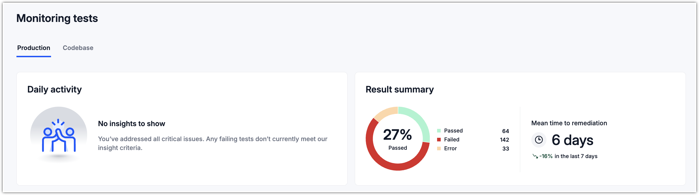
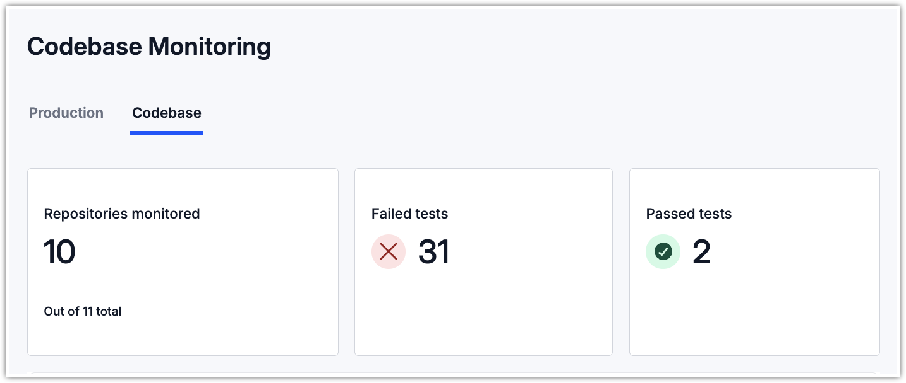
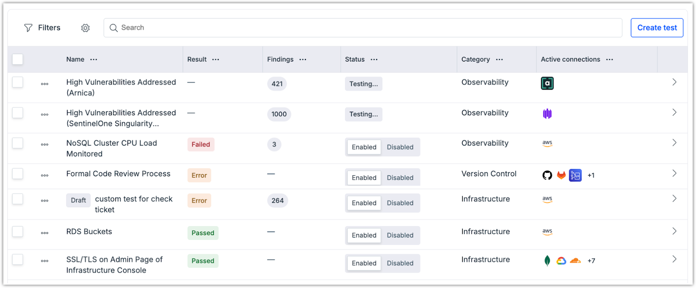
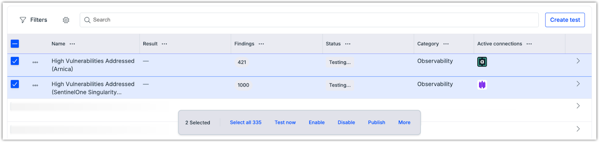

# Monitoring Overview

Source: https://help.drata.com/en/articles/13391811-monitoring-overview
Collection: Understand the Drata Platform › Monitoring
Updated: 2026-11-09
Fetched: 2026-11-22
Description: Learn how to use Monitoring in Drata to review test results and maintain continuous audit readiness.

## Article text

Monitoring helps you review test results and maintain audit readiness across frameworks such as SOC 2, ISO 27001, and HIPAA. It provides visibility into the status of every test in your workspace so you can track readiness and take corrective action when needed.

## Mapped vs unmapped tests

Each test in Monitoring can be either **mapped** or **unmapped** to a control.

**Mapped tests**

Tests that are connected to one or more controls. Their results impact control readiness and any frameworks linked to those controls.

Example: An MFA test mapped to SOC 2 CC6.1. If the test fails, the control is not ready and your SOC 2 readiness score reflects the gap.

**Unmapped tests**

Tests that are not connected to any control. Their results do not affect readiness scores but still provide visibility into risk areas you may want to map later.

## Prerequisites

Must have one of the following Drata RBAC roles:

- Admins
- Information Security Leads
- Workspace Managers
- Control Managers
- DevOps Engineers

Users with these roles may be assigned **read-only** access by an admin. If you have read-only access, you can view Monitoring data but cannot make changes.

## Navigate to Monitoring

From the main navigation, go to: **Compliance → Monitoring**

The Monitoring page has two tabs: Production and Codebase.

### Production vs Codebase

The Monitoring page has two tabs that show different compliance tests in your workspace.

| **Tab** | **Description** |
|---|---|
| **Production** | Shows tests that run against your connected business systems. These often include identity providers (Okta, Azure AD), cloud infrastructure (AWS, GCP, Azure), security tools, and HR platforms. |
| **Codebase** | Shows compliance tests that scan connected code repositories using infrastructure-as-code (IaC) analysis. These detect misconfigurations, missing guardrails, and policy violations early in development. |

### Monitoring summary (Production)

At the top of the Production tab, a summary of test results across your connected systems is displayed. Draft tests (tests that are not published) are not included in these metrics.

| **Metric** | **Description** |
|---|---|
| **% of tests passed** | Percentage of tests that passed their last run |
| **Passed tests** | Tests currently compliant |
| **Failed tests** | Tests that require remediation |
| **Error tests** | Tests that could not complete their run |

### Monitoring summary (Codebase)

The **Codebase** tab displays security and compliance test results from your connected code repositories.

| **Metric** | **Description** |
|---|---|
| **Repositories monitored** | Number of connected repositories being scanned |
| **Failed tests** | Number of code-level tests that failed |
| **Passed tests** | Number of successful tests |

## Explore the test table

Note: The Codebase tab uses the same table and actions.

| **Column** | **Description** |
|---|---|
| **Name** | Test name with a Draft label if applicable. |
| **Result** | Latest test outcome (Passed, Failed, Error). |
| **Findings** | Number of issues identified for this test. |
| **Status** | Whether the test is Enabled, Disabled, or Testing… |
| **Category (Production tab only)** | Type of test (Device, Identity Provider, Infrastructure, Policy, etc.). |
| **Active connection (Production tab only)** | Integration connected to the test (for example, Okta, AWS, GitHub). |

### Take bulk actions

| **Action** | **Description** |
|---|---|
| **Test now** | Run the selected tests immediately. |
| **Enable** | Turn on the selected tests so they run daily with Autopilot. |
| **Disable** | Turn off the selected tests if they are not relevant. |
| **More > Download CSV** | Export test details for record-keeping or auditor review. |

1. Select one or more tests using the checkboxes in the test table.
2. Choose the action you want to perform.

## Filter and Search Tests

- **New**: Highlights newly added tests.
- **Result**: Passed, Failed, Error.
- **Status**: Enabled, Disabled, Unused, Testing.
- **Category (Production tab only)**: Device, Identity Provider, Infrastructure, Policy, etc.
- **Type (Production tab only)**: Drata, Custom Draft, Custom Published.
- **Exclusions**: Filter tests which have exclusions.
- **Connection (Production tab only)**: Select a connection.
- **Control**: Select a control to filter which tests are mapped to that control.
- **Framework**: Select a framework to filter which tests are mapped to that framework.
- **Tickets**: In progress or done.

> 🎓 **Want to learn more?** Dive deeper into this topic and see it in action! Check out our dedicated Monitoring course over at the **[Drata Academy](https://academy.drata.com/controls-monitoring-1)**.

## Images

- [image 01] ../../images/ux/monitoring/monitoring-overview--01.png
- [image 02] ../../images/ux/monitoring/monitoring-overview--02.png
- [image 03] ../../images/ux/monitoring/monitoring-overview--03.png
- [image 04] ../../images/ux/monitoring/monitoring-overview--04.png

## Related articles

- [Apply Default Mappings for Controls](apply-default-mappings-for-controls.md)
- [Filter and search tests in Monitoring (New Experience)](filter-and-search-tests-in-monitoring-new-experience.md)
- [View and Manage Test Details (New Experience)](view-and-manage-test-details-new-experience.md)
- [Drata Controls (DCFs) Training Video (New Experience)](drata-controls-dcfs-training-video-new-experience.md)
- [Understanding Monitoring in Drata Training Video (New Experience)](understanding-monitoring-in-drata-training-video-new-experience.md)
