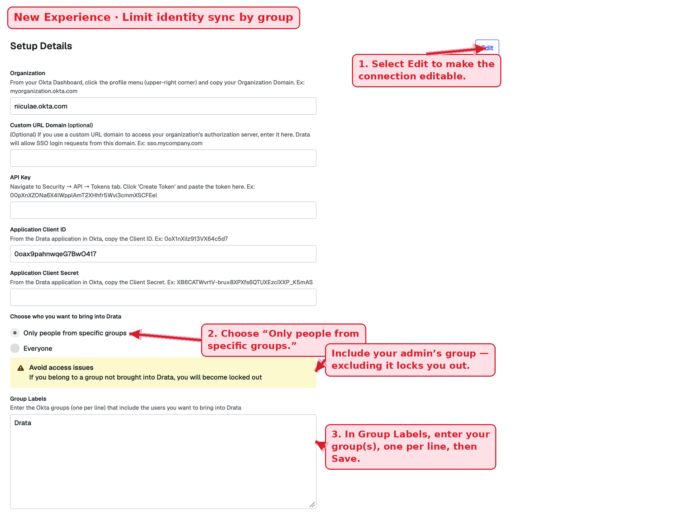

# Multi-Domain Support

Source: https://help.drata.com/en/articles/17155877-multi-domain-support
Collection: Settings
Updated: 2026-11-10
Fetched: 2026-11-22

## Article text

| ⚠️ **Important:** You must contact Drata Support to enable multi-domain support for your account. |
|---|

Multi-domain support allows Drata to sync users from multiple domains configured in your connected identity provider (IdP).

This article explains:

- How multi-domain support works
- What to consider before enabling it
- How to limit which users are synced
- What to expect after it is enabled

### How multi-domain support works

When multi-domain support is enabled, Drata syncs users from all domains configured in your connected IdP. Drata cannot currently sync only selected domains.

When choosing which domains to sync, you can select **only your primary domain** (determined by the first admin in Drata) or **all domains** on the connection. Users from additional domains are pulled into Drata during the next Automated Provisioning (AP) sync after the feature is enabled. This sync runs the same day the setting is enabled.

### Important considerations

Before requesting enablement, consider the following:

- **All IdP domains are included.** Multi-domain support pulls in all domains in your connected IdP.
- **Individual domain selection is not available.** Drata cannot currently limit syncing to selected domains.
- **All IdP email addresses may be synced.** If your IdP sync is not limited to specific groups, all email addresses in the IdP may be pulled into Drata, including guest accounts and secondary or alias email addresses.
- **Additional tests may fail.** Newly synced users may cause more tests to fail if they are not compliant with requirements such as machine configurations, policies, or multi-factor authentication (MFA).
- **Microsoft 365 identity mapping.** When connecting Microsoft 365, select **Email Address** (not UPN) as the identity mapping field to ensure proper user matching.
- **Domain verification for Microsoft 365.** Ensure that your email domain is verified as a custom domain in Entra ID (Azure Portal → Entra ID → Custom Domain Names) before enabling multi-domain support.

### Recommended setup: Limit identity sync by group

If you do not want all IdP users synced to Drata, configure group-based sync before requesting multi-domain support.

1. In your IdP, create and manage one or more groups that contain only the employees you want to sync to Drata. Make sure a group includes your Drata administrator.
2. In Drata, go to **Connections** and open your IdP connection.
3. On the **Setup Details** panel, select **Edit**.
4. Under **Choose who you want to bring into Drata**, select **Only people from specific groups**.
5. In **Group Labels**, enter each group (one per line) whose users you want to sync.
6. Save your changes.

### After multi-domain support is enabled

Once enabled, the next IdP sync pulls the applicable users from the additional domains into Drata. If group-based sync is configured, only users in the selected groups are synced.

Before contacting Support, confirm that you are comfortable with the users and domains that may be added to Drata and with any resulting changes to your test results.

### Learn more

- [Understanding Connections in Drata](understanding-connections-in-drata.md)
- [Identity sync updates in Drata](identity-sync-updates-in-drata.md)
- [Assigning Policies to Specific Groups](assigning-policies-to-specific-groups.md)
- [Ad-hoc identity and account resync](ad-hoc-identity-and-account-resync.md)

## Images

- [image 01] ../../images/integrations/okta/multi-domain-support--01.png

## Related articles

- [Microsoft 365 Integration Guide](microsoft-365-integration-guide.md)
- [Azure Repos (DevOps) Integration Guide](azure-repos-devops-integration-guide.md)
- [Your Drata Domain](your-drata-domain.md)
- [Assigning Policies to Specific Groups](assigning-policies-to-specific-groups.md)
- [Troubleshooting Identity Sync Issues in Drata](troubleshooting-identity-sync-issues-in-drata.md)
