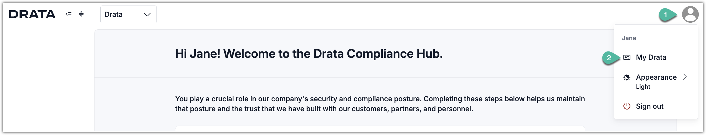
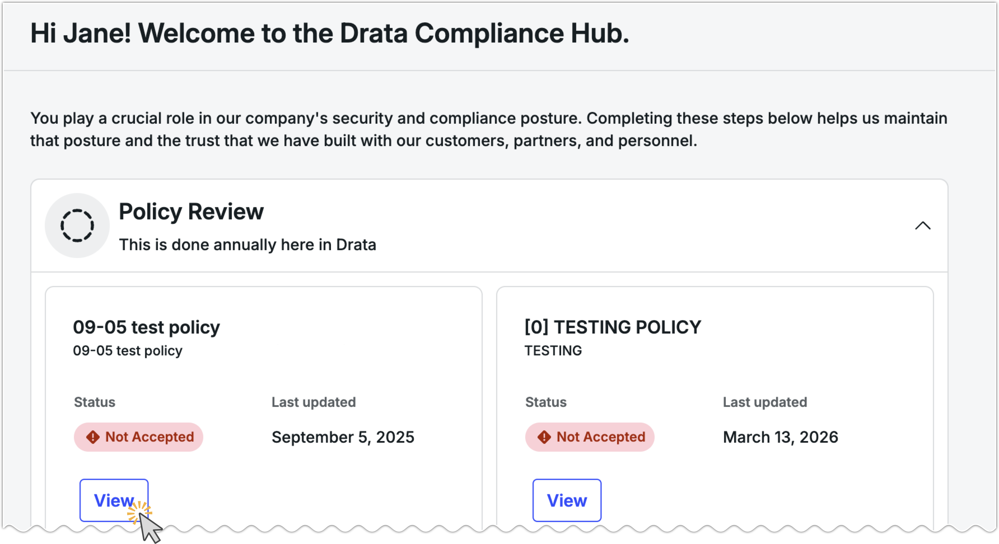

# My Drata Overview: Complete Your Personal Compliance Tasks (New Experience)

Source: https://help.drata.com/en/articles/13442440-my-drata-overview-complete-your-personal-compliance-tasks-new-experience
Collection: Getting Started › Helpful Resources
Updated: 2026-05-11
Fetched: 2026-11-22

## Article text

## Overview

**My Drata** is your personal compliance hub in Drata. It shows the security and compliance tasks assigned to you and helps your organization maintain a strong security posture and meet audit requirements.

By completing the items in My Drata, you help ensure that required policies, training, device security, and access controls remain up to date and audit-ready.

Some users are taken directly to My Drata when they sign in, depending on their role and onboarding status.

## How to Access My Drata

You can access My Drata at any time.

1. Select your **profile icon**
2. Select **My Drata**

**ℹ️ Note:** For those with limited access, My Drata may open automatically after you sign in.

## What's in My Drata

When you open My Drata, there is a list of required actions assigned to you. These tasks are based on your role and your organization’s compliance requirements.

Each item includes clear instructions and tracks whether it is complete or needs attention. Completing these tasks helps:

- Keep your organization compliant
- Reduce audit follow-up questions
- Maintain customer and partner trust

## Policy Review

Policy Review shows the policies you are required to acknowledge as part of your organization’s compliance program. Each policy listed includes:

- **Policy name**: The document you need to review
- **Status**: Whether the policy has been acknowledged
- **Last updated**: The most recent update to the policy

If a policy shows a status of **Not Accepted**, you need to review and acknowledge it.

Select **View** to read the policy and confirm that you understand it. Once acknowledged, the policy status is updated to the date you acknowledge it.

## Background Check

Complete or verify background screening as part of compliance and hiring requirements.

## Enable Multi-Factor Authentication (MFA)

Ensure MFA is enabled on your identity provider. Drata checks this daily to confirm continued compliance. Learn more at [MFA Test](test-86-mfa-on-identity-provider.md).

## Install and Set Up the Drata Agent

Install the Drata Agent on your devices. The agent reports daily on device security posture and configuration. Learn more at [Drata Agent](how-does-the-drata-agent-work.md).

## Configure Your Devices

The Drata Agent checks your device daily for required configurations. If a setting can’t be verified automatically, **you’ll be asked to upload evidence** (for example, a screenshot) to confirm compliance.

Completing these steps ensures your device continues reporting correctly in My Drata and helps your organization maintain its overall security and compliance posture.

## Security Awareness Training

Complete required security awareness training, typically on an annual schedule.

## HIPAA Training

Complete HIPAA-specific training if required for your role.

## AI Training

Review and complete AI usage and compliance training as required by your organization.

## Key Takeaways

- **My Drata is your personal compliance hub**
- Tasks are assigned based on your role and company requirements
- Completing tasks helps maintain audit readiness and trust
- Some users are directed to My Drata immediately after signing in

## Images

- [image 01] ../../images/ux/personnel/my-drata-overview-complete-your-personal-compliance-tasks-new-experience--01.png
- [image 02] ../../images/ux/personnel/my-drata-overview-complete-your-personal-compliance-tasks-new-experience--02.png

## Related articles

- [Annual Compliance Review](annual-compliance-review.md)
- [Pre-Audit Checklist: How to Prepare for Your Audit with Drata](pre-audit-checklist-how-to-prepare-for-your-audit-with-drata.md)
- [Manage tasks in Drata](manage-tasks-in-drata.md)
- [Managing Personnel Compliance in Drata Training Video (New Experience)](managing-personnel-compliance-in-drata-training-video-new-experience.md)
- [Manage Risk Tasks in Drata (New Experience)](manage-risk-tasks-in-drata-new-experience.md)
