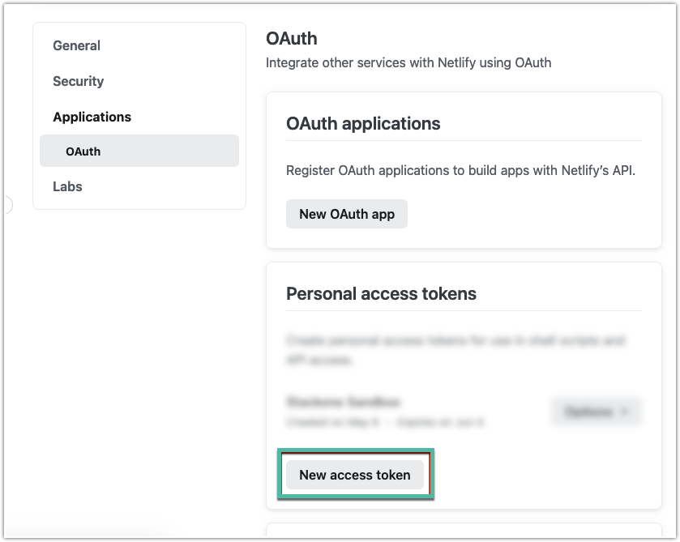

# Netlify Integration Guide (User Access Review)

Source: https://help.drata.com/en/articles/10302115-netlify-integration-guide-user-access-review
Collection: Connection Support › Other Guidance
Updated: 2025-10-22
Fetched: 2026-11-22
Description: Follow these steps to connect Netlify to Drata.

## Article text

The Netlify integration enables security and compliance teams to automate user access reviews by syncing user data directly from Netlify into Drata. It connects Drata to Netlify so your team can efficiently verify access permissions, reduce manual review time, and maintain accurate compliance records.

## Prerequisites & Data Access

- Must have **Admin**, **Information Security Lead**, **DevOps Engineer**, or **Workspace Manager** roles in Drata.
- Must have the **Owner** role within **Netlify**.
- The following fields are required to connect:
   - **Account Slug**
   - **Personal Access Token**

## Step-by-Step Setup

### Step 1: Copy your Netlify Account Slug

Log in to your Netlify account. Your Account Slug is visible in the URL.

For example, if your URL is `https://app.netlify.com/teams/user-12abcde/settings`, the Account Slug is `user-12abcde`.

### Step 2: Copy your Netlify Personal Access Token

1. In your Netlify account, navigate to your **User Settings**.
2. Under **General**, select **Application**.
3. Scroll down to **Personal access tokens** and select **New access token**.
   
4. Under **Create a new personal access token**, enter a **Description** and **Expiration Date**, then select **Generate token**.
5. Copy the displayed **Access Token** and store it safely.

## Complete the Connection

In Drata’s **Connections** page, enter the following information:

| **Drata Field** | **Netlify Value** |
|---|---|
| **Personal Access Token** | Your generated token |
| **Account Slug** | Your Netlify slug |

For steps on accessing and using the Connections page in Drata, refer to [The Connections Page in Drata](https://help.drata.com/en/articles/12305645-the-connections-page-in-drata).

## Images

- [image 01] ../../images/integrations/netlify/netlify-integration-guide-user-access-review--01.png

## Related articles

- [Justworks Integration Guide](justworks-integration-guide.md)
- [Sentry Integration Guide](sentry-integration-guide.md)
- [Dixa Integration Guide](dixa-integration-guide.md)
- [JetBrains Integration Guide](jetbrains-integration-guide.md)
- [Tableau Integration Guide](tableau-integration-guide.md)
