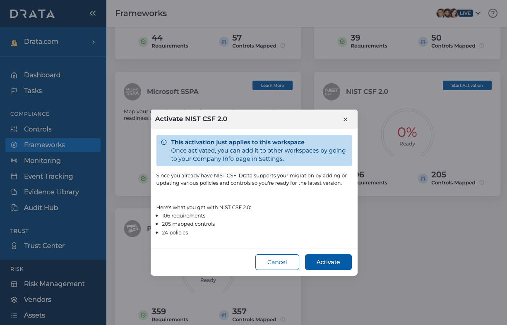

# NIST CSF 2.0

Source: https://help.drata.com/en/articles/9854381-nist-csf-2-0
Collection: Framework Information › NIST CSF 2.0
Updated: 2025-11-14
Fetched: 2026-11-22

## Article text

## What do I need to know about the latest version of NIST CSF 2.0?

The NIST Cybersecurity Framework (CSF) is designed to help organizations of all sizes and sectors — including industry, government, academia, and nonprofit — to manage and reduce their cybersecurity risks.

CSF 2.0 is the latest version of the framework, released by NIST on 26th of February 2024. The update further increases the framework’s scope beyond critical infrastructure, and ensures better alignment with other NIST standards, such as SP 800-161 (Cybersecurity Supply Chain), SP 800-218 (Secure Software Development), and the Privacy Framework.

Broad changes across the framework, from the previous version (CSF 1.1) include:

- Addition of *Implementation Examples*, to better guide organizations to their desired outcomes;
- Increased profile development support; and,
- Clearer maturity level (framework tier) objectives.

There have also been several changes across the framework functions to include:

- Introduction of a new *Govern (GV)* function, emphasizing the role of governance in cybersecurity;
- Bolstered *Cybersecurity Supply Chain Risk Management (GV.SC)* measures; and,
- Expanded *Respond (RS)* and *Recover (RC)* functions, leading to more impactful incident management outcomes and operational resilience.

For a comprehensive view, please refer to the [Cybersecurity Framework](https://www.nist.gov/cyberframework) page on NIST.

## How do these changes affect my Drata account?

If you already purchased NIST CSF 1.1, you will automatically have access to version 2.0. However, it will not be active in your account until you are ready.

When you’re ready to use NIST CSF 2.0 in Drata, simply click on the “Start Activation” button on the NIST CSF 2.0 card in the “Available for your company” section of the frameworks page. If you are an admin, you will see the following confirmation before continuing. Once you select “Activate” it will be ready to use in your account.

If the NIST CSF 2.0 framework is not visible in your account after activation, confirm with your Drata administrator or Drata support that it has been added to your package and activated for your account. If not, request specific activation through Drata support. Once activated, it will appear in the framework's section of your account.

We’ve released CSF 2.0 as its own framework, allowing you to work on one or both versions as your organization needs, and transition over to the new version at your own pace.

Once you activate version 2.0 in your account, you can expect the following:

1. 23 new DCF controls will be enabled in your account; 205 DCF controls mapped in total.
2. 36 DCF controls were updated for better applicability.
   - 2 control names
   - 34 control descriptions
3. 2 policy templates have been added to the Policy Center. You may already have these policy templates as a result of other frameworks being enabled in your account.
   - System and Information Integrity Policy
   - Logging and Monitoring Policy

The framework also maps to a total of 24 required policy templates that organizations can use to establish compliance documentation. These policies cover a wide range of requirements, including Acceptable Use, Asset Management, Business Continuity, and more.

## What’s next?

To implement NIST CSF 2.0, we suggest taking the following steps:

1. Review the changes between the two versions and conduct a gap analysis as it applies to your organization.
2. Implement the new or revised DCF controls that are within your CSF 2.0 scope (learn more about how to do this in[this help article](https://help.drata.com/en/articles/8840054-revert-to-drata-s-latest-control-template-on-any-control-in-the-dcf-library).)
3. Review the 2 new policy templates, and implement them as applicable.
4. Update your policies, and implement the additions made to your policies if needed.
5. If working with an assessor, discuss the best time to start tracking your compliance against the new version of the framework.

## Images

- [image 01] ../../images/ux/frameworks/nist-csf-2-0--01.png

## Related articles

- [Frameworks](frameworks.md)
- [Policies to Framework Summary](policies-to-framework-summary.md)
- [October 2024 Release: AWS Drata test](october-2024-release-aws-drata-test.md)
- [February 2025 Release: AWS and Azure Drata Tests](february-2025-release-aws-and-azure-drata-tests.md)
- [Control Mapping Updates for Policies - 10/17/2025](control-mapping-updates-for-policies-10-17-2025.md)
