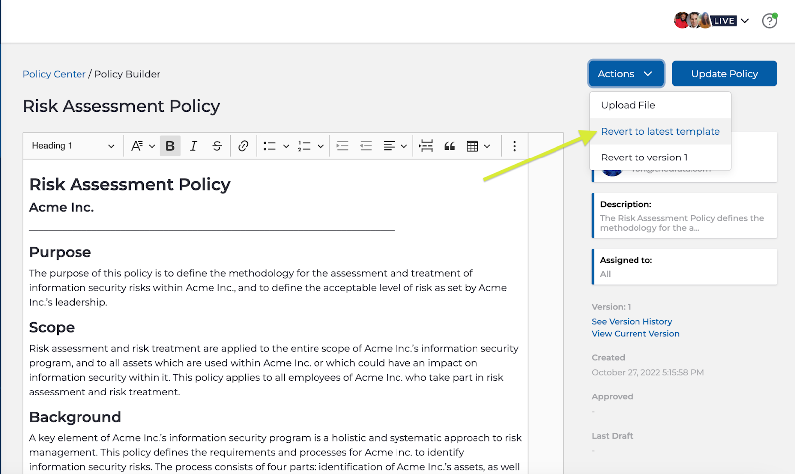

# NIST SP 800-53 (Rev. 5) Control & Policy Mapping Updates

Source: https://help.drata.com/en/articles/6933260-nist-sp-800-53-rev-5-control-policy-mapping-updates
Collection: Framework Information › NIST SP 800-53
Updated: 2026-07-08
Fetched: 2026-11-22
Description: What you need to know about the latest updates to the NIST SP 800-53r5 framework in Drata

## Article text

When the NIST SP 800-53r5 framework was first released in Drata it included only the framework's requirements (i.e., NIST 800-53 Controls). To support customers in their compliance journey for NIST 800-53 we have made the following updates:

- Updated the requirements to include the Assessment Objectives as set out by NIST SP 800-53A.
- Added DCF control mapping to all requirements with a Security or Privacy baseline (423 requirements).
   - **Note: **If you use our [Risk Management](risk-management-in-drata-an-overview.md) tool, these controls are also mapped to the applicable risks.
- Updated 5 existing DCF controls (DCF-2, DCF-92, DCF-283, DCF-364, and DCF-527).
   - **Note:** The only thing updated here is the mapping itself; any edits you have made to these controls have not been altered.
- Added 5 policy templates to the Policy Center in addition to the original 20 security policies. Four are new policies created specifically for NIST 800-53; the fifth is the *Change Management Policy* template that you may already have if you also have ISO 27001:2022 enabled.
   - Maintenance Management Policy
   - System and Information Integrity Policy
   - System and Services Acquisition Policy
   - System Security Planning Policy
- Updated 8 existing policy templates (see below on how to access these updates).

Note: Pre-mapped evidence from the Evidence Library is currently not available for the NIST 800-53 framework.

### How do these changes affect me and what should I do next?

When these changes were introduced, you may have noticed a change in your readiness for the NIST 800-53 framework. Here are the steps you need to take in order to stay on track with your compliance goals for this framework.

1. Review the mappings of requirements to controls
2. Determine if any new controls are out of scope for your organization
3. Ensure the DCF controls that are in scope have the necessary evidence
4. Review, update, and approve the new policies and policy template revisions and have your personnel accept them

### How do I update to the latest policy templates?

The following policy templates have been updated for the NIST 800-53 framework:

1. Asset Management Policy
2. Backup Policy
3. Data Protection Policy
4. Incident Response Plan
5. Password Policy
6. Risk Assessment Policy
7. System Access Control Policy
8. Vendor Management Policy

To update to the latest policy templates, go to **Policy Center** and click on the edit icon next to each of the policies listed above. From here, click on the **'Actions'** button, and select '**Revert to Latest Template**' (or '**Restart with Latest Template**' if you had uploaded a custom policy). Review and edit the policy as you see fit, then follow the usual policy approval workflow.

## Images

- [image 01] ../../images/ux/policies/nist-sp-800-53-rev-5-control-policy-mapping-updates--01.png

## Related articles

- [Frameworks](frameworks.md)
- [Control Mapping Updates for Policies - 4/13/2023](control-mapping-updates-for-policies-4-13-2023.md)
- [2023: CCPA Updates](2023-ccpa-updates.md)
- [NIST SP 800-171 Rev. 2  Framework Updates](nist-sp-800-171-rev-2-framework-updates.md)
- [NIST SP 800-171 Rev. 2 Self-Assessment](nist-sp-800-171-rev-2-self-assessment.md)
