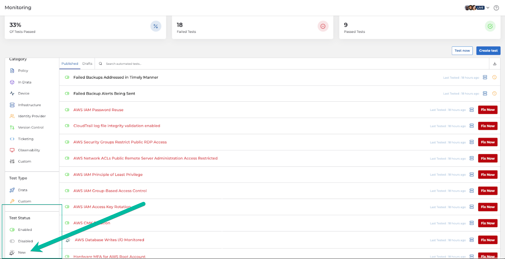

# October 2024 Release: AWS Drata test

Source: https://help.drata.com/en/articles/10034590-october-2024-release-aws-drata-test
Collection: Monitoring Test Guidance
Updated: 2026-11-14
Fetched: 2026-11-22
Description: New AWS tests in released in October 30, 2024.

## Article text

We’re excited to announce the release of new tests in Drata. These AWS tests were released on October 30, 2024.

## Prerequisite

- **Framework and Control Mapping**:
   - These tests are mapped to specific controls, which are tied to a compliance framework within your workspace. If your compliance framework does not have the specific control that corresponds to one of these newly released tests, the test will not be made available. Within this article, we cover what controls map to each test.
   - Frameworks, controls and tests are workspace-specific. If a control isn't enabled in a particular workspace, tests related to that control will not be available in that workspace.
- **Connections Required:**
   - These tests are related to **AWS **and require a valid connection to AWS. If no connection is available, the test status will be **Unused**

## Controls Mapped to the New Tests

These new tests automate control monitoring and evidence collection for the following controls:

- DCF-12
- DCF-152
- DCF-335
- DCF-346
- DCF-350
- DCF-406
- DCF-478
- DCF-54
- DCF-55
- DCF-68
- DCF-73
- DCF-75
- DCF-776
- DCF-779
- DCF-783
- DCF-85
- DCF-86
- DCF-90
- DCF-99

## Test Overview

Each test is directly mapped to specific controls in your compliance framework.

### Center for Internet Security (CIS)

The Center for Internet Security (CIS) has foundation benchmarks which offer detailed configuration guidelines for various vendor products.

A significant portion of these new tests are derived from the Center for Internet Security (CIS) foundation benchmarks for AWS. These tests align with the Center for Internet Security's (CIS) foundation benchmarks which provides prescriptive guidance for establishing a secure baseline configuration for Amazon Web Services. These benchmarks are developed through a global, consensus-driven process involving cybersecurity experts aimed at helping organizations strengthen their defenses against potential threats.

| **Test ID** | **Test Name** | **Mapped Control(s)** | **Benchmark** | **Frameworks** |
|---|---|---|---|---|
| 205 | CloudTrail log file integrity validation enabled | DCF-478 | CIS | PCI DSS v3.2.1, NIST 800-53r5, NIST CSF 1.1, FedRAMP, ISO 27017:2015, PCI DSS v4.0, ISO 27001:2022, SOC 2, ISO 27701:2019, NIST 800-171r2, NIST CSF 2.0, CMMC 2.0 |
| 226 | AWS S3 Object-Level Logging for Read & Write Events | DCF-406 | CIS | PCI DSS v3.2.1, NIST 800-53r5, FedRAMP, PCI DSS v4.0, ISO 27001:2022, SOC 2, NIST 800-171r2, NIST CSF 2.0, CMMC 2.0 |
| 231 | AWS EFS Encrypted at Rest | DCF-54 | CIS | ISO 27001:2013, HIPAA, GDPR, CCPA, CPRA, NIST 800-53r5, CCM, NIST CSF 1.1, FedRAMP, PCI DSS v4.0, ISO 27001:2022, SOC 2, ISO 27701:2019, NIST 800-171r2, NIST CSF 2.0, NIS 2, CMMC 2.0 |
| 220 | AWS RDS Public Access Restricted | DCF-75 | CIS | ISO 27001:2013, CCM, ISO 27017:2015, ISO 27001:2022, SOC 2, FedRAMP, NIS 2 |
| 219 | AWS RDS Auto Minor Version Upgrade | DCF-152 | CIS | ISO 27001:2013, NIST 800-53r5, NIST CSF 1.1, FedRAMP, ISO 27001:2022, SOC 2, ISO 27701:2019, NIST 800-171r2, CMMC 2.0 |
| 218 | AWS EBS Volume Encryption | DCF-54 | CIS | ISO 27001:2013, HIPAA, GDPR, CCPA, CPRA, NIST 800-53r5, CCM, NIST CSF 1.1, FedRAMP, PCI DSS v4.0, ISO 27001:2022, SOC 2, ISO 27701:2019, NIST 800-171r2, NIST CSF 2.0, NIS 2, CMMC 2.0 |
| 234 | AWS S3 HTTP Requests Denied | DCF-55 | CIS | ISO 27001:2013, HIPAA, CCPA, CPRA, NIST 800-53r5, CCM, NIST CSF 1.1, FedRAMP, PCI DSS v4.0, ISO 27001:2022, SOC 2, ISO 27701:2019, NIST 800-171r2, NIST CSF 2.0, ISO 27018:2019, NIS 2, CMMC 2.0 |
| 221 | AWS S3 Bucket Access Logging | DCF-406 | CIS | PCI DSS v3.2.1, NIST 800-53r5, FedRAMP, PCI DSS v4.0, ISO 27001:2022, SOC 2, NIST 800-171r2, NIST CSF 2.0, CMMC 2.0 |
| 223 | AWS CMK Rotation - Requires additional permissions, refer to [test article](test-223-aws-cmk-rotation.md#h_56fec577b2) for more information. | DCF-779 | CIS | ISO 27001:2022, SOC 2, ISO 27701:2019, NIST 800-171r2, CMMC 2.0 |
| 229 | AWS IAM Unused Credentials | DCF-335 | CIS | PCI DSS v3.2.1, NIST 800-53r5, FedRAMP, PCI DSS v4.0, NIST 800-171r2, CMMC 2.0 |
| 232 | AWS IAM Access Key Rotation | DCF-783 | CIS | ISO 27001:2022, SOC 2, ISO 27701:2019 |
| 216 | AWS IAM Password Reuse | DCF-350 | CIS | PCI DSS v3.2.1, PCI DSS v4.0, HIPAA, ISO 27001:2022, SOC 2, ISO 27701:2019, NIST 800-171r2, CMMC 2.0 |
| 217 | AWS IAM Group-Based Access Control | DCF-776 | CIS | ISO 27001:2022, SOC 2, ISO 27701:2019, NIST 800-171r2, NIST CSF 2.0, CMMC 2.0 |
| 230 | AWS IAM Principle of Least Privilege | DCF-776 | CIS | ISO 27001:2022, SOC 2, ISO 27701:2019, NIST 800-171r2, NIST CSF 2.0, CMMC 2.0 |
| 214 | MFA for AWS Root Account | DCF-90 | CIS | NIST 800-53r5, FedRAMP, ISO 27001:2022, SOC 2 |
| 215 | AWS IAM Password Minimum Length | DCF-346, DCF-68 | CIS | ISO 27001:2013, HIPAA, PCI DSS v3.2.1, CCPA, CPRA, NIST 800-53r5, CCM, NIST CSF 1.1, FedRAMP, Cyber Essentials, ISO 27017:2015, PCI DSS v4.0, ISO 27001:2022, SOC 2, ISO 27701:2019, NIST 800-171r2, NIST CSF 2.0, NIS 2, CMMC 2.0 |
| 222 | AWS CloudTrail Logs Encrypted | DCF-54 | CIS | ISO 27001:2013, HIPAA, GDPR, CCPA, CPRA, NIST 800-53r5, CCM, NIST CSF 1.1, FedRAMP, PCI DSS v4.0, ISO 27001:2022, SOC 2, ISO 27701:2019, NIST 800-171r2, NIST CSF 2.0, NIS 2, CMMC 2.0 |
| 224 | AWS VPC Flow Logging | DCF-406 | CIS | PCI DSS v3.2.1, NIST 800-53r5, FedRAMP, PCI DSS v4.0, ISO 27001:2022, SOC 2, NIST 800-171r2, NIST CSF 2.0, CMMC 2.0 |
| 225 | Hardware MFA for AWS Root Account | DCF-90 | CIS | NIST 800-53r5, FedRAMP, ISO 27001:2022, SOC 2 |
| 227 | AWS Network ACLs Public Remote Server Administration Access Restricted | DCF-73 | CIS | ISO 27001:2013, HIPAA, CCPA, CPRA, NIST 800-53r5, CCM, FedRAMP, ISO 27001:2022, SOC 2, NIST 800-171r2, ISO 27701:2019, CMMC 2.0 |
| 228 | AWS Security Groups Restrict Public RDP Access | DCF-73 | CIS | ISO 27001:2013, HIPAA, CCPA, CPRA, NIST 800-53r5, CCM, FedRAMP, ISO 27001:2022, SOC 2, NIST 800-171r2, ISO 27701:2019, CMMC 2.0 |
| 233 | AWS VPC Default Security Groups Restrict All Traffic | DCF-85 | CIS | ISO 27001:2013, CCPA, CPRA, NIST 800-53r5, CCM, NIST CSF 1.1, FedRAMP, Cyber Essentials, PCI DSS v4.0, ISO 27001:2022, SOC 2, ISO 27701:2019, NIST 800-171r2, NIST CSF 2.0, CMMC 2.0 |
| 132 | Daily backup job status monitored - Requires additional permissions, refer to [test article](test-132-daily-backup-job-status-monitored.md) for more information. | DCF-99 | Custom | ISO 27001:2013, HIPAA, CCM, NIST CSF 1.1, Cyber Essentials, ISO 27001:2022, SOC 2, NIST CSF 2.0 |
| 133 | Failed Backup Alerts Being Sent - Requires additional permissions, refer to [test article](test-133-failed-backup-alerts-being-sent.md) for more information. | DCF-99 | Custom | ISO 27001:2013, HIPAA, CCM, NIST CSF 1.1, Cyber Essentials, ISO 27001:2022, SOC 2, NIST CSF 2.0 |
| 134 | Failed Backups Addressed in Timely Manner - Requires additional permissions, refer to [test article](test-134-failed-backups-addressed-in-timely-manner.md) for more information. | DCF-99 | Custom | ISO 27001:2013, HIPAA, CCM, NIST CSF 1.1, Cyber Essentials, ISO 27001:2022, SOC 2, NIST CSF 2.0 |
| 206 | SQL freeable memory monitored | DCF-86 | Custom | ISO 27001:2013, HIPAA, NIST 800-53r5, CCM, NIST CSF 1.1, FedRAMP, ISO 27001:2022, SOC 2, NIST 800-171r2, NIST CSF 2.0, CMMC 2.0 |
| 290 | AWS Database Writes I/O Monitored | DCF-86 | Custom | ISO 27001:2013, HIPAA, NIST 800-53r5, CCM, NIST CSF 1.1, FedRAMP, ISO 27001:2022, SOC 2, NIST 800-171r2, NIST CSF 2.0, CMMC 2.0 |
| 291 | AWS Security Groups HTTP Access Restricted | DCF-85 | Custom | ISO 27001:2013, CCPA, CPRA, NIST 800-53r5, CCM, NIST CSF 1.1, FedRAMP, Cyber Essentials, PCI DSS v4.0, ISO 27001:2022, SOC 2, ISO 27701:2019, NIST 800-171r2, NIST CSF 2.0, CMMC 2.0 |
| 292 | AWS EC2 Instances IMDSv1 Disabled | DCF-12 | Custom | ISO 27001:2013, PCI DSS v3.2.1, NIST 800-53r5, CCM, NIST CSF 1.1, FedRAMP, Cyber Essentials, ISO 27017:2015, PCI DSS v4.0, ISO 27001:2022, SOC 2, NIST 800-171r2, NIST CSF 2.0, CMMC 2.0 |
| 293 | AWS Classic Load Balancer Latency Monitored | DCF-86 | Custom | ISO 27001:2013, HIPAA, NIST 800-53r5, CCM, NIST CSF 1.1, FedRAMP, ISO 27001:2022, SOC 2, NIST 800-171r2, NIST CSF 2.0, CMMC 2.0 |
| 294 | AWS Application Load Balancer Target Response Time Monitored | DCF-86 | Custom | ISO 27001:2013, HIPAA, NIST 800-53r5, CCM, NIST CSF 1.1, FedRAMP, ISO 27001:2022, SOC 2, NIST 800-171r2, NIST CSF 2.0, CMMC 2.0 |
| 295 | AWS Classic Load Balancer Server Errors Monitored | DCF-86 | Custom | ISO 27001:2013, HIPAA, NIST 800-53r5, CCM, NIST CSF 1.1, FedRAMP, ISO 27001:2022, SOC 2, NIST 800-171r2, NIST CSF 2.0, CMMC 2.0 |
| 296 | AWS Application Load Balancer Server Errors Monitored | DCF-86 | Custom | ISO 27001:2013, HIPAA, NIST 800-53r5, CCM, NIST CSF 1.1, FedRAMP, ISO 27001:2022, SOC 2, NIST 800-171r2, NIST CSF 2.0, CMMC 2.0 |
| 297 | AWS Classic Load Balancer Unhealthy Hosts Monitored | DCF-86 | Custom | ISO 27001:2013, HIPAA, NIST 800-53r5, CCM, NIST CSF 1.1, FedRAMP, ISO 27001:2022, SOC 2, NIST 800-171r2, NIST CSF 2.0, CMMC 2.0 |
| 298 | AWS Application Load Balancer Unhealthy Hosts Monitored | DCF-86 | Custom | ISO 27001:2013, HIPAA, NIST 800-53r5, CCM, NIST CSF 1.1, FedRAMP, ISO 27001:2022, SOC 2, NIST 800-171r2, NIST CSF 2.0, CMMC 2.0 |
| 299 | AWS Application Load Balancer Redirects HTTP to HTTPS | DCF-55 | Custom | ISO 27001:2013, HIPAA, CCPA, CPRA, NIST 800-53r5, CCM, NIST CSF 1.1, FedRAMP, PCI DSS v4.0, ISO 27001:2022, SOC 2, ISO 27701:2019, NIST 800-171r2, NIST CSF 2.0, ISO 27018:2019, NIS 2, CMMC 2.0 |
| 300 | AWS Lambda Error Rate Monitored | DCF-86 | Custom | ISO 27001:2013, HIPAA, NIST 800-53r5, CCM, NIST CSF 1.1, FedRAMP, ISO 27001:2022, SOC 2, NIST 800-171r2, NIST CSF 2.0, CMMC 2.0 |
| 301 | AWS DynamoDB Point-in-Time Recovery Enabled - Requires additional permissions, refer to [test article](test-301-aws-dynamodb-point-in-time-recovery-enabled.md#h_e48668d6c3) for more information. | DCF-86 | Custom | ISO 27001:2013, HIPAA, NIST 800-53r5, CCM, NIST CSF 1.1, FedRAMP, ISO 27001:2022, SOC 2, NIST 800-171r2, NIST CSF 2.0, CMMC 2.0 |

## Enable new tests

These new tests will be released under the following status:

- **New status**: The mapped control exists and the required connection (such as AWS) is enabled. These tests will not run automatically. You must update the status to Enabled to run the test.
   - **New Customers Note:** Customers starting after **October 30, 2024** will have these tests automatically enabled if they have the required mapped control and connection enabled.
- **Unused status**: The mapped control exists but the required connection (such as AWS) is not enabled.

**To find test with the new status:**

1. Navigate to the Monitoring page.
2. Within the filter options next to the test table, scroll down to **Test Status**.
   
3. Select **New**.

**To run a new test:**

1. Navigate to the Monitoring page.
2. Select the test.
3. Within the test drawer, there will be a test status field. Open the dropdown menu and select **Enabled**. Once you enable a new test, it will no longer be categorized as “new”.

- You can also disable a new test from here if desired.

## Troubleshooting AWS Tests

Organizations using Drata may encounter errors in certain AWS tests. Below you'll find troubleshooting guidance to help resolve these errors and ensure compliance.

### Resolving AWS Resource Permission Errors

One of the most frequent issues in AWS tests is a missing permission in the DrataAutopilot role. There are several additional permissions that need to be added in addition to the **SecurityAudit policy**. You can find these additional permissions in our [AWS Resource Permissions Article.](aws-resource-permissions.md)

#### Steps to Fix Resource Permission Errors

1. Click "See Raw Test Result" in the Test Drawer and click the Test in Error
2. Click Show raw JSON
3. Refer to the error message to identify which permission is missing for the DrataAutopilot role to complete the test.
4. Verify IAM Role Permissions
   1. Check that the DrataAutopilot role has the required permissions noted in our [AWS Resource Permissions Article.](aws-resource-permissions.md)
      1. If missing, add it as an inline policy via the AWS IAM Console.
      2. For detailed instructions, refer to [this Help Center article](aws-integration-guide-infrastructure-user-access-review.md).

## Images

- [image 01] ../../images/ux/monitoring/october-2024-release-aws-drata-test--01.png

## Related articles

- [Frameworks](frameworks.md)
- [Policies to Framework Summary](policies-to-framework-summary.md)
- [DCF Library Updates on 1/18/2024](dcf-library-updates-on-1-18-2024.md)
- [February 2025 Release: AWS and Azure Drata Tests](february-2025-release-aws-and-azure-drata-tests.md)
- [Control Mapping Updates for Policies - 10/17/2025](control-mapping-updates-for-policies-10-17-2025.md)
