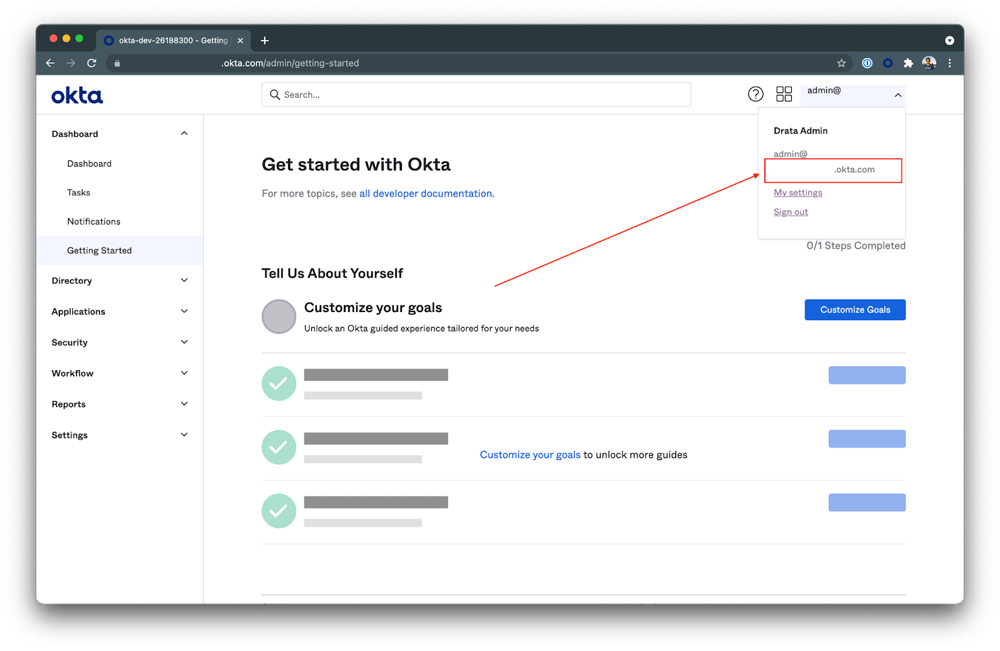
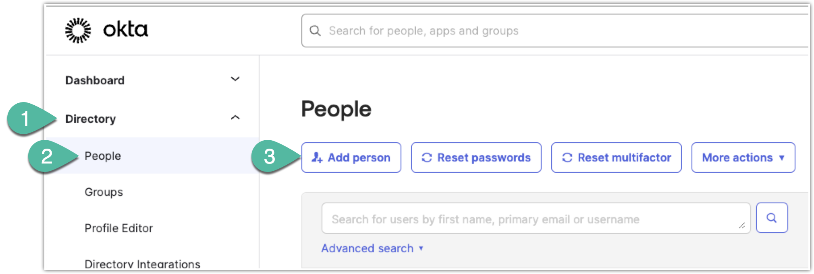
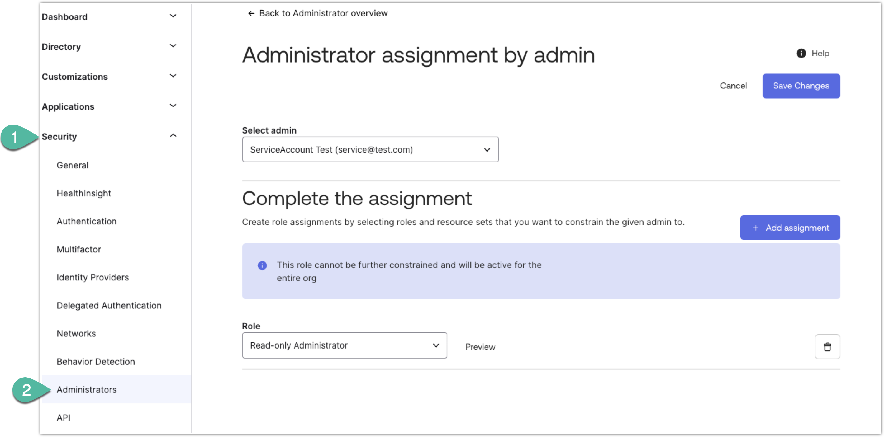
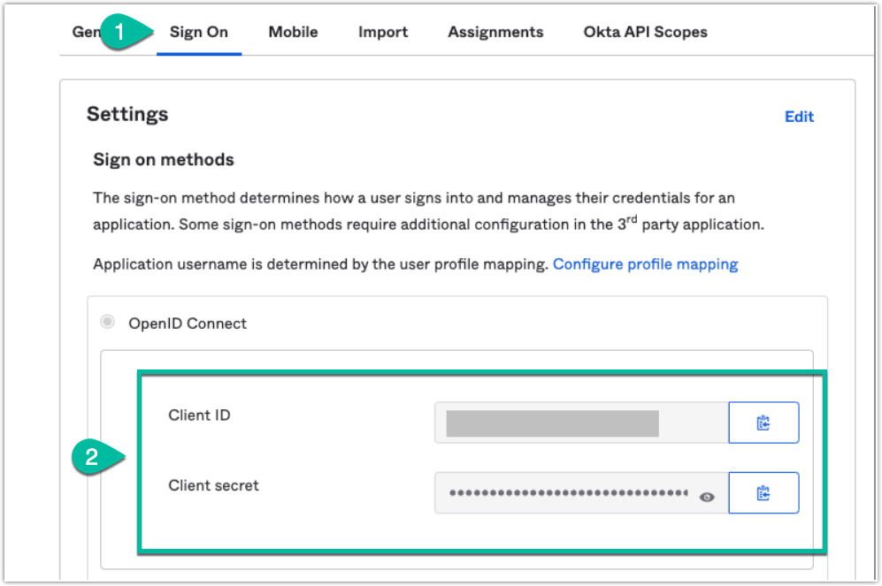
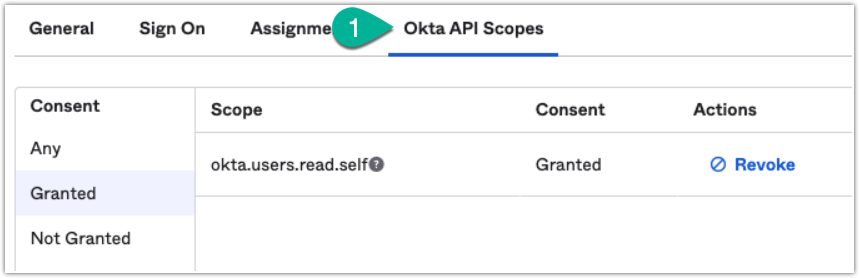

# Okta Integration Guide (Identity Management Provider)

Source: https://help.drata.com/en/articles/5608136-okta-integration-guide-identity-management-provider
Collection: Connection Support › Identity (IdP) Guidance
Updated: 2026-09-28
Fetched: 2026-11-22

## Article text

The Okta integration enables security, IT, and compliance teams to automate identity management and, optionally, user access reviews. It connects Drata to your Okta tenant so your team can sync workforce identities, enforce MFA, and centralize access review evidence for audits.

## Key Capabilities

- **Identity & Access Management (IdP): **Syncs users, groups, and role assignments from Okta into Drata to support provisioning, de-provisioning, and IdP monitoring.
- **Audit & Evidence Collection: **Captures identity metadata, MFA configuration, and account status to provide audit-ready evidence for compliance reviews.

This integration is used to automate tests such as **MFA on Identity Provider (Test 86)**, **Employees Have Unique Email Accounts (Test 96).**

## Prerequisites & Data Access

### In Okta

- Sign in with an Okta account that has the **Organization Owner** role.
- An **Okta service account** to authenticate the integration with Drata. A service account is required to generate the API token used for this connection. Create an **Okta API key**. We’ll show you how to do this later in the guide.
- Install and configure the **Drata Okta App** with the `okta.users.read.self` scope, then copy the **Client ID** and **Client Secret** shown after setup.
   - We’ll walk you through this later in the guide.
- Ensure the **email field** on each Okta user profile is set to at least **Read Only**.
   - Drata uses this field for syncing personnel records and for login authentication.
   - We’ll cover this later in the guide.
- Avoid using **nested groups** in Okta. Drata syncs members from top-level groups only, not from subgroups.
- An **Okta service account** to authenticate the integration with Drata
- Copy the **group labels** you want to include if you plan to sync specific user groups.
- Copy your **Okta organization domain**. You’ll use this when connecting Okta to Drata.

### Optional Requirements

- Copy your **custom authorization domain** if your organization uses a custom URL domain for the authorization server.

### Additional Notes

- **Connect one Okta group at a time.**
   - Attempting to connect multiple groups simultaneously will cause the connection to fail.
- **For customers with existing Okta SSO connections:**
   - If your Drata tenant previously used the Enterprise SSO connector, disconnect it before using the new **Sign in with Okta** option.
   - Otherwise, continue using the original **Sign in with SSO** connection.
- **If you don’t use an HRIS integration:**
   - Drata uses the **Okta user profile creation date** as the hire date by default.
   - To override this behavior, you can add two custom attributes in Okta:
      - `drataStartDate` (string): Tracks employee start date.
      - `drataContractor` (boolean): Identifies whether the user is a contractor or employee.
   - Drata automatically recognizes these attributes, eliminating the need to manually update personnel records.
   - **Note:** Separation date isn’t currently supported. The separation date remains the date the Okta user profile was deactivated.

### Permissions & Data Table

| **Permission/Scope** | **Why It’s Needed** | **Data Accessed (Read Only)** |
|---|---|---|
| **`okta.users.read.self`** (granted to the Drata application you created in Okta) | Allows Drata to read the profile of the user who logs in via Okta, enabling single sign-on (SSO) and proper identity sync for that user. | The authenticated user’s profile attributes (for example: email, name, user ID).   Note: This scope does *not* allow reading other users’ profiles. |

## Step-by-Step Setup

### Step 1: Verify the email field permission in Okta

The **email** field must be set to at least **Read Only** so Drata can sync personnel data and authenticate users correctly.

1. Sign in to **Okta** as an administrator.
2. In the side navigation, select **Directory > Profile Editor**.
3. Open the **Users** tab, then select **User (default)** under the **Profile** tab.
4. Scroll to the **Primary email** field and select the **info** icon ℹ️ next to it.
5. Review the **User permission** configurations and confirm it is set to **Read Only** or higher.

If this field is set to *Hide*, Drata can’t read user emails for login or personnel sync.

### Step 2: Copy your Okta Organization Domain

1. From your Okta dashboard, copy your **Okta organization domain. **
2. You’ll paste this value into the **Organization** field into Drata.

### Step 3: Create a service account

You’ll now create a service account in Okta and assign the **Read-only Administrator** role.

1. Sign in to **Okta** as an administrator.
2. Go to **Directory > People**, then select **Add Person**.
   
3. Create the new **service account** that will be used to connect Drata. Then, Assign the **Read-only Administrator** role to that account:
   - Go to **Security > Administrators > Add Administrator**.
   - Select the service account you created.
   - Assign the **Read-only Administrator** role and save changes.
      

### Step 4: Generate an API token

1. Log in as the **service account** you just created.
2. Go to **Security > API > Tokens > Create Token**.
3. Generate a new **API token**.
4. **Copy the token immediately** and save it securely (for example, in a password manager).
   - This is the **only time** you can view it.
   - You’ll paste it into the **API Key** field in Drata later.

**Important:** Treat the API token like a password. It provides administrative access to Okta data.

### Step 5: Install the Drata Okta OIN App

1. Log in to **Okta** as a **Super Administrator**.
2. Go to **Applications > Browse App Catalog**.
3. Search for **Drata**.
4. Select **Drata – OIDC** under Integrations and click **Add**.
5. Open the installed app and select the **Sign On** tab.
6. Copy the **Client ID** and **Client Secret** displayed there.
   - You’ll add these to the corresponding fields into Drata.
   
7. Open the **Okta API Scopes** tab.
8. Scroll down to **okta.users.read.self** and click **Grant** to enable this scope.
   
9. Assign the Drata OIN app to users who should have **SSO access** to Drata:
   - Go to **Applications > Drata – OIDC > Assignments**.
   - Select the users or groups who should have access.

**SSO options supported:**

- **IdP-initiated SSO:** Users can launch Drata directly from the Okta dashboard.
- **SP-initiated SSO:** Users can start from the Drata login page and authenticate through Okta.

## Complete the connection in Drata

1. In Drata, go to **Connections > Identity Providers > Okta**.
2. Enter the following values from your Okta setup:

**Okta Value:** Okta connections now align with other IdP integrations by offering radio button options for **All Personnel** or **Specific Group Labels**. When selecting specific groups, customers can now choose multiple group labels for more flexible access control.

| **Drata Field** | **Okta Value** |
|---|---|
| Organization | Okta organization domain |
| Custom URL Domain (Optional) | The **custom URL domain** your organization uses to access its Okta authorization server. |
| API Key | The Okta API token generated from your service account. |
| Application Client ID | From the Drata OIN App |
| Application Client Secret | From the Drata OIN App |
| Choose who you want to bring into Drata | Options: - **Only people from specific groups** - **Everyone** |
| Group Label | The group label in Okta for the specific user group you want to sync. |

**When editing group scope on your Okta Identity connection:**

- Include your Drata administrator in the selected group(s) — otherwise you risk losing admin access to Drata.
- Users not included in the selected group(s) will not sync to Drata.
- If personnel are already synced via this connection, removing a user from the group(s) can move them to Former Employee status.

For steps on accessing and using the Connections page in Drata, refer to [The Connections Page in Drata](https://help.drata.com/en/articles/12305645-the-connections-page-in-drata).

## (Optional) Enable User Access Review

Note: The **Okta IdP connection** is required before you can use Okta as your **User Access Review** source. For detailed steps to configure the User Access Review connection, refer to **[Okta Integration Guide (User Access Review)](okta-integration-guide-user-access-review.md)**.

## Images

- [image 01] ../../images/integrations/okta/okta-integration-guide-identity-management-provider--01.png
- [image 02] ../../images/integrations/okta/okta-integration-guide-identity-management-provider--02.png
- [image 03] ../../images/integrations/okta/okta-integration-guide-identity-management-provider--03.png
- [image 04] ../../images/integrations/okta/okta-integration-guide-identity-management-provider--04.png
- [image 05] ../../images/integrations/okta/okta-integration-guide-identity-management-provider--05.png

## Related articles

- [JumpCloud IdP Integration Guide](jumpcloud-idp-integration-guide.md)
- [Manual Import (CSV) Identity Provider Integration Guide](manual-import-csv-identity-provider-integration-guide.md)
- [Okta Integration Guide (User Access Review)](okta-integration-guide-user-access-review.md)
- [Integrating an Okta Tenant with Drata Training Video](integrating-an-okta-tenant-with-drata-training-video.md)
- [Enterprise SCIM Integration Guide](enterprise-scim-integration-guide.md)
