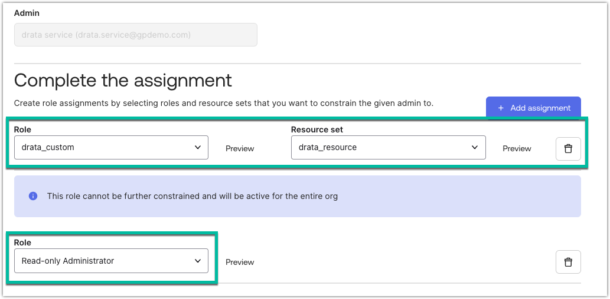

# Okta Integration Guide (User Access Review)

Source: https://help.drata.com/en/articles/8542832-okta-integration-guide-user-access-review
Collection: Connection Support › Other Guidance
Updated: 2026-11-14
Fetched: 2026-11-22
Description: Connect Okta as an user access review (UAR) connection type

## Article text

The Okta User Access Review (UAR) integration enables security, IT, and compliance teams to automate access reviews and gain visibility into workforce identity management. It connects Drata to your Okta tenant to sync users, groups, and role assignments.

### Key Capabilities

- **User & Group Sync**: Imports users, groups, and role assignments from Okta into Drata.
- **De-provisioning Evidence**: Tracks suspended or deactivated accounts to support off-boarding controls.
- **Audit Visibility**: Collects identity metadata and logs for audit-ready reporting.

## Prerequisites & Data Access

Before setting up the Okta integration for user access review:

1. An existing Okta IdP connection in Drata.
2. An **Okta Super Admin** (one-time) to create a custom admin role and resource set.
3. A **dedicated Okta service account** to:
   - Be assigned the custom admin role and resource set
   - Okta API token created with **least privilege** permissions (explained within this article).

**Additional notes**

- **Verify which apps Okta can provision or connect to.** Some applications do not expose user data even when integrated with Okta, refer to[Okta integration network](https://www.okta.com/integrations/?category=lifecycle-management).
- Okta provides user attributes based on **how SSO provisioning is configured**. Some apps may not appear if provisioning is not fully managed through Okta.
- If your IT team **provisions user access outside of Okta** (for example, assigning access directly in a SaaS app), visibility will be limited. You can upload user lists manually or use Drata direct integrations when available.

**Permissions & Data Table**

| **Permission / Scope** | **Why It’s Needed** | **Data Accessed (Read Only)** |
|---|---|---|
| For custom administrator role: **View roles, resources, and admin assignments** | Required to retrieve role metadata for user access review | Role metadata and assignments |
| For resource set: **Identity and Access Management** → **All Identity and Access Management resources**. | Limits Drata to directory-related data only, following least privilege | Access to identity directory data (users & groups) within scope |

## Step-by-Step Setup

### Step 1: Create custom administrator role

A **Super Admin** is required for this step. You will NOT use a Super Admin API token. Drata uses a **custom admin role** following the **principle of least privilege**.

1. Log in to Okta as a **Super Administrator**.
2. Navigate to **Security > Administrators > Roles**.
3. Click **Create new role**.
4. Enter a role name (e.g., `drata_custom`) and description.
5. Click **Add Permissions**, and select:
   - View roles, resources, and admin assignments
6. Click **Save Role**.

### Step 2: Create a resource set

Okta requires **custom roles to be assigned to a resource set**.

1. Navigate to **Security > Administrators > Resource Sets**.
2. Click **Create new resource set**.
3. Enter a name (e.g., `drata_resource`) and description.
4. Click **Add Resource** and choose:
   - Identity and Access Management → All Identity and Access Management resources
5. Click **Save Resource Set**.

This grants read access **only** to identity-related resources.

### Step 3: Create account to assign role

1. Create a **service account** in Okta for Drata (e.g., `drata_service@yourcompany.com`).
2. Assign to it:
   - **Read-Only Administrator** role **(`drata_custom`)**
   - **Resource Set (`drata_resource`)**
   

### Step 4: Create the API token

1. Log in as the **service account user**.
2. Navigate to **Security > API > Tokens**.
3. Click **Create Token** and name it `Drata`.
4. Copy and securely store the token (you will not be able to view it again).

### Step 5: Complete the Connection

When connecting, enter the following values from Okta:

| **Drata Field** | **Okta Value** |
|---|---|
| API Token | Generated in Step 3 via service account |
| Okta Domain URL | Your Okta tenant domain (e.g., `https://company.okta.com`) |
| Service Account Email | Email of the Okta service account used for generating token |

For steps on accessing and using the Connections page in Drata, refer to [The Connections Page in Drata](https://help.drata.com/en/articles/12305645-the-connections-page-in-drata).

### Step 6: Verify

1. Go to the **Connections** page in Drata and locate the **Okta** tile.
2. Select **Manage Accounts**.
3. Confirm that users are successfully syncing from Okta.

## Important Notes

- Use **API tokens from a dedicated service account** only.
- Nested groups in Okta may sync differently depending on your organization’s setup.
- Okta attribute mappings may impact **role visibility** and **access review completeness**.
- If some users or apps do not appear, verify whether those are managed **outside of Okta**.

## Images

- [image 01] ../../images/integrations/okta/okta-integration-guide-user-access-review--01.png

## Related articles

- [Okta Integration Guide (Identity Management Provider)](okta-integration-guide-identity-management-provider.md)
- [Segment Integration Guide](segment-integration-guide.md)
- [Canva Integration Guide](canva-integration-guide.md)
- [JetBrains Integration Guide](jetbrains-integration-guide.md)
- [Tableau Integration Guide](tableau-integration-guide.md)
