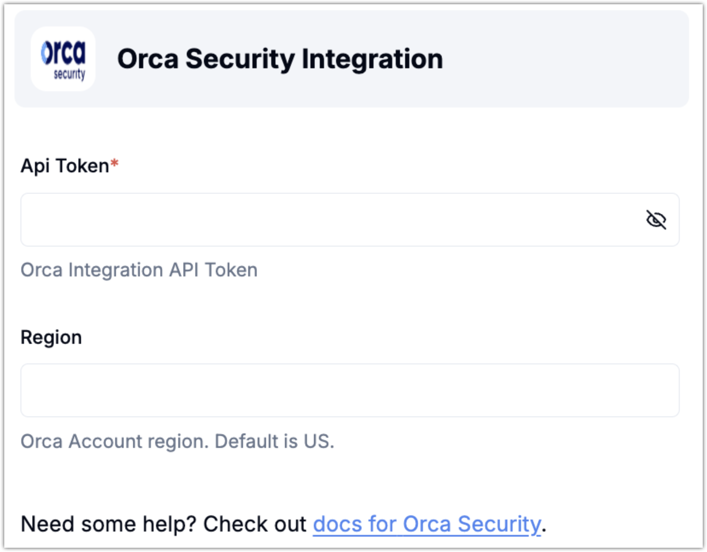

# Orca Security Integration Guide

Source: https://help.drata.com/en/articles/13131033-orca-security-integration-guide
Collection: Connection Support › Other Guidance
Updated: 2026-07-27
Fetched: 2026-11-22
Description: Connection type: Vulnerability

## Article text

The Orca integration enables Drata to import vulnerability findings from your Orca Security platform. These findings support Drata’s vulnerability scanning tests and help maintain continuous visibility into security issues across your environment.

## Key Capabilities

- **Automated Data Retrieval**: Imports findings from supported scanning tools
- **Evidence support:** Provides vulnerability data used in Drata’s automated evidence collection for vulnerability scanning tests mapped to DCF-18.
- **Read-only access**: Retrieves vulnerability metadata without triggering or modifying scans

## Prerequisites & Data Access

- You must have access to Orca with permission to create API tokens.
- API Token must be assigned the **Viewer role**, which provides read-only access to vulnerability data.
- The integration requires:
   - **Orca Region** (where your Orca environment is hosted)
   - **Orca API Token** (Service Token)
- Must be assigned one of the following Drata roles: **Admin, Workspace Managers, DevOps Engineer**.
- If you have the **Access Reviewer** Drata role, you can only view the Connections page.

**Important Note about Sync duration:**

- The initial sync may take additional time depending on how many vulnerabilities exist in your environment.
- Drata retrieves up to **1,000 new findings per day**. If your environment contains more than 1,000 findings, only the first 1,000 will be included in each daily sync, based on the scope you configured when connecting.
- Any remaining findings are synced (up to a 1,000) during the next daily update. The order in which findings sync is determined by the scope you configured during the connection setup.

## Permissions & Data Table

| Permission / Scope | Why It’s Needed | Data Accessed (Read-Only) |
|---|---|---|
| Orca API Token | Authenticates Drata to retrieve vulnerability data | Vulnerability findings (code, host, container), alerts, and AppSec scan results |
| Orca Region | Restricts which environments Drata can read | Only findings within the selected cloud accounts or business units |

## Step-by-Step Setup

### Step 1: Create your API Token

1. In Orca, navigate to: **Settings → Users & Permissions → API**
2. Select **Add API Token**.
3. Enter a **Name** and optional **Description** for the new API token.
4. Enable:
   - **Never Expire** (recommended)
   - **Service Token**
      - **Important Note**: Service tokens are not linked to a specific user. The token is scoped according to the user who created it but can still be used if the user is removed from the organization.
5. Set **Role = Viewer** (read-only).
6. Configure which cloud accounts or business units the API token can access
   - **All Cloud Accounts**: Leave the scope unchecked to allow the integration to access data from all cloud accounts and business units in your Orca environment.
   - **Specific Resources**: Check “Scope access to specific resources” to limit the token to designated accounts or business units only.
7. Select **OK** to create the token.

The integration fetches the following data types from scoped resources:

- **Alerts**: Security alerts including vulnerability findings of type **`code`**, **`host`**, and **`container`**
- **Assets**: Resource information including branches, containers, hosts, and images
- **Application Security findings**: Code security vulnerabilities from AppSec scans

**Expected outcome:**
You have configured a read-only Viewer-role service token with the correct scope.

---

### Step 2: Save your API token.

1. In the **Integration API Token** pop-up, click **Add**.
2. Copy the API token immediately. Orca will not show it again.

**Expected outcome:**
You have the API Token ready for use in Drata.

---

### Step 3: Copy your region (Optional)

**Note**: The default is US.

1. Your Orca **Region** corresponds to the URL you use to access your Orca environment.
2. For Example: `https://app.us.orcasecurity.io` → Region = `US`
3. Enter region in uppercase.

**Expected outcome:**
You have the region and API Token ready for use in Drata.

---

### Step 4: Connect inside Drata

1. In Drata, go to **Connections** .
2. Go to your available connections and search and choose to connect **Orca Security. **Ensure it is the correct type of connection.
3. Select the following configurations:
   - **Severity of vulnerabilities:** Choose the severity levels you want to import (Critical, High, Medium, Low).
   - **Date:** Select the date from which vulnerabilities should be pulled.
   - Orca API Token
   - Region
   
4. Save and test the connection.

**Expected outcome:**
Drata connects successfully and begins retrieving vulnerability findings according to your token scope.

---

### Step 5: Validate connection / test

1. Confirm the connection card shows **Connected** in Drata.
2. Navigate to **Vulnerabilities** to confirm findings are being populated.
3. Drata shows *findings*, which are instances of *vulnerabilities* (an individual but higher-level CVE) against specific resources. This may reflect as higher finding counts in Drata vs. your Orca Security dashboard.
4. Validate that only scoped resources appear, if you restricted the API token's access.

**Expected outcome:**
Orca vulnerabilities appear inside Drata and can be used to support applicable vulnerability scanning tests.

---

## Images

- [image 01] ../../images/integrations/orca-security/orca-security-integration-guide--01.png

## Related articles

- [Aikido Integration Guide](aikido-integration-guide.md)
- [Arnica Integration Guide](arnica-integration-guide.md)
- [Wiz (Vulnerability Scanning) Integration Guide](wiz-vulnerability-scanning-integration-guide.md)
- [Upwind Integration Guide](upwind-integration-guide.md)
- [GitLab VMS Integration Guide](gitlab-vms-integration-guide.md)
