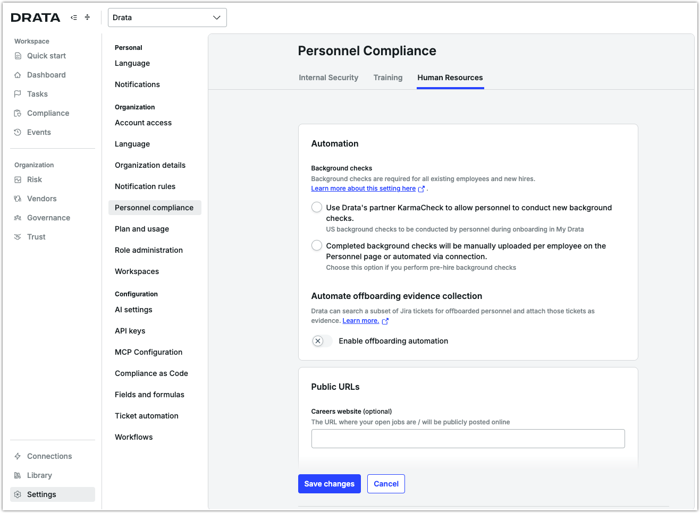
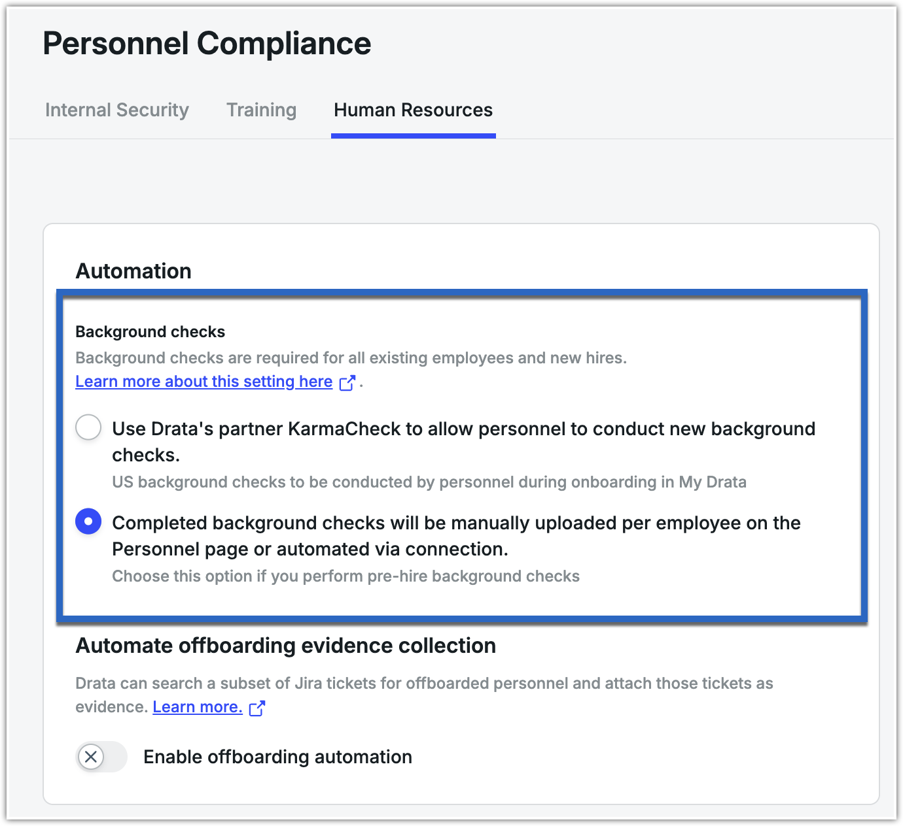
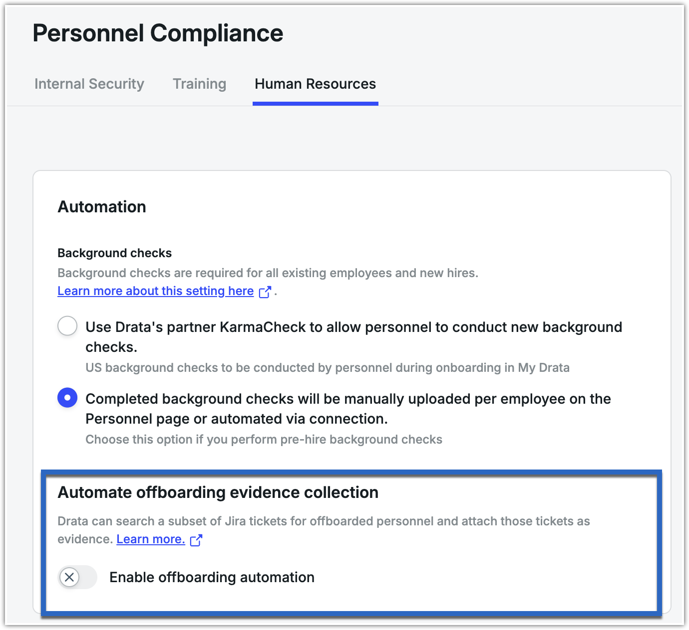
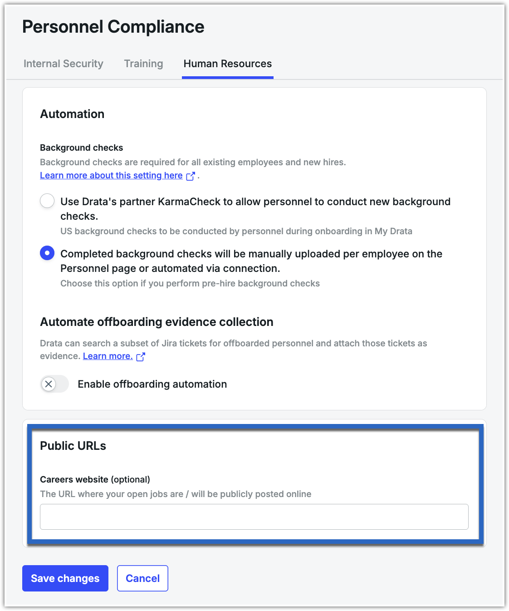

# Organization settings: Human Resources Settings (New Experience)

Source: https://help.drata.com/en/articles/13566413-organization-settings-human-resources-settings-new-experience
Collection: Settings
Updated: 2026-11-09
Fetched: 2026-11-22
Description: Configure personnel-related controls used for audit evidence and compliance reporting.

## Article text

The **Human Resources** section in Settings helps you configure how Drata collects and stores evidence related to employee lifecycle controls.

These settings support audit requirements such as:

- Background checks
- Hiring and onboarding documentation
- Offboarding evidence
- Organizational structure
- Performance evaluation processes

Most settings apply **organization-wide** and directly impact audit readiness.

## Prerequisites

- Drata roles: **Admins or Personnel compliance managers** can manage Human Resources settings.
- Individual employee data (background checks, status) is managed on the **Personnel** page.
- Some features depend on **connected providers**.

## Find Human Resources settings

1. Select **Settings**.
2. Go to **Organization** > **Personnel compliance**.
3. Open **Human Resources** tab.

Human Resources settings define **how Drata evaluates personnel controls**, not individual employees. This includes:

- How background checks are handled
- Required HR documentation used as evidence
- Links and documents auditors commonly request

---

## Background checks

You can choose how background checks are initiated and recorded in Drata. Use this section to define how background checks are handled for your organization.

You can require background checks for:

- All existing employees
- New hires

---

### Choose how background checks are completed

**Option 1: Use Drata's partner [Partner Name] to allow personnel to conduct new background checks.**

Use this option if you:

- Use one of Drata’s background check partner
- Would like to enable U.S. background checks during onboarding in **My Drata**

**Option 2: Completed background checks will be manually uploaded per employee on the Personnel page or automated via connection.**

Use this option if:

- Background checks are uploaded per employee on the **Personnel** page
- You perform background checks **before hire**
- Background checks are completed outside of Drata

---

## Automate offboarding evidence collection

Drata can automatically collect evidence when employees are offboarded.

When enabled:

- Drata searches a defined subset of Jira tickets
- Relevant tickets are attached as offboarding evidence

Use this setting if:

- You manage offboarding through Jira
- You want automated evidence collection for access removal

---

## Public URLs: Careers website (optional)

Provide the public URL where job openings are posted. This supports audit validation of hiring practices.

---

## Required documentation

Upload and maintain the following documents to support HR-related controls. These files are used as **audit evidence**.

1. **Employee performance evaluation process:** Describe how employee performance is evaluated. Must describe the process (not individual reviews).
2. **Sample employment agreement: **Upload a sample agreement with Confidentiality or NDA language and Employee signature section
3. **Company org chart: **Upload an org chart that includes employee names, roles, and reporting structure
4. **Sample engineering job description: **Upload a sample job description for an engineering role. Screenshot or PDF is acceptable

---

### File management notes

- Uploaded files can be downloaded or replaced
- To replace a file, delete the existing file and upload a new version

---

## Audit considerations

- Missing or outdated documents may cause controls to fail
- Background check configuration must align with actual hiring practices
- Offboarding automation should match how access is revoked in practice

---

## Partner Offers & Discounts

Drata has direct partnerships with leading background check providers such as Checkr and Amiqus for **first time and new customers**. Check out [more partner offers and discounts](https://drata.com/partner/find/tech-directory?collections=partner-discountoffers,partner-offers-discounts-pod).

- **Checkr**: Global background checks. Get $100 credit by using the code `DRATA100` when creating your account through Drata. Credit will be applied towards future invoices until exhausted.
- **Amiqus**: Focused on UK background checks. Visit [https://amiqus.co/partners/amiqus-x-drata](https://amiqus.co/partners/amiqus-x-drata) to get 10% off your first 3 months.
   - **Note:** Amiqus cannot be directly integrated with Drata.

## Images

- [image 01] ../../images/ux/settings/organization-settings-human-resources-settings-new-experience--01.png
- [image 02] ../../images/ux/settings/organization-settings-human-resources-settings-new-experience--02.png
- [image 03] ../../images/ux/settings/organization-settings-human-resources-settings-new-experience--03.png
- [image 04] ../../images/ux/settings/organization-settings-human-resources-settings-new-experience--04.png

## Related articles

- [Background Check Management](background-check-management.md)
- [Personnel Overview](personnel-overview.md)
- [Manually map proof of a background check](manually-map-proof-of-a-background-check.md)
- [Managing Personnel Compliance in Drata Training Video (New Experience)](managing-personnel-compliance-in-drata-training-video-new-experience.md)
- [Bulk Import Personnel Background Checks (New Experience)](bulk-import-personnel-background-checks-new-experience.md)
