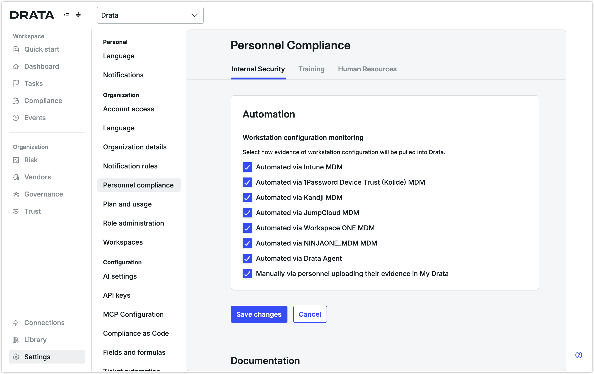

# Organization settings: Internal Security

Source: https://help.drata.com/en/articles/13566935-organization-settings-internal-security
Collection: Settings
Updated: 2026-11-09
Fetched: 2026-11-22
Description: The Internal Security settings define how employee-related security evidence is sourced and tracked across your organization.

## Article text

Internal Security overview manages how security evidence is collected and tracked for personnel requirements like workstation compliance and training. These settings automate audit preparation by defining how employee data is sourced across your organization.

Configure how Drata collects evidence for employee security requirements, including workstation compliance, security awareness training, and physical access records.

The Internal Security settings define **how employee-related security evidence is sourced and tracked** across your organization. These settings directly support multiple compliance controls and affect onboarding, recurring tasks, and audit evidence.

## Prerequisites

- **Required Drata roles:** Administrators

### Find Internal Security settings

Go to **Settings**. Under **Organization**, select **Personnel compliance**, then select **Internal Security**.

The Internal Security page is divided into the following sections:

1. Workstation configuration monitoring
2. Office visitor logs

Each section determines **how evidence is collected**, not whether the requirement exists.

---

## Workstation configuration monitoring

Define how Drata collects evidence for employee workstation security controls. You can choose one or more of the following methods:

- **Drata Agent: **Automatically collects workstation configuration evidence from employee devices.
- **MDM integration: **Uses a supported mobile device management (MDM) provider to collect device compliance data.
- **Manual uploads (My Drata): **Allows employees to upload evidence manually through their My Drata tasks.

Important behavior notes:

- Using automated methods does **not** prevent manual uploads.
- The **manual option only affects the employee My Drata experience**.
- Administrators can always upload evidence directly to personnel records if needed.

---

## Office visitor logs

If your organization has a physical office, upload visitor sign-in records to support physical access controls.

Accepted formats include:

- Exported visitor logs
- Images or scans of physical sign-in books

If your organization does **not** maintain a physical office, this section may be left blank.

---

## Common misconfigurations to avoid

- Enabling manual-only workstation evidence without clear employee guidance
- Assuming MDM or agent connections retroactively populate past evidence

## Images

- [image 01] ../../images/ux/settings/organization-settings-internal-security--01.png

## Related articles

- [Test 65: Security Patches Auto-Applied](test-65-security-patches-auto-applied.md)
- [Manual evidence uploads for personnel compliance checks](manual-evidence-uploads-for-personnel-compliance-checks.md)
- [Rippling Integration Guide (HRIS, MDM, UAR)](rippling-integration-guide-hris-mdm-uar.md)
- [Organization settings: Human Resources Settings (New Experience)](organization-settings-human-resources-settings-new-experience.md)
- [Multi-Device Support](multi-device-support.md)
