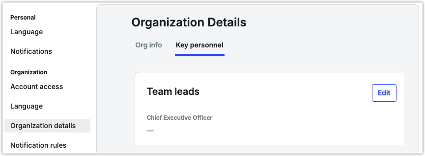

# Organization settings: Key Personnel Information (New Experience)

Source: https://help.drata.com/en/articles/13566374-organization-settings-key-personnel-information-new-experience
Collection: Settings
Updated: 2026-11-09
Fetched: 2026-11-22
Description: Define leadership and accountability roles used in audits and compliance reporting.

## Article text

Key Personnel Information establishes **who is accountable** for security, compliance, and governance at your organization.

## Prerequisites

- Only **Admins** can manage Key Personnel Information.
- Personnel must already exist in Drata to be assigned.

### Access Key Personnel Information

1. Select **Settings**.
2. Go to **Organization details**.
3. Open the **Key personnel** tab.

### What you configure here

You assign individuals responsible for core governance functions. Each role represents **responsibility**, not just a job title. If your organization does not have a formal title (for example, no CISO or Board), assign the person who performs the responsibilities described.

---

### Board of Directors

If your organization has a board:

- Assign the appropriate individuals
- Include links to public profiles where applicable (LinkedIn is commonly used)

If you are an early-stage company, it can be acceptable for founders or executives to fulfill board-level responsibilities. Auditors typically evaluate **function**, not formality

---

## Common mistakes to avoid

- **Leaving roles unassigned: **Auditors may flag missing governance ownership.
- **Assigning inactive users: **Ensure assigned personnel are current and active in Drata.
- **Using titles instead of responsibility: **Auditors care about *who owns the responsibility*, not the title text.

## Images

- [image 01] ../../images/ux/settings/organization-settings-key-personnel-information-new-experience--01.png

## Related articles

- [Personnel Overview](personnel-overview.md)
- [Organization settings: Organization Details (New Experience)](organization-settings-organization-details-new-experience.md)
- [Organization settings: Human Resources Settings (New Experience)](organization-settings-human-resources-settings-new-experience.md)
- [Roles and permissions overview (New Experience)](roles-and-permissions-overview-new-experience.md)
- [Audits page overview (New Experience)](audits-page-overview-new-experience.md)
