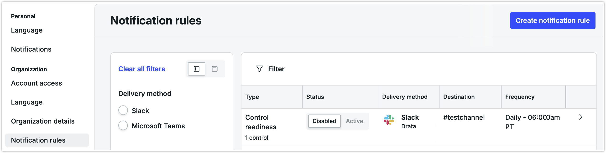
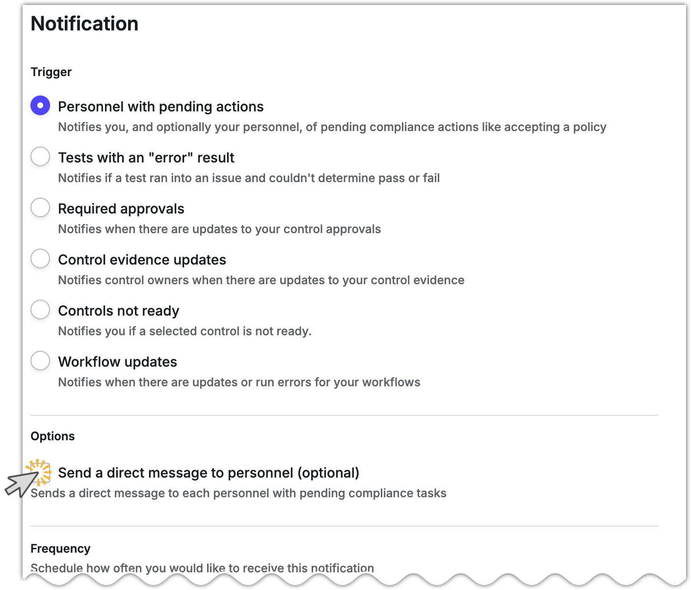
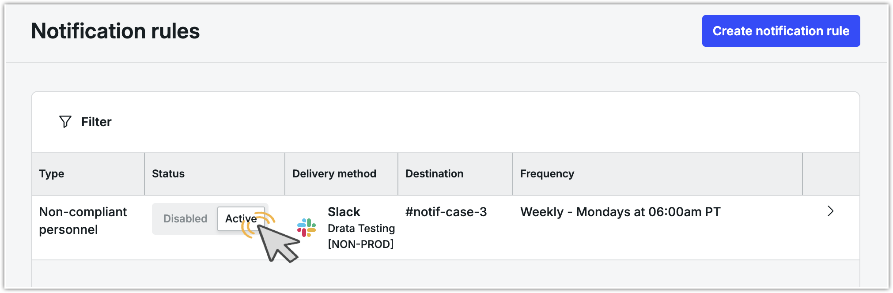

# Organization settings: Notifications rules

Source: https://help.drata.com/en/articles/13566136-organization-settings-notifications-rules
Collection: Settings
Updated: 2026-11-14
Fetched: 2026-11-22
Description: Organization notifications rules let you configure automated compliance updates to Slack or Microsoft Teams.

## Article text

These notifications help teams stay on top of control readiness, personnel actions, and system errors, without relying on individual email preferences.

### What organization notifications are used for

Use organization notifications to:

- Monitor **controls that are not audit-ready**
- Track **personnel with pending compliance actions**
- Surface **monitoring or automated test errors**
- Keep security and compliance teams aligned in shared channels

⚠️ **Important:** These notifications may include **sensitive compliance or personnel information**. Choose destinations carefully.

---

## Prerequisites

Before creating notifications, you must connect at least one messaging platform: **[Slack](slack-integration-guide-communication-and-uar.md) **or **[Microsoft Teams](microsoft-teams-integration-guide.md)**

### Slack-specific prerequisites (private channels)

If you plan to send notifications to **private Slack channels**, the **Drata app must be added** to each private channel. Here are the options to add Drata to a private Slack channel:

**Option 1: Command**

```
/invite @Drata
```

**Option 2: Slack UI**

1. Open the channel
2. Select the channel name → **Integrations**
3. Select **Add an app**
4. Add **Drata**

### Microsoft Teams-specific prerequisites (direct messaging)

If you plan to use direct messaging for Teams notifications:

- The **Drata App must be installed** in Microsoft Teams. If it is not installed, contact your IT team.
- Direct messages are sent through the **Drata App**—not to a user's personal chat.
- Personnel must have **Allow notifications** enabled under **Settings > Personal > Notifications** to receive direct messages. This toggle applies to email, Slack, and Teams notifications.

⚠️ Microsoft Teams does not support sending notifications to private channels.

---

## Create an organization notification

1. Select **Settings**.
2. Go to** Notification rules**.
3. Select **Create notifications rule**



---

## Choose a target

### Slack

- Select one or more public or private channels
- Or notify specific users
- Private channels require the Drata app to be added

### Microsoft Teams

- Paste the **channel URL** as the destination

**How to get a Teams channel URL: **Copy from the browser address bar **or **select **Get link to channel** in Teams

---

## Available notification types

Notification options depend on whether you’re using **Slack** or **Microsoft Teams**.

- **Personnel with Pending Actions**
   - Notifies pending compliance actions (for example, accepting a policy).
   - ⚠️ May include names and compliance status.
   - **Recommended:** Send to a private channel.
- **Tests with an “Error” Result**
   - Alerts you when an automated test encounters an issue and cannot determine pass or fail.
   - These errors require investigation to restore monitoring.
- **Required Approvals**
   - Notifies you when there are updates or changes to control approvals.
- **Control Evidence Updates**
   - Notifies control owners when evidence has been added or updated for their controls.
- **Controls Not Ready**
   - Alerts you when selected controls are not audit-ready.
   - You can choose specific controls to monitor.
   - Notifications are only sent if issues are detected.
- **Workflow Updates**
   - Notifies you when workflows are updated or encounter run errors.

---

## Send a direct message to personnel

When enabled, Drata sends the notification to both the configured destination channel and directly to each relevant personnel in Slack or Microsoft Teams. The channel notification is always sent regardless of whether this option is enabled.

⚠️ Direct messages are sent through the **Drata App** in Slack or Microsoft Teams—not to a user's personal chat. Ensure the Drata App is installed before enabling this option.

⚠️ Personnel must have Allow notifications enabled under Settings > Personal > Notifications to receive direct messages. This toggle applies to email, Slack, and Teams notifications.



The following notification types support direct messaging:

| Notification Type | Description | Send a direct message to personnel (optional) |
|---|---|---|
| **Personnel with Pending Actions** | Notifies you, and optionally your personnel, of pending compliance actions like accepting a policy. | Sends a direct message to each personnel with pending compliance tasks. |
| **Required Approvals** | Notifies when there are updates to your control approvals. | Sends a direct message to each personnel with pending compliance tasks. |
| **Control Evidence Updates** | Notifies control owners when there are updates to your control evidence. | Sends a direct message to each control owner when there are updates to your control evidence. |
| **Workflow Updates** | Notifies when there are updates or run errors for your workflows. | Sends a direct message to each personnel with pending compliance tasks. |

---

## Notification frequency

Available frequencies:

- **Daily**: Sent at **6:00 AM PT**, including weekends
- **Weekly**: Sent **Mondays at 6:00 AM PT**

---

## Manage existing notifications

For each notification rule, you can:

- **Disable: **Temporarily stop the notification without removing it. Use this if the rule may be needed again.
- **Active: **Turn the notification back on so it resumes sending alerts based on its configured schedule.
   
- **Delete: Select the notification rule to **permanently remove the notification rule.
   - ⚠️ This action cannot be undone.

---

## Common misconfigurations to avoid

- ❌ Sending personnel notifications to public channels
- ❌ Forgetting to re-authorize Slack after adding private channels
- ❌ Assuming notifications replace dashboards or reports
- ❌ Expecting personal notification settings to affect org rules
- ❌ Expecting Teams or Slack direct messages to arrive in personal chat instead of the Drata App

## Images

- [image 01] ../../images/ux/settings/organization-settings-notifications-rules--01.png
- [image 02] ../../images/ux/settings/organization-settings-notifications-rules--02.png
- [image 03] ../../images/ux/settings/organization-settings-notifications-rules--03.png

## Related articles

- [Slack Integration Guide (Communication and UAR)](slack-integration-guide-communication-and-uar.md)
- [Microsoft Teams Integration Guide](microsoft-teams-integration-guide.md)
- [Create Workflow for Personnel](create-workflow-for-personnel.md)
- [Manage Notifications for Required Approvals and Control Updates](manage-notifications-for-required-approvals-and-control-updates.md)
