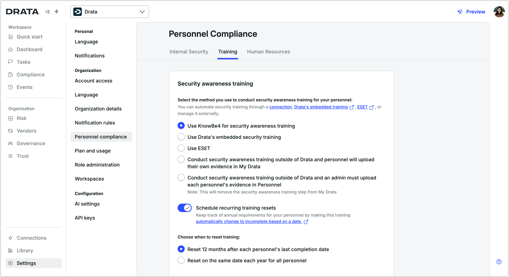
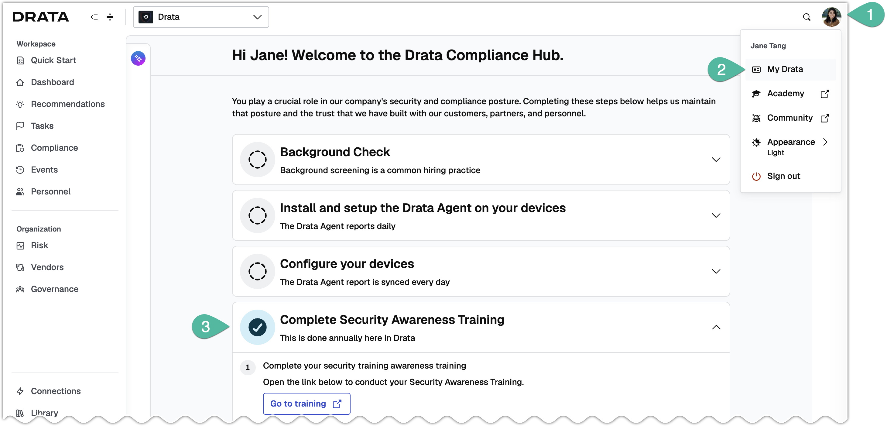

# Organization settings: Security awareness, HIPAA, and AI training

Source: https://help.drata.com/en/articles/13566994-organization-settings-security-awareness-hipaa-and-ai-training
Collection: Settings
Updated: 2026-11-14
Fetched: 2026-11-22

## Article text

Security training helps fulfill personnel-related requirements across frameworks such as SOC 2 and HIPAA. Drata allows you to configure **how training is delivered, tracked, and reset over time**, while ensuring evidence is available for audits.

## Prerequisites

- **Required Drata roles: Admins only**

## Where to configure

1. Go to **Settings**
2. Under **Organization**, select **Personnel compliance**
3. Select the **Training** tab

## Security Awareness Training

Security awareness training helps your organization ensure personnel understand basic security practices and meet compliance requirements.

In Drata, you can choose how training is completed and how evidence is collected for audits.

---

## Choose a Training Method

Drata supports several ways to manage security awareness training. Select the option that best fits your organization’s process.

### Drata Embedded Training (Default)

With Drata’s built-in training:

- Personnel complete training directly in Drata
- Completion is recorded automatically
- Audit-ready evidence is attached to each personnel record
- Training must be completed again when the recurrence resets

This is the simplest option for maintaining compliance.

**How personnel complete it:** Personnel access the embedded training from **My Drata** (select your profile icon, then **My Drata**) under the **Complete Security Awareness Training** task.

Select **Go to Training** to start. Once finished, the task shows as completed in **My Drata** and on the **Personnel** page. Any other required training — such as HIPAA or AI Awareness Training — appears in the same **My Drata** page

---

### Connected Training Provider

If your organization already uses a training platform, you can connect it to Drata.

- Supported providers include KnowBe4 and ESET
- Completion data is synced automatically when available

This option reduces manual uploads while using your existing system.

---

### External Training (Evidence Upload)

If training is completed outside of Drata, evidence must be uploaded manually.

You can choose one of the following:

- **Personnel upload:** Each person uploads proof of completion in *My Drata*
- **Admin upload:** An admin uploads evidence to each personnel record

Admin upload removes the training step from personnel onboarding, but increases admin responsibility.

---

### Recurring Training Resets

To support annual or recurring compliance requirements, you can require training to reset automatically.

Choose one of the following reset options:

- Reset 12 months after each person’s last completion
- Reset on the same date each year for all personnel

When a reset occurs, training status returns to **Incomplete** until new evidence is provided.

---

## HIPAA Training (If Enabled)

If HIPAA is enabled in your account, additional HIPAA training settings appear. You can select:

- Drata embedded HIPAA training
- HIPAA training through KnowBe4
- External training with uploaded evidence
- No HIPAA training required

HIPAA compliance is based on whether valid evidence exists for each current employee or contractor.

Recurring reset behavior works the same as security awareness training.

---

## AI Awareness Training (If Enabled)

At least one framework out of ISO 42001:2023 or NIST AI RMF must be enabled on your account and within the workspace for these settings to appear.

AI awareness training helps organizations meet emerging expectations around AI governance and responsible use. You can choose to:

- Use Drata’s embedded AI awareness training
- Use a connected provider (such as KnowBe4)
- Manage training externally with evidence uploads
- Disable AI awareness training if it is not required

Disabling this option removes:

- The AI awareness compliance check
- The AI training step from personnel onboarding

Recurring reset options apply the same way as other training types.

---

## Training Status and Compliance

Training status reflects whether a person has completed the current training cycle.

- **Incomplete/Pending** means training has not been completed for the current period
- Status resets automatically based on your configured schedule
- Compliance is determined by valid evidence for the current cycle, not past completions. Historical evidence remains accessible- Compliance statuses are visible on the Personnel page, the Personnel Detail drawer, and the My Drata onboarding view, but do not count toward compliance after the reset date. To verify actual completion dates:

1. Open the individual’s Personnel drawer in Drata.
2. Alternatively, download the Compliance Overview CSV to review recorded completion timestamps.- The "Last checked" date may not update if a completion does not change compliance status (e.g., it remains passing).- You can filter or export the Personnel table to monitor compliance and identify employees who still need to complete their training.

---

## Important Notes

Keep the following in mind when configuring training:

- Training settings directly impact audit readiness
- Missing or outdated evidence may cause controls to fail
- Changing training settings does not retroactively mark personnel compliant
- Removing onboarding steps shifts evidence collection responsibility to admins- Use the Bulk Import Personnel Training Records workflow to efficiently re-upload certificates after a compliance reset.- Compliance requires evidence of training completion for the current cycle; past evidence does not count after a reset.

## Images

- [image 01] ../../images/ux/settings/organization-settings-security-awareness-hipaa-and-ai-training--01.png
- [image 02] ../../images/ux/personnel/organization-settings-security-awareness-hipaa-and-ai-training--02.png

## Related articles

- [Showing completion of Security Awareness Training](showing-completion-of-security-awareness-training.md)
- [Test 42: Policies for Security Awareness Training](test-42-policies-for-security-awareness-training.md)
- [KnowBe4 Integration Guide](knowbe4-integration-guide.md)
- [HIPAA Checklist](hipaa-checklist.md)
- [Reset recurring personnel trainings](reset-recurring-personnel-trainings.md)
