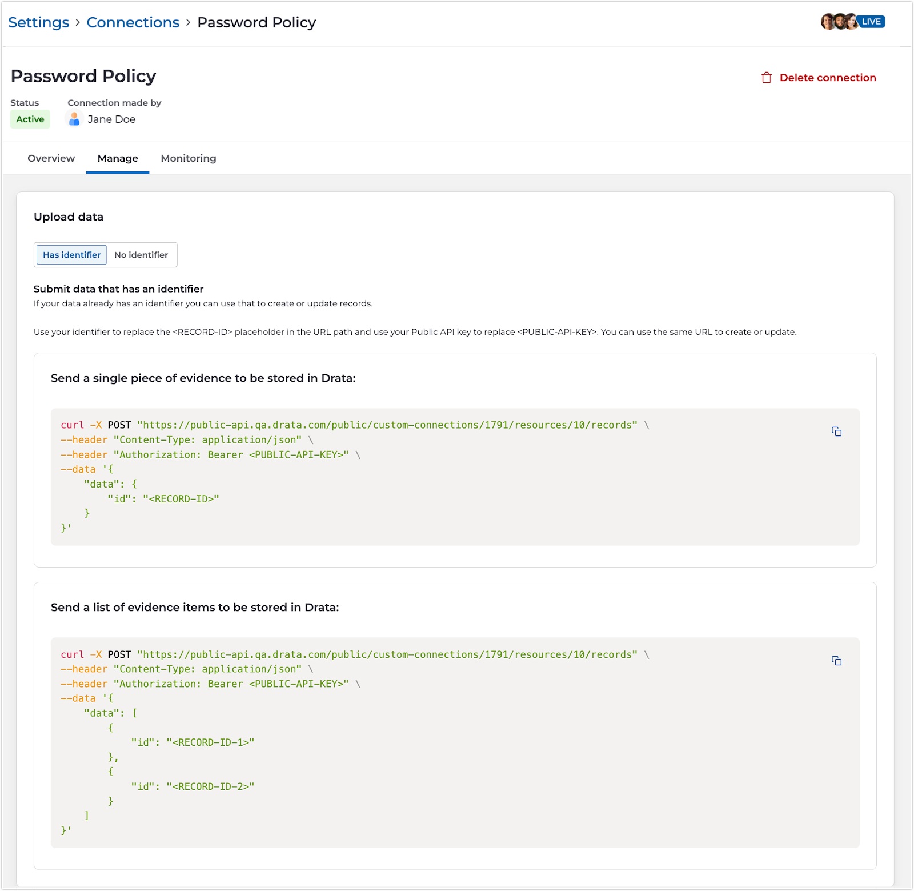
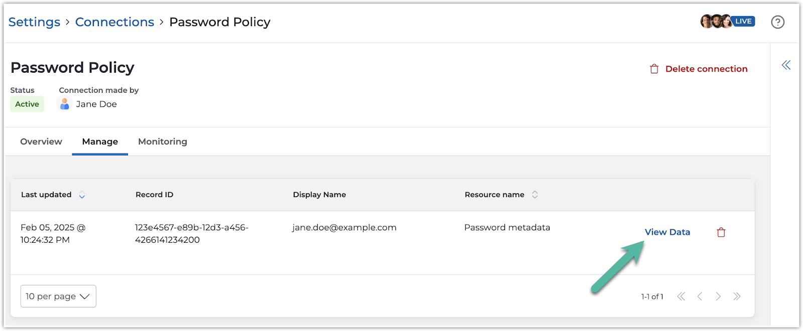
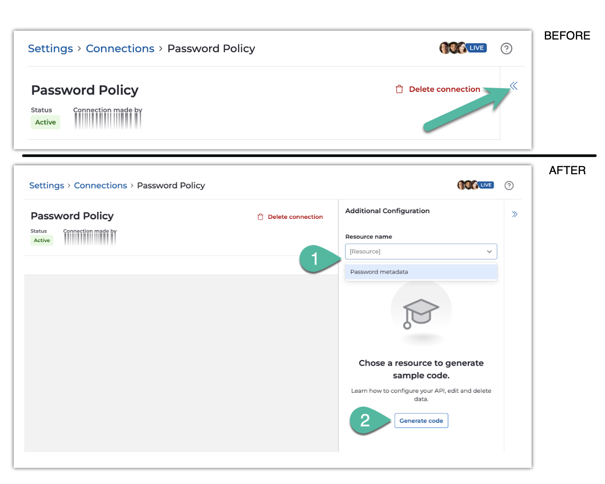

# Part 1: Custom Connections and Tests

Source: https://help.drata.com/en/articles/11995676-part-1-custom-connections-and-tests
Collection: Understand the Drata Platform › Connections › Custom Connections and Tests
Updated: 2026-11-14
Fetched: 2026-11-22

## Article text

If your organization uses a tool or system that Drata doesn’t currently integrate with, you can still automate evidence collection. With Custom Connections and Tests (CCT), you can send structured JSON data from any source, whether cloud-based, on-premises, or proprietary, directly into Drata and create custom tests that run against the data.

CCT includes two key capabilities:

- Custom Connections: Set up a connection to push JSON evidence into Drata from any external system.
- Custom Tests: Create and run custom tests against your data.

**Complete workflow overview**

Here’s how to connect an external system to Drata and run custom tests on the submitted data.

1. **Set Up a Custom Connection
   **Connect your external system and define the schema for the data you want to send.
2. **Submit Evidence
   **Submit your first dataset to confirm your connection and schema are working correctly.
3. **Automate Data Syncs
   **Set up a recurring data submission process using a tool like Make.com, Tines, or a scheduled script (such as a cron job). This ensures evidence is collected continuously without manual effort.
4. **Create a Custom Test
   **Use the Test Builder to define rules that validate your custom data—for example, checking whether MFA is enabled.
5. **Review Results and Link to Controls
   **View pass/fail results, manage exceptions, and map custom tests to compliance controls in Drata.

## Prerequisites

- **Availability**: Custom Connections and Tests are available on the **Advanced** and **Enterprise** plans.

**Notes:**

- The third-party platform configuration as well as the automation of the workflow and its cadence is set by the customer. This is **not **a standard integration.
- The use of custom connections requires developers to access the API and manually build into the workflow. The time required varies based on the complexity of each organization's configuration.
- The cadence and how data is pulled and pushed into Drata is determined and manually initiated by the customers.

## Step 1: Create a Custom Connection

1. In the left navigation panel, select **Connections**.
2. Near the upper-right corner, select **Create connection**.
3. Enter a **name**, **description**, and choose a **workspace**.

## Step 2: Set Up Your Data Source

Before submitting data, you'll define the structure of the data you'll send into Drata.

### Understand Data Structure Requirements

- Your JSON must include at least one property at the top level that's a string or number—like a name, email, or ID. Drata uses this property to create a display name, which helps you identify individual records in test results.
- Your JSON **must include at least one top-level property** that’s a string or number (such as a name, email, or id). This becomes the **display name** used to identify individual records in test results.
- Avoid top-level arrays. For example,[ { "email": "[user@example.com](mailto:user@example.com)" } ] prevents Drata from generating a display name and is not a supported schema.
- Multiple properties at the root level are supported, even if one of them is an array. For example:
   ```
{  
     "userId": "abc123",  
     "email": "jane@example.com",  
     "roles": ["admin"]
}
   ```
- If your data includes complex nested arrays, you may need to use the[advanced test editor](https://help.drata.com/en/articles/9492912-advanced-editor-in-the-test-builder) to create custom tests.

To learn, go to[JSON Schema](https://json-schema.org/docs).

### Define Your Schema

1. Enter a name and description for your data source.
2. Choose how to provide your schema.
   - You can define your schema in one of two ways:
      - **JSON Schema **or
      - **Sample JSON Data (Recommended approach).**
   - **JSON Schema**: Manually define the structure of your data, specifying the structure, data types, and required fields.
      - Example JSON schema:
         ```
{  
   "title": "Person",  
   "type": "object",  
   "properties": {    
                  "id": {"type": "string"},
                  "firstName": {"type": "string"},
                  "lastName": {"type": "string"},    
                  "title": {"type": "string"},    
                  "mfa": { "type": "boolean"}  
                  },  
   "required": ["firstName", "lastName","title", "mfa"],
   "additionalProperties": false
}
         ```
   - **Sample JSON Data **: Provide example JSON payload. Drata will automatically generate a schema based on the structure of your sample data.
      - **This is the recommended approach.** You can use a sample API response from your system to ensure the schema accurately reflects your real-world data.
3. Select** Validate** or **Generate **to verify or create your schema.
   - If you provide sample JSON Data, Drata verifies that it can generate a schema and updates it accordingly.

### Set the Display Name

Choose a field that Drata will use to identify records in test results. For example, if you want to identify users who don’t have MFA enabled, select the email field as the display name.

### Configure API Access

Choose to create an API key or utilize an existing API key.

- **Create an API key (Recommended approach)**: Includes the required scopes by default
- **Use existing API key**: Ensure your API key has the required scopes:
   - Under Custom Connections Data
      - Create Data
      - Create and Update Data
      - Delete Data

## Step 3: Submit Your First Dataset

After setting up your custom connection, submit a record or dataset to confirm that your configuration is working correctly.

**Requirements:**

- **JSON Request Requirement: **The request body must include a top-level field containing your JSON payload.
- **Maximum JSON size:** 5 MB
- **Rate limit:** 500 requests/min per source IP

**Response behavior:**

Drata's response will vary depending on whether the record is **new** or an **update**:

| **Status Code** | **Description** |
|---|---|
| 201 CREATED | The record was successfully created. |
| 200 OK | An existing record was updated. |

**To submit your first dataset:**

1. Upload data by sending JSON evidence records through a third-party tool or automation platform, such as Make.com or Tines.
2. View or manage your submitted records, go to the **Manage** tab.

Behavior differs depending on whether your data includes a unique identifier.



After submitting your record, select **View Data** for more information.



You can also expand the side panel to view additional available API calls.



## Example Scenarios: Single Evidence Submission

Here are some more examples for submitting a single piece of evidence or list of evidence items.

### Scenario 1: New Record (No ID Provided)

If the payload does not include an ID, a new record will be created.

**Request:**

```
{
"firstName": "Fred",
"lastName": "Krueger",
"title": "Antagonist"
}
```

**Response:**

A UUID will be generated for the evidence to be used in subsequent operations.

HTTP/1.1 201 Created

```
{
"id": "3aae5645-82cf-46ea-9e34-d5fe682eff48",
"firstName": "Fred",
"lastName": "Krueger",
"title": "Antagonist",
"createdAt": "2024-10-31T15:59:35.318Z",
"updatedAt": "2024-10-31T15:59:35.318Z"
}
```

### Scenario 2: Existing Record (ID Provided)

The payload includes an ID. A lookup will be performed in the custom_data table. If the record ID is found, the record will be updated (200). If no record ID is found, a new record will be created using the provided id (201).

**Payload:**

```
{
"id": "928764",
"name": "John Doe",
"age": 28
}
```

**Response:**

The record ID is found and is updated.

```
HTTP/1.1 200 OK
{
"id": "928764",
"name": "John Doe",
"age": 28,
"createdAt": "2024-12-02T15:30:00Z",
"updatedAt": "2024-12-03T15:35:00Z"
}
```

### Scenario 3: Submitting an Array of Records

**Processing Rules:**

Each object in the array will be validated and processed individually. Responses will include a status code (200, 201, or 400) for each item.

**Example Request:**

```
[
{
  "id": "2",
  "firstName": "Fred",
  "lastName": "Krueger",
  "title": "Antagonist"
},
{
  "firstName": "Michael",
  "lastName": "Myers",
  "title": "Serial Killer"
},
{
  "id": "230",
  "firstName": "Sarah",
  "lastName": "Connor",
  "title": "Resistance Leader"
}
]
```

**Example Response:**

In the response below, review the statusCode for each record to determine whether it was newly created or updated. **Fred Krueger** and **Michael Myers** were newly created (201), while **Sarah Connor** was updated (200) because her record with ID 230 already existed.

```
[
{
  "id": "2",
  "firstName": "Fred",
  "lastName": "Krueger",
  "title": "Antagonist",
  "statusCode": 201,
  "createdAt": "2024-10-31T15:59:35.318Z",
  "updatedAt": "2024-10-31T15:59:35.318Z"
},
{
  "id": "52411ed5-00e3-4c71-ade4-5ee14211250d",
  "firstName": "Michael",
  "lastName": "Myers",
  "title": "Serial Killer",
  "statusCode": 201,
  "createdAt": "2024-10-31T15:59:35.318Z",
  "updatedAt": "2024-10-31T15:59:35.318Z"
},
{
  "id": "230",
  "firstName": "Sarah",
  "lastName": "Connor",
  "title": "Resistance Leader",
  "statusCode": 200,
  "createdAt": "2024-10-20T15:59:35.318Z",
  "updatedAt": "2024-10-31T15:59:35.318Z"
}
]
```

## Next Step

**Ready to automate this process?
**→[Automate Evidence Submissions](part-2-automate-evidence-submission.md)

**Want to create a test and map the results to controls?**

→[Create, Run, and Map a Custom Test](part-3-create-run-and-map-a-custom-test.md)

## Images

- [image 01] ../../images/ux/connections/part-1-custom-connections-and-tests--01.png
- [image 02] ../../images/ux/connections/part-1-custom-connections-and-tests--02.png
- [image 03] ../../images/ux/connections/part-1-custom-connections-and-tests--03.png

## Related articles

- [Part 2: Automate Evidence Submission](part-2-automate-evidence-submission.md)
- [Custom Device Connections](custom-device-connections.md)
- [Dayforce Integration Guide (HRIS)](dayforce-integration-guide-hris.md)
- [Enable AI Summaries for Tests](enable-ai-summaries-for-tests.md)
- [Workday Implementation Best Practices](workday-implementation-best-practices.md)
