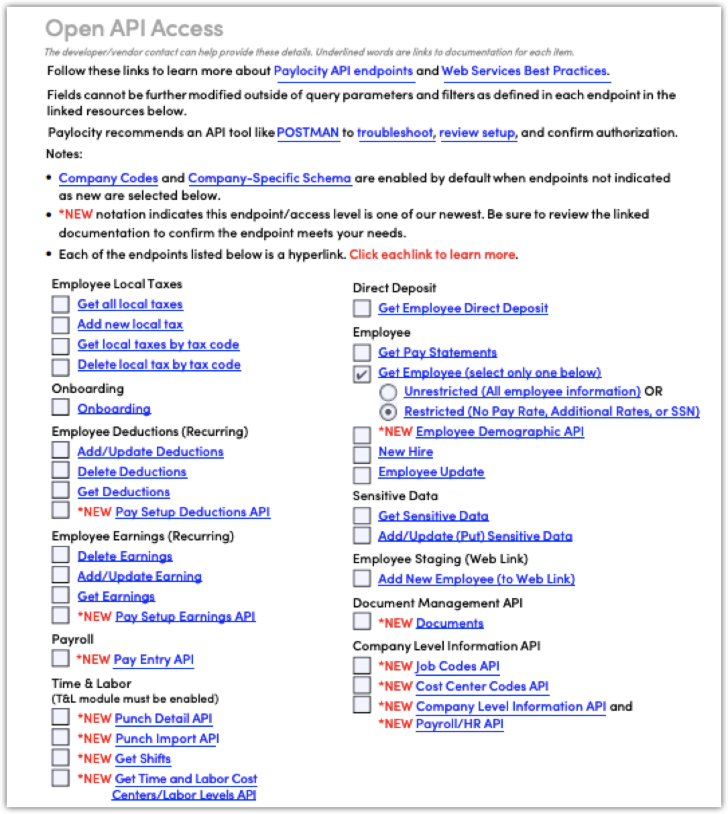

# Paylocity Integration Guide

Source: https://help.drata.com/en/articles/5260586-paylocity-integration-guide
Collection: Connection Support › Other Guidance
Updated: 2026-08-05
Fetched: 2026-11-22
Description: Making the initial connection to Paylocity

## Article text

The **Paylocity integration** enables security and compliance teams to automatically synchronize employee data from Paylocity. This allows Drata to collect evidence related to personnel hire dates, termination dates, and employment status to support compliance monitoring and audit readiness

---

## Prerequisites & Data Access

### Paylocity Access Requirements

- You must have **Admin access** in your **Paylocity account**.
- You must obtain **Paylocity API credentials** by submitting a **Paylocity Web Services Access Request Form**.
- Paylocity will provide the required **Client ID and Client Secret** after the request is approved.

Note: There may be a **cost associated with enabling the Paylocity API and obtaining credentials** from Paylocity.

### Drata Role Requirements

- To create or modify connections, you must have one of the following **Drata roles with write access**: Admin, Workspace Manager, or DevOps Engineer
- **Access Reviewers** can view the connection page but cannot create or modify connections

---

### Permissions & Required Access

| Permission | Why It’s Needed |
|---|---|
| Client ID | Identifies the Paylocity API application |
| Client Secret | Authenticates the Paylocity integration |
| Company ID | Identifies the Paylocity company being connected |

---

### Step 1: Submit a Paylocity Web Services Access Request

1. Download and complete the **[Paylocity Web Services Access Request Form](https://docs.paylocity.com/Knowledge/Partner%20Integration/Paylocity%20Web%20Services_Access%20Request.pdf)**.
2. Provide the required details
   - **Client Contact Information: **Enter contact details for someone at your company (for example, an HR administrator).
   - **Vendor / Third-Party Contact Information: **Enter information about the integration provider.
   - **Use Case Description: **Describe the integration use case and include the following statement: "We are using Merge to connect."
3. Select the required API permissions.

**Note: **The "**Get Employee** (Restricted)" permission (see screenshot below) is required to authenticate the integration. This is the only permission Drata needs to pull basic user data from Paylocity.
Only select additional permissions if you have additional integrations, other than Drata.



Expected outcome:
The access request form is completed with the required permissions.

---

### Step 2: Send the Request to Paylocity

Email the completed form to: **[webservices@paylocity.com]()**

The email body should contain the following:

```
Subject: Requesting Client ID and Client Secret

Hi Paylocity team, can we get access to a Client ID and Client Secret for API access? (https://www.paylocity.com/our-products/integrations/api-library/) We have attached the form specifying relevant permissions. 
```

Expected outcome:
Paylocity processes the request and provides your **Client ID** and **Client Secret**.

---

### Step 3: Retrieve Your Company ID

Your **Company ID** is the identifier used when logging into Paylocity.

You can find it in the **upper-left corner of the Paylocity portal**.

Important:

- If the ID includes **CS**, only enter the **number that follows it**.
- Company IDs are **case-sensitive**.

Example:

- If the ID is: `CS12345`
- Enter: `12345`

Expected outcome:
 You have identified the **Company ID** required for the connection.

---

### Step 4: Connect Paylocity in Drata

1. Log in to **Drata** → go to the **Connections** page.
2. Navigate to your **Available Connections**.
3. Search for and start the **Paylocity connection process**.
4. Enter the following information when prompted:

- **Client ID**
- **Client Secret**
- **Company ID**

Expected outcome:
 Paylocity is successfully connected and employee data begins syncing to Drata.

---

## Important Notes

- **Credential expiration:** Paylocity API credentials may need to be renewed periodically. Update the connection in Drata before credentials expire to avoid interruptions.
- **Multiple companies:** If your Paylocity account includes multiple companies, additional **Company IDs** may be entered during the connection process.
- **Duplicate employees:** Employees who work across multiple companies may appear multiple times in the synced data.

---

## Additional Resources

[Paylocity Authentication](https://developer.paylocity.com/integrations/reference/authentication)

## Images

- [image 01] ../../images/integrations/paylocity/paylocity-integration-guide--01.png

## Related articles

- [BambooHR Integration Guide](bamboohr-integration-guide.md)
- [TriNet Integration Guide](trinet-integration-guide.md)
- [Workday Integration Guide (HRIS)](workday-integration-guide-hris.md)
- [Bitwarden Integration Guide](bitwarden-integration-guide.md)
- [OpenVPN Integration Guide](openvpn-integration-guide.md)
