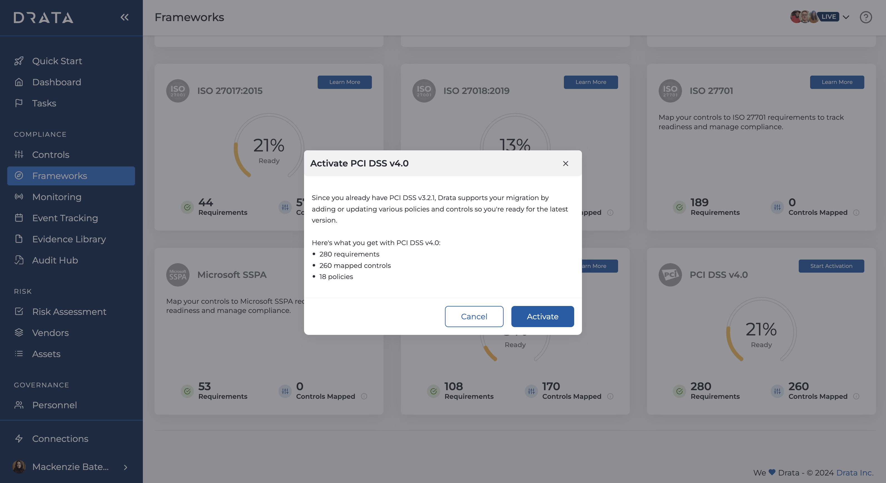
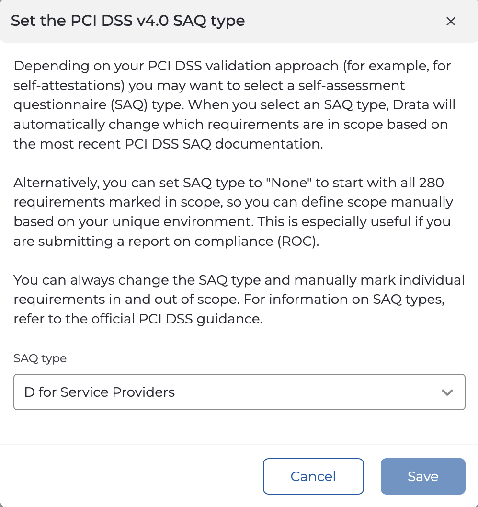
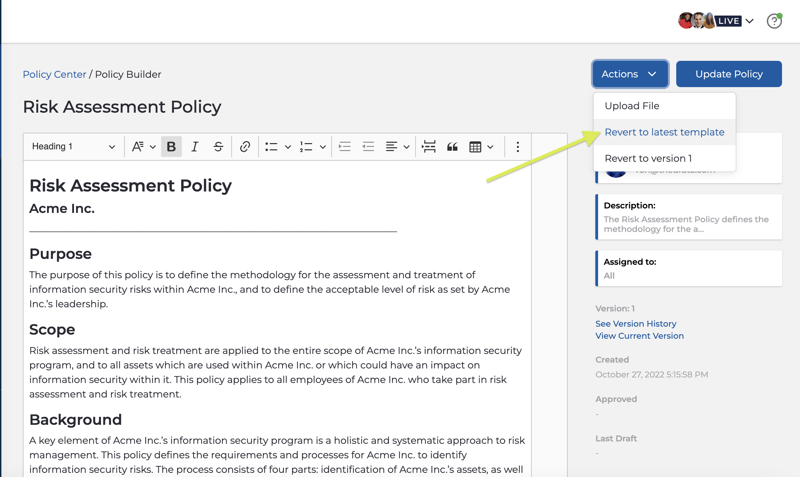

# PCI DSS v4.0

Source: https://help.drata.com/en/articles/8732413-pci-dss-v4-0
Collection: Framework Information › PCI DSS
Updated: 2026-11-14
Fetched: 2026-11-22

## Article text

## What do I need to know about the latest version of PCI DSS?

Note: Activating PCI DSS v4.0 when you have PCI DSS v3.2.1 can lower your PCI DSS v.3.2.1 readiness score. To learn how to archive your policy, go to [Archiving policies](https://help.drata.com/en/articles/6219753-archiving-policies).

The PCI Data Security Standard (PCI DSS) is a global standard that provides technical and operational requirements designed to protect payment data. PCI DSS v4.0 is the next evolution of the standard. There were many changes incorporated into the latest version of the Standard. In Drata, we call this standard a Framework. Below are examples of some of those changes.

**Continue to meet the security needs of the payments industry.** Why it is important: Security practices must evolve as threats change. Examples:

- Expanded multi-factor authentication requirements.
- Updated password requirements.
- New e-commerce and phishing requirements to address ongoing threats.

**Promote security as a continuous process.** Why it is important: Criminals never sleep. Ongoing security is crucial to protect payment data. Examples:

- Clearly assigned roles and responsibilities for each requirement.
- Added guidance to help people better understand how to implement and maintain security.

**Increase flexibility for organizations using different methods to achieve security objectives.** Why it is important: Increased flexibility allows more options to achieve a requirement’s objective and supports payment technology innovation. Examples:

- Allowance of group, shared, and generic accounts.
- Targeted risk analyses empower organizations to establish frequencies for performing certain activities.
- Customized approach, a new method to implement and validate PCI DSS requirements, provides another option for organizations using innovative methods to achieve security objectives.

**Enhance validation methods and procedures.** Why it is important: Clear validation and reporting options support transparency and granularity. Example:

- Increased alignment between information reported in a Report on Compliance or Self-Assessment Questionnaire and information summarized in an Attestation of Compliance.

For a comprehensive view, please refer to the Summary of Changes from PCI DSS v3.2.1 to v4.0, found in the [PCI SSC Document Library](https://www.pcisecuritystandards.org/document_library/).

## What are critical dates for the PCI DSS v4.0 release?

PCI DSS v4.0 was published in March 2022. However, the previous version, PCI DSS v3.2.1, will remain active until March 31, 2024. This transition period provides organizations with time to become familiar with the changes in v4.0, update their reporting templates and forms, and plan for and implement changes to meet updated requirements. **As of March 31, 2024, PCI DSS v3.2.1 will be retired and v4.0 will become the only active version of the standard.**

In addition to the transition period when v3.2.1 and v4.0 will both be active, **organizations have until March 31, 2025 to phase in new requirements** that are initially identified as best practices in v4.0. Prior to this date, organizations are not required to validate to these new requirements. After March 31, 2025, these new requirements are effective and must be fully considered as part of a PCI DSS assessment.

## How do these changes affect my Drata account?

If you already purchased PCI DSS v3.2.1, you will automatically have access to version 4.0. However, it will not be active in your account until you are ready. It is a good idea to check with your auditor to align on the right time for your organization to begin work towards achieving PCI DSS v4.0 compliance.

When you’re ready to use PCI DSS v4.0 in Drata, simply click on the “Start Activation” button on the PCI DSS v4.0 card in the “Available for your company” section of the frameworks page. If you are an **admin**, you will see the following confirmation before continuing. Once you select “Activate” it will be ready to use in your account.

Since PCI DSS v3.2.1 can have overlapping dates of effectiveness with PCI DSS v4.0, we’ve released v4.0 as its own framework. This allows you to work on one or both versions as your organization needs.

Once you activate version 4.0 of the framework in your account, you can expect the following:

1. 57 new DCF controls will be enabled in your account, 260 DCF controls mapped in total
   1. If you have our Risk Management module, 3 of the new DCFs are also mapped to risks
2. 15 policy templates have been updated
3. 2 **new** policy templates have been added
   1. PCI DSS Compliance Policy
   2. Logging and Monitoring Policy
4. One additional policy already available in Drata has been mapped to the PCI DSS v4.0 framework; the Network Security Policy.

In addition to the automated control and policy mapping, you will be able to optionally select a self-assessment questionnaire (SAQ) type if applicable to your organization. This is specially useful if you are submitting a self-assessment questionnaire as PCI DSS assessment method. The first thing you’ll see when you click on the new framework is the prompt below. Upon selecting the SAQ type, Drata will automatically mark any requirements out of scope that do not align with the SAQ type you selected.

Alternatively, you always have the option to forgo the SAQ type by selecting "None" which will show all 280 requirements initially as in-scope and allow you to manually mark requirements in or out of scope. This is specially useful if you are submitting a report on compliance (ROC) as PCI DSS assessment method.

If your organization is aligned with more than one SAQ type, you have a couple of options. You can either start by selecting "None" when prompted to select an SAQ type, or you can select one of your SAQ types, and then manually move applicable requirements into scope that were marked out of scope.

## What’s next?

To be compliant with the requirements for PCI DSS v4.0, we suggest taking the following steps:

1. Review the changes between the two versions and conduct a gap analysis
2. Implement the new or revised DCF controls that are within your PCI DSS v4.0 scope (learn more about how to do this in [this help article](https://help.drata.com/en/articles/8840054-revert-to-drata-s-latest-control-template-on-any-control-in-the-dcf-library).)
3. Update your policies, and implement the additions made to your policies
4. Talk to your auditor to determine when the best time is to start tracking your compliance against the new version of the framework.

## How do I update to the latest policy templates?

The following policy templates have been updated for PCI DSS v4.0:

1. Physical Security Policy
2. Information Security Policy
3. Acceptable Use Policy
4. System Access Control Policy
5. Asset Management Policy
6. Data Protection Policy
7. Password Policy
8. Encryption Policy
9. Change Management Policy
10. Software Development Life Cycle Policy
11. Vulnerability Management Policy
12. Network Security Policy (formerly known as the Global Network Firewall Policy)
13. Vendor Management Policy
14. Data Retention Policy

To update to the latest policy templates, go to **Policy Center** and select the edit icon next to each of the above policies. From here, select the **'Actions'** button, and then select **'Revert to Latest Template'** (or **'Restart with Latest Template'** if you had uploaded a custom policy). Review and edit the policy as you see fit, then follow the usual policy approval workflow.

## Images

- [image 01] ../../images/ux/frameworks/pci-dss-v4-0--01.png
- [image 02] ../../images/ux/frameworks/pci-dss-v4-0--02.png
- [image 03] ../../images/ux/policies/pci-dss-v4-0--03.png

## Related articles

- [Policies to Framework Summary](policies-to-framework-summary.md)
- [October 2024 Release: AWS Drata test](october-2024-release-aws-drata-test.md)
- [February 2025 Release: AWS and Azure Drata Tests](february-2025-release-aws-and-azure-drata-tests.md)
- [PCI DSS v4.0.1 Updates: What You Need to Know](pci-dss-v4-0-1-updates-what-you-need-to-know.md)
- [PCI DSS v4.0.1 Checklist](pci-dss-v4-0-1-checklist.md)
