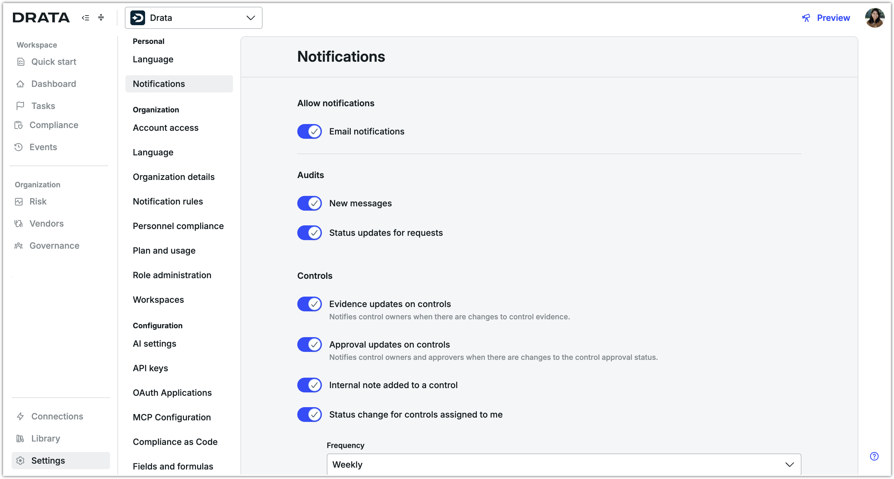

# Personal settings: Notifications (New Experience)

Source: https://help.drata.com/en/articles/13566050-personal-settings-notifications-new-experience
Collection: Settings
Updated: 2026-11-14
Fetched: 2026-11-22

## Article text

Drata notifications keep you informed about work that needs your attention, such as task deadlines, policy updates, monitoring failures, and security issues. You control **which notifications you receive and how often**, and these settings apply **only to you**.

To manage notification flows for Slack or Microsoft Teams, please navigate to the [Notification Rules page](organization-settings-notifications-rules.md).

## Before you begin

Keep these points in mind before you review the notification list:

- Some notifications are sent **immediately**, while others are sent as **weekly summaries** or on a fixed reminder cadence.
- If you do not receive expected emails, check your spam or junk folder, allowlist Drata’s sender address, and confirm your email gateway is not blocking Drata emails.

## Access notification settings

1. Select **Settings**.
2. Open **Personal → Notifications**.

## Personal notification reference

This guide covers all personal email notifications. To manage notification flows for Slack or Microsoft Teams, please navigate to the **Notification Rules** page. Please note that access to the **Notification Rule**s page is restricted to Administrators.

| **Area** | **Notification** | **What triggers it** | **Who receives the notification** |
|---|---|---|---|
| Audits | New messages | Sent when there are **new messages from auditorsor Drata admin**. | **All Drata Adminsassigned auditors **receive an email notification when there is a new message. |
| Audits | Status updates for requests | Sent when there are **status updates on audit requests**. | **All Drata Adminsassigned auditors **receive an email notification when the status of an audit request changes. |
| Controls | Evidence updates on controls | Sent to **control owners** when there are changes to control evidence.  **Notification Triggers:** - Mapping or un-mapping evidence to a control - Deleting evidence from a control - Updating evidence from a control | The control owner receive an email notification. |
| Controls | Approval updates on controls | Sent to **control ownersand approvers** when the **control approval status changes**.  **Notification Triggers include:** - control needing approval, - an approver requesting changes, - another approver is added or changed, or - control being approved. | The control owners and approvers receive an email notification. |
| Controls | Internal notes added to controls | Sent when a **new note** is added to a control. | The control owners receive an email notification. |
| Controls | Status changes for controls assigned to you | Sent as **summaries of assigned controls** and their status changes. | The control owners receive an email notification.  Can be configured as a **daily or weekly** summary. |
| Monitoring | Evidence collection errors | Sent when Drata records an **evidence collection error**. | Any user with this notification toggled on. |
| Monitoring | Automated test error | Sent when there are **automated test failures**. | Any user with this notification toggled on.  Can be configured as a **daily or weekly** summary. |
| Evidence | Evidence assigned to me | Sent when **evidence is assigned to you**. | Newly assigned evidence owner. |
| Policies | Policy comment replies | Sent when someone **replies to one of your policy comments**. | Any user with this notification toggled on. |
| Policies | Updates for policies assigned to me | Sent to policy owners when a policy is **assigned to them**, **removed from them**, or **updated by someone else**. If a policy owner loses access to Drata, Drata reassigns the policy to the first available Admin and notifies that Admin. | The policy owner receives the notification. |
| Risk | Risk owner notifications | Sent when **somebody new is assigned as the owner of a risk**. | Newly assigned risk owner. |
| Tasks | Upcoming task reminder | Sent to task owners when they have tasks **due in the next seven days**. | The user who is assigned the task. |
| Tasks | Annual compliance task reminder | Once a month, task assignees receive an email reminder about any upcoming annual compliance tasks. | Sent on the **15th of each month to the user who is assigned the task**. |
| Tasks | Past due tasks | Sent to task owners who have **overdue tasks**. | Sent twice a week to the user who is assigned the overdue task, |
| Vulnerabilities | Reminders for vulnerabilities with missed or upcoming SLAs | Sent for **critical and high-severity vulnerabilities** with **upcoming** or **missed** SLA deadlines. | Receive email reminders when vulnerabilities are overdue or nearing their due date. - On the Vulnerabilities Settings page, set the warning period. This period indicates how many days in advance you would like to receive updates regarding upcoming vulnerabilities. - This setting lets you choose the frequency, which is daily or weekly. |
| Workflows | Workflow creator notifications | A workflow you created is published (goes live) or deactivated. | User who created the workflow |

### Notification frequency

Some notifications are sent **immediately**, while others are delivered as **weekly summaries**. Frequency options appear only where applicable.

---

## Common issues and troubleshooting

If you’re not receiving notifications:

- Check your **spam or junk** folder
- Allowlist **[no-reply@drata.com](mailto:no-reply@drata.com)**
- Confirm your organization’s email gateway isn’t blocking Drata emails
- Allow time for weekly summaries to be delivered

---

### Important notes

- ℹ️ Notification availability depends on your **role and ownership**
- ℹ️ Some roles may not see certain notification types

## Images

- [image 01] ../../images/ux/settings/personal-settings-notifications-new-experience--01.png

## Related articles

- [Task notifications](task-notifications.md)
- [Manage Notifications for Required Approvals and Control Updates](manage-notifications-for-required-approvals-and-control-updates.md)
- [Organization settings: Notifications rules](organization-settings-notifications-rules.md)
- [Roles and permissions overview (New Experience)](roles-and-permissions-overview-new-experience.md)
- [Section 5: Control Owners](section-5-control-owners.md)
