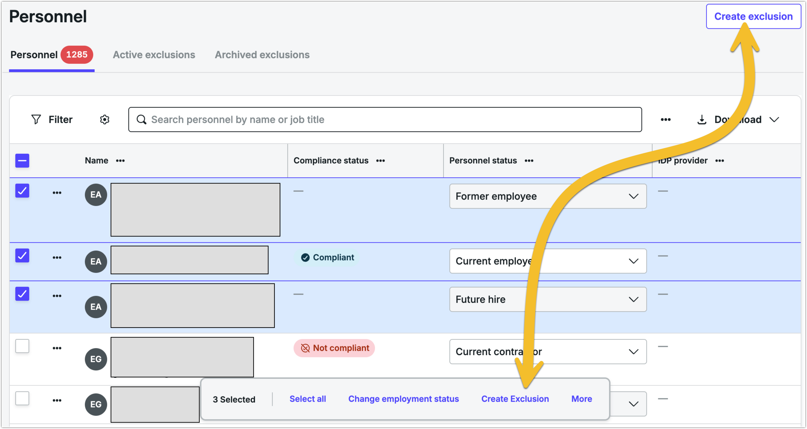
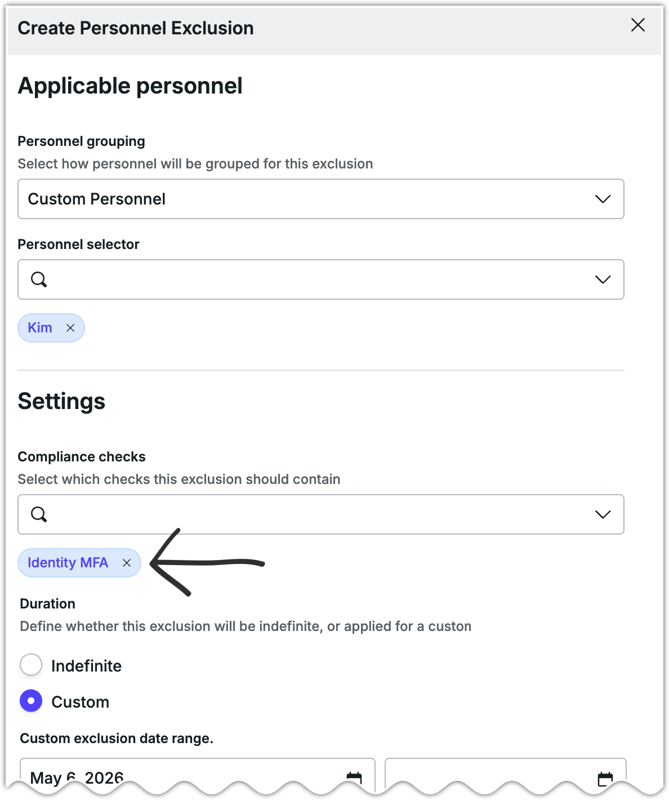
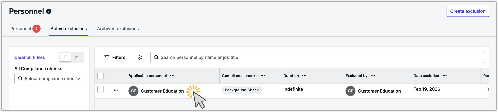
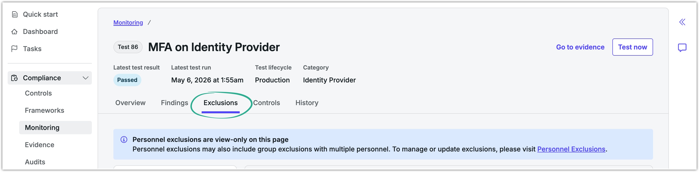

# Personnel exclusions

Source: https://help.drata.com/en/articles/13521706-personnel-exclusions
Collection: Understand the Drata Platform › Personnel
Updated: 2026-11-09
Fetched: 2026-11-22
Description: Create and manage personnel exclusions to document approved compliance exceptions while keeping users in audit scope.

## Article text

Personnel exclusions allow you to exclude specific compliance checks for selected personnel while keeping those users included in audit scope. This helps document approved deviations, temporary gaps, or accepted risks without removing personnel from compliance monitoring entirely.

## Before you begin

Review the following before creating personnel exclusions:

- **Workspace scope:** Personnel exclusions only apply to your primary workspace in Drata.
- **Devices cannot be excluded individually.** You can exclude a personnel record from device compliance checks, which applies to all of that person's devices.
- **Sync timing:** New and updated exclusions take effect on the next Autopilot sync.

## Understand personnel exclusions

Personnel exclusions let you exclude **certain test requirements for a person** while keeping that person included in audit scope. Use personnel exclusions when a requirement applies generally but does not apply to a specific individual or role.

When you create a personnel exclusion:

- You can apply it indefinitely or for a defined time range
- Drata records a business rationale for audit review
- Auditors can review exclusion reasons and durations in audit exports

### Example scenario

Alex is a contractor who supports internal tooling.

- Alex has access to company systems
- Alex does not access customer data
- Alex uses a personal device that the company does not manage

If Alex should remain included in the audit, but a device management requirement does not apply, create a **personnel exclusion** for that requirement. Alex stays in scope, and all other applicable checks continue to apply.

## Step 1: Start creating the exclusion

Select **Governance > Personnel** page. You can start an exclusion in either of the following ways:

1. Select **Create exclusion** on the Personnel page, **or**
2. Select one or more users, then select **Actions** > **Create exclusion**
   - If you start by selecting users, Drata automatically sets the **personnel grouping** to **Custom personnel** and pre-fills the selected users.

## Step 2: Select the personnel grouping

Choose how Drata applies the exclusion:

- **Custom personnel**: Apply the exclusion to specific users
- **Status or group**: Apply the exclusion based on employment status or IdP group
- **All personnel – all time**: Apply the exclusion to all personnel indefinitely

When you apply an exclusion by status or group, Drata creates a separate exclusion for each applicable user. Drata automatically updates exclusions as personnel join or leave the selected status or group.

## Step 3: Select compliance checks to exclude

Choose the checks that do not apply to the selected personnel. Common examples include:

- Acknowledged Policies
- Antivirus
- Auto Updates
- Background Check
- Disk Encrypted
- HIPAA Training
- Identity MFA
- Lock Screen
- AI Awareness Training
- Offboarding Evidence
- Password Manager
- Security Training

Select only the checks that require an approved exception.

> **💡 Excluding personnel from MFA checks note:**
>
> To exclude a personnel record from the MFA on Identity Provider check, select **Identity MFA**. Use this when the person is exempt from your IdP MFA policy (for example, a contractor without an IdP account, or a service account).
>
> 
>
> For more information, refer to [Test 86: MFA on Identity Provider](test-86-mfa-on-identity-provider.md).

## Step 4: Set the exclusion duration and reason

Choose how long the exclusion applies:

- **Indefinite**: The exclusion remains active until archived
- **Custom**: Select a start and end date

Enter a **business rationale** for the exclusion. Drata includes this reason in audit download packages if the personnel is sampled.

## Step 5: Confirm and save

1. Review the exclusion details.
2. Select the confirmation checkbox.
3. Select **Save**.

Drata applies the exclusion during the next sync and updates.

## View, edit, or archive personnel exclusions

You can view exclusions in the following ways:

- Open the **Active exclusions** tab to view all current exclusions, or
- Select a personnel record and scroll to review the requirements (compliance checks) that were excluded.

### Edit a personnel exclusion

To edit an exclusion:

1. Open the **Active exclusions** tab on the Personnel page.
   
2. Select the exclusion you want to update.
3. In the modal, update the requirements, duration, or reason.
4. Save your changes. Drata applies the update on the next Autopilot sync.

### Archive personnel exclusions

Archive an exclusion when it no longer applies.

**To archive a single exclusion:**

1. Open the **Active exclusions** tab on the Personnel page.
2. Select the exclusion.
3. Select **Archive**.

**To archive in bulk:**

1. Open the **Active exclusions** tab on the Personnel page.
2. Select the exclusions you want to archive.
3. Select **Actions > Archive**.

⚠️ **Archiving cannot be undone.** If you need the same exclusion again, create a new one.

Exclusions with a custom duration are auto-archived once the duration ends. To view archived exclusions, change the filter to **Archived**.

## View exclusions in your tests

Personnel exclusions appear in the monitored tests that correspond to the excluded compliance check (for example, an **Identity MFA** exclusion appears in **Test 86: MFA on Identity Provider**).

When viewing a test:

- The **Excluded** list shows each excluded personnel and how long they've been excluded.
- You cannot add or remove personnel directly from the test. To change who is excluded, edit the exclusion on the **Active exclusions** tab on the Personnel page.

## Related Articles

- [Test 86: MFA on Identity Provider](test-86-mfa-on-identity-provider.md)
- [Identity sync updates in Drata](identity-sync-updates-in-drata.md)
- [Populating and Managing Personnel Data in Drata (Concept Guide)](populating-and-managing-personnel-data-in-drata-concept-guide.md)

## Images

- [image 01] ../../images/ux/personnel/personnel-exclusions--01.png
- [image 02] ../../images/ux/personnel/personnel-exclusions--02.png
- [image 03] ../../images/ux/personnel/personnel-exclusions--03.png
- [image 04] ../../images/ux/monitoring/personnel-exclusions--04.png

## Related articles

- [Populating and Managing Personnel Data in Drata (Concept Guide)](populating-and-managing-personnel-data-in-drata-concept-guide.md)
- [Excluding Infrastructure resources](excluding-infrastructure-resources.md)
- [Map accounts to personnel in Drata (New Experience)](map-accounts-to-personnel-in-drata-new-experience.md)
- [Personnel Overview](personnel-overview.md)
- [Managing Personnel Compliance in Drata Training Video (New Experience)](managing-personnel-compliance-in-drata-training-video-new-experience.md)
