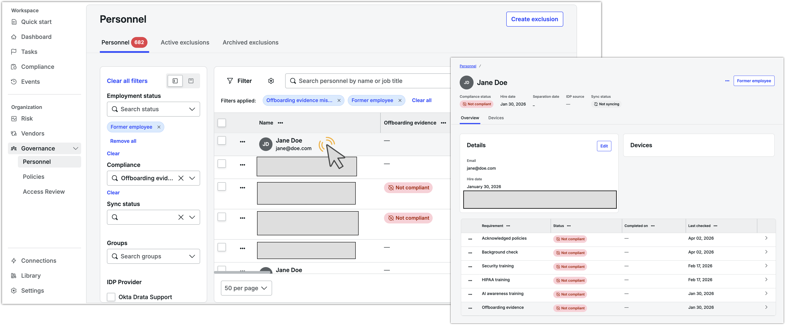
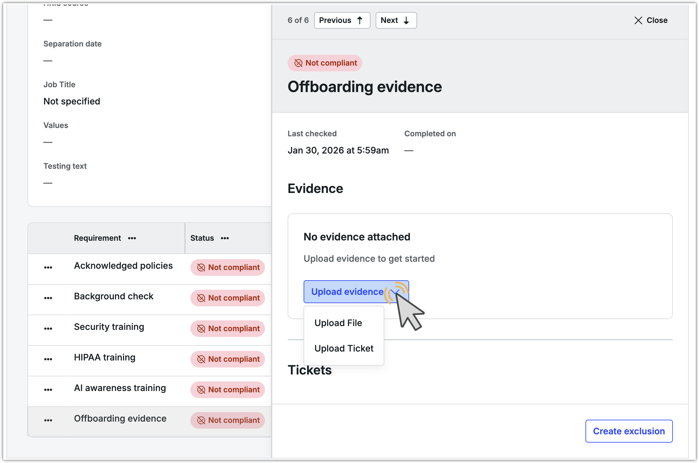

# Personnel Offboarding Evidence

Source: https://help.drata.com/en/articles/6653817-personnel-offboarding-evidence
Collection: Personnel Management › Employee Offboarding
Updated: 2026-11-09
Fetched: 2026-11-22
Description: The goal of offboarding evidence is to provide proof that access and responsibilities were removed for former employees.

## Article text

### Prerequisites

- **Role:** You must have a **Drata Admin role**.
- **Status:** Evidence can only be linked to individuals with a **Former personnel** status.
- **Jira Connection:** To use Jira-based evidence, a Jira connection must be enabled in Drata.

#### Important rules for Jira evidence

Drata uses specific data to verify if a Jira ticket is valid proof of offboarding.

- **Closed tickets only:** Only closed tickets are included in audits. Drata determines a ticket is "closed" based on the **Resolution date** field.
   - When a former employee is selected for review during an audit, only closed tickets in Jira, which is determined by the **resolution date **Jira field, are included in the evidence download, even if the overall status of the ticket is **Closed** or **Completed**.
- **The DrataAccept label:** If your Jira project is **Team-managed** (which does not expose the resolution date) or if the ticket lacks a resolution date, you must add the label `DrataAccept` to the ticket in Jira.
- **Automation limits:** Automated Jira searches (JQL) must specify exactly one project and one issue type (e.g., `type = story`).

### What counts as offboarding evidence

Offboarding evidence shows that required actions (such as access removal) were completed for a former employee.

Examples of acceptable offboarding evidence include:

- Closed Jira offboarding ticket that shows access removal steps
- Screenshot or export from your IdP showing the user’s account deactivated
- IT helpdesk ticket confirming device and access removal

Learn more about [offerboarding checklist](offboarding-checklist-guidance.md).

#### Supported file uploads

If you provide evidence manually, use screenshots, exported reports, or PDFs that document the removal of access. Common examples include:

- **Identity Provider (IdP) records:** A screenshot or export from Okta, Entra ID, or a similar provider showing the account is disabled or deleted.
- **HRIS records:** A screenshot from your HR system showing the person marked as terminated with a visible effective date.
- **Internal checklists:** A PDF or image of a completed offboarding checklist that lists specific systems and confirms the date access was removed.

#### Valid Jira tickets

A Jira ticket serves as valid evidence when it documents the specific actions taken to secure your environment. To pass an audit, the ticket must meet the following criteria:

- **Documented actions:** The ticket description or comments should list the systems where access was removed (for example, "Okta account disabled" or "Google Workspace access revoked").
- **Resolved status:** The ticket must be in a "Done" or "Resolved" state.
- **Validated metadata:** For company-managed projects, the ticket must have a **Resolution date**. If the ticket does not have a resolution date (or is in a team-managed project), it must include the `DrataAccept` label.- **Overrides Ticket Status:** The `DrataAccept` label ensures that tickets in any state are treated as resolved for compliance purposes.

---

### View offboarding status

- **Where to find it:** Go to **Governance** > **Personnel**.
- **Action:** Filter by **Employment status** > **Former employee**.
- **Impact:** View the **Offboarding evidence** column to identify who has evidence linked and who is missing it. You can also filter by **Compliance** > **Offboarding evidence missing** to see a list of incomplete records.

To identify users missing offboarding compliance evidence:

1. Review the raw data associated with the compliance test.
2. Examine the details for each failing user to determine who is missing the required documentation.
3. Upload the necessary evidence for those individuals.

---

### Provide evidence manually

Use this method for screenshots from your Identity Provider (IdP) or HRIS, or for individual Jira tickets.

1. Go to **Governance** > **Personnel**.
2. Select the former employee.
3. Scroll down to the **Requirements **table and select the **Offboarding evidence** requirement.
   - **Tip:** If you only need to upload a file, you can select the **ellipses (...)** next to the requirement and choose **Upload** for faster access.
4. **Choose your evidence type:**
   - **To upload a file:** Select **Upload file** and choose your screenshot, PDF, or report.
   - **To link a Jira ticket:** Select **Upload ticket** and paste the Jira ticket URL.
   
5. **Manage exclusions:** If this requirement does not apply to this specific person, you can select **Create an exclusion** within this same view.

#### Automate evidence collection

1. Go to **Settings** > **Personnel Compliance** > **Human Resources** tab.
2. Toggle **Automate offboarding evidence collection** to **On** and select **Configure**.
3. **Configuration Setup (JQL):** Enter your search string (e.g., `project = "Offboarding" AND type = "Task"`).
4. ** Matching Logic:** Choose to match by **Full name** or **Email** and map them to the corresponding Jira fields.
5. **Review:** Check the 5 sample matches for accuracy before selecting **Finish**.6. **Automation Tip:** Configure Jira automation to apply the `DrataAccept` label automatically to relevant tickets, reducing manual effort and ensuring consistency.

#### Alternative Automation Methods

If you don’t use Jira, you can automate evidence collection programmatically using Drata’s API. This allows you to upload evidence directly to personnel records without manual intervention.

## Images

- [image 01] ../../images/ux/personnel/personnel-offboarding-evidence--01.png
- [image 02] ../../images/ux/personnel/personnel-offboarding-evidence--02.png

## Related articles

- [Manual evidence uploads for personnel compliance checks](manual-evidence-uploads-for-personnel-compliance-checks.md)
- [Offboarding Checklist Guidance](offboarding-checklist-guidance.md)
- [How Drata Uses HRIS Data](how-drata-uses-hris-data.md)
- [Personnel Overview](personnel-overview.md)
- [Organization settings: Human Resources Settings (New Experience)](organization-settings-human-resources-settings-new-experience.md)
